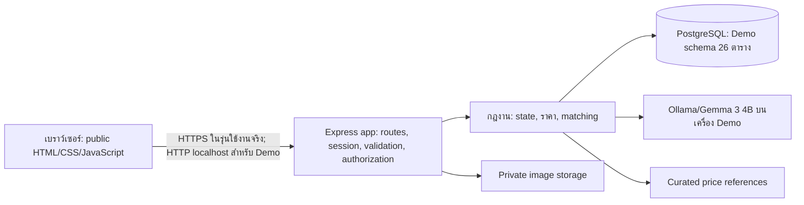

# จุดเริ่มต้นการออกแบบระบบ — Demo v1.8

## แผนภาพสถาปัตยกรรมสำหรับอธิบายตาม CE385

การเลือกแบบนี้เป็น **modular monolith 3 ชั้น**: เบราว์เซอร์แสดงผล, Express ตรวจคำขอ/สิทธิ์และเรียกกฎธุรกิจ, PostgreSQL บังคับ PK/FK/UNIQUE/CHECK/transaction. การอ่านเขียน DB และเรียก Ollama ใช้ asynchronous I/O; ไม่ทำงานโมเดลใน event loop ของ Node.js. ใช้ `pg` กับ SQL แบบ parameterized เพราะ DDL 26 ตารางและกฎ transaction มีอยู่แล้วและทีมต้องอธิบาย SQL ได้ตาม CE396. สไลด์ CE385 สัปดาห์ที่ 8 สอน Prisma/Zod เป็นตัวอย่างหนึ่ง; ระบบ Demo ปัจจุบัน **ไม่ได้ติดตั้ง Prisma หรือ Zod**. การย้าย ORM/validation library ต้องประเมิน schema migration, ความเข้ากันของ API และชุดทดสอบก่อน ไม่ถือว่าจำเป็นเพียงเพราะปรากฏในสไลด์.

แผนภาพนี้เป็นภาพ **implementation ปัจจุบัน** ไม่ใช่ภาพการกระจายระบบ Production. คำอธิบายเกณฑ์การเรียนและสิ่งที่ยังต้องเตรียมสำหรับนำเสนออยู่ใน [ผลเทียบสไลด์ CE385/CE396](course-slide-alignment-review.md).

เอกสารออกแบบที่เป็น authority ของ Demo คือ [SRS](software-requirements-v1.md), [Use Case/API](mvp-demo-design-v1.md), [Activity Diagram](mvp-activity-diagrams-v1.md), [Data Model/ERD](mvp-data-model-v1.md), [API/Job State](api-and-job-state-v1.md) และ [ขั้น 6 — Wireframe](wireframes-v1.md). เอกสารเหล่านี้แทน design ของ FixTech v4 สำหรับขอบเขตปัจจุบัน; หาก wireframe ขัดกับ API/state หรือ schema ให้แก้ wireframe ให้ตรง ไม่สร้างพฤติกรรมใหม่จากภาพ.

สถานะตรวจรับ/ความพร้อมรวมขั้น 1–7 ให้ยึด [Step 1–7 readiness review](step-1-7-readiness-review.md) และ [validation report](validation.md); เกณฑ์ใน SRS เป็น acceptance targets ไม่ใช่หลักฐานว่าแต่ละ workflow ผ่านแล้ว.

การตรวจความสอดคล้องและปรับประสิทธิภาพล่าสุดบันทึกใน [Step 1–7 optimization review](step-1-7-optimization-review.md); ผลทดสอบรอบนั้นอยู่ต้น [validation report](validation.md).

ข้อกำหนดที่ผู้ใช้ขอเพิ่มเพื่อใช้งานจริง ได้แก่ การชำระเงินจริง, แหล่งราคาอัปเดต, การตรวจตัวตนช่าง, security audit และ WCAG 2.2 AA อยู่ใน [แผนขยายสู่ production](production-expansion-v1.md) และ SRS §14. แผนนี้เป็นงานรุ่นถัดไปและยังไม่เปลี่ยนสถานะของ Demo v1.8.

รายละเอียดการต่อยอดขั้น 1–7 สำหรับรุ่นใช้งานจริงอยู่ใน [แบบสร้าง Production](production-step-1-7-build-spec.md); [ผลตรวจความพร้อม](production-readiness-review.md) ระบุส่วนที่ทำแล้วและเกณฑ์ที่ยังไม่ผ่าน.

สถาปัตยกรรมเป้าหมายเป็น Node.js/Express + PostgreSQL, server-authoritative authorization, service/adapters สำหรับ AI และ market pricing, private file storage และ website-only UI. Demo ใช้ seed/synthetic data; payment เป็น simulation.

ลำดับงานระบบ: intake/consent → AI summary → curated non-live price estimate → customer confirmation/publish → matching หรือ B2B offer selection → chat/appointment → repair/completion → payment simulation/warranty/review/dispute. UI หลักผ่าน browser walkthrough ตาม validation report; รายละเอียด state, API, constraints และ acceptance ให้ยึดเอกสารหลักข้างต้น ไม่อนุมานจาก schema v4.

ฐาน v4 เดิมและหลักฐานทดสอบถูกเก็บใน `archive/fixtech-v4/` เฉพาะเครื่องเดิมเพื่อเป็นประวัติ ไม่รวมใน repository Demo นี้.

## ผลขั้น 7 และ handoff

สูตรและนโยบาย matching ขั้น 7 implement ตาม [Step 7](step-7-pricing-matching-decisions.md): 15% เป็น platform markup สมมติ (ไม่ใช่กำไรจริง), complexity/urgency คง 1.0, curated reference ทบทวนทุก 30 วัน และไม่ใช้ weighted score เพราะไม่มีข้อมูลคุณภาพ provider ที่เชื่อถือได้. `priority` ยังคงเป็นลำดับ seed เท่านั้น. PostgreSQL disposable workflow และ browser checks ทั้งราคา/stale-reference ผ่านตาม validation report. รักษา B2C ราคาเดียว, B2B ช่วงราคา/เลือก offer, versioned snapshots และ deterministic outputs.
