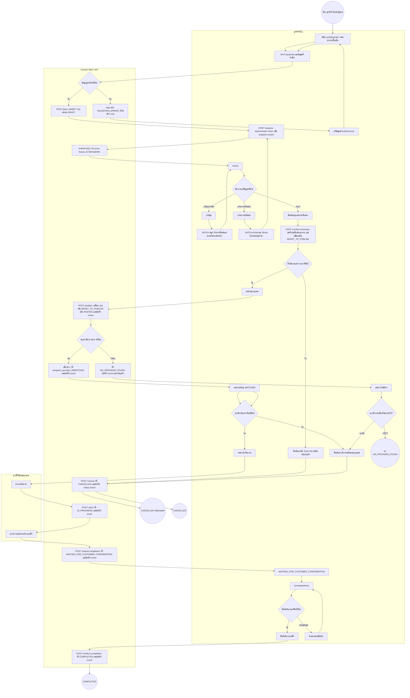
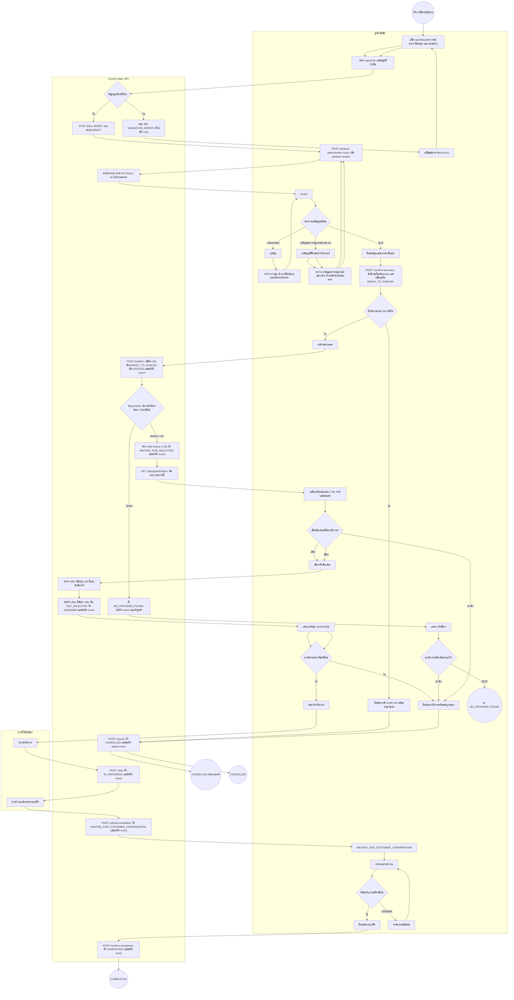
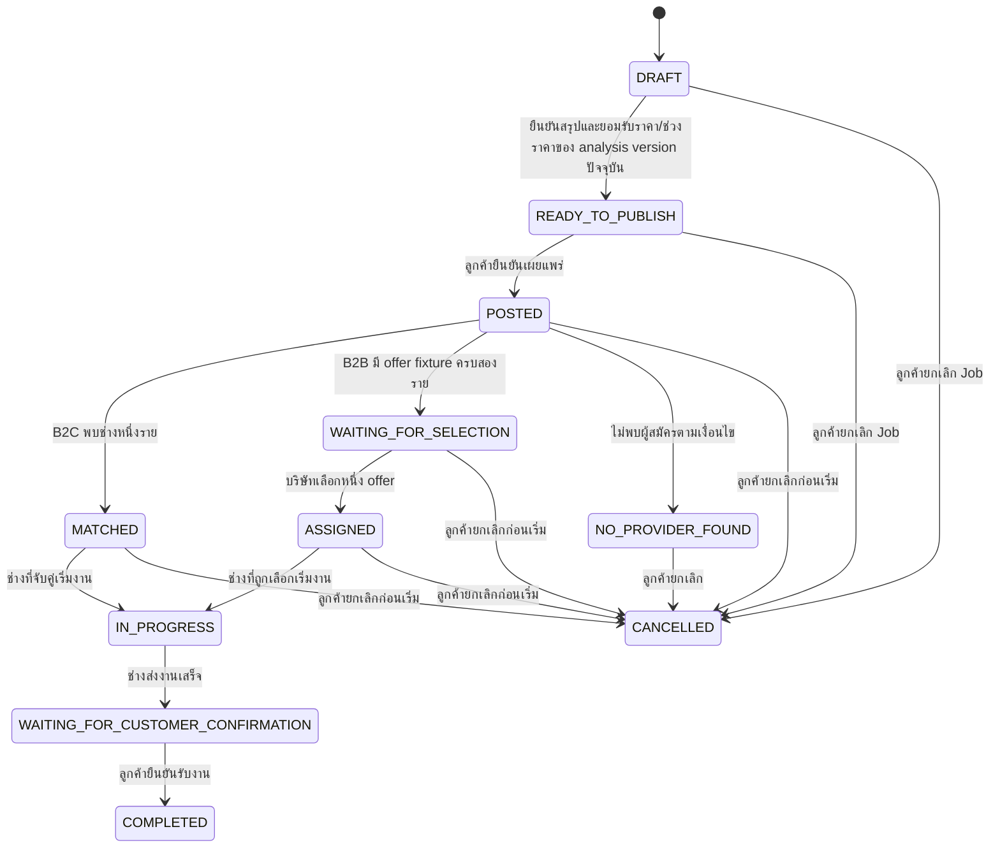
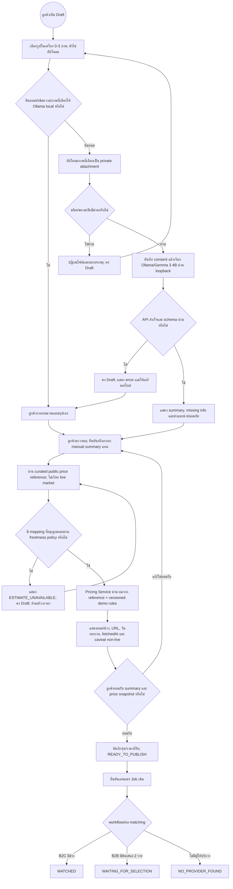
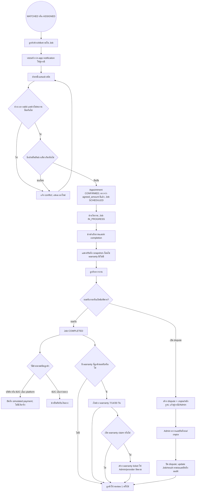

# Fixtech MVP Demo — ขั้นตอนที่ 3: Activity Diagram

> **ฉบับใช้งาน:** Activity Diagram ปัจจุบันของ Demo v1.8 คือ §7.1–7.3 และ traceability §7.4. §§2–6 เป็น baseline v1.7 เพื่อเก็บประวัติเท่านั้น; อย่านำ mock/fixture, implementation notes หรือ state flow เก่าไป implement. ขอบเขต/acceptance อ้าง SRS §13.7 (v1.8.4) ล่าสุด; ผังปัจจุบันใช้ราคาอ้างอิง curated (non-live) ตามขั้น 5 §9.

> **Implementation link:** หาก flow diagram ย่อรายละเอียด guard/HTTP error ให้ใช้ [ขั้น 5 — API และกฎการเปลี่ยนสถานะงาน](api-and-job-state-v1.md) สำหรับ transition และสิทธิ์ของ API ที่ implement จริง.

**อ้างอิง:** [SRS v1.8 — Expanded Demo](software-requirements-v1.md) และ [ขั้นตอนที่ 2 — Use Cases, ERD และ API](mvp-demo-design-v1.md)
**สถานะ:** แบบจำลองกระบวนการสำหรับ expanded student demo; ไม่ใช่ workflow production

## 1. ขอบเขตและวิธีอ่าน

แผนภาพแสดงการทำงานหลังผู้ใช้เข้าสู่ระบบด้วยบัญชี seed จนงานจบหรือถูกยกเลิกก่อนเริ่มงาน แบ่งตามลูกค้าทั่วไปและลูกค้าบริษัท เพราะวิธีเสนอราคาและการเลือกช่างต่างกัน จากนั้นแสดงวงจรช่าง/ลูกค้าร่วมกัน

หมายเหตุ: ข้อความขอบเขตและผัง §§1–4 ด้านล่างเป็น baseline v1.7 เพื่อเก็บร่องรอยการออกแบบ; ข้อความ “ไม่มี” และ mock/fixture ในส่วนเดิมไม่ใช่ขอบเขต Demo ปัจจุบัน. ให้ใช้ expanded flows ใน §7 และ SRS §13 สำหรับการทำงานจริงของ Demo.

แผนภาพใช้ Mermaid flowchart และ state diagram ที่ฝังใน Markdown เพื่อสื่อ activity flow/swimlane; เป็นแบบจำลองกระบวนการสำหรับทีม ไม่ได้อ้างว่าเป็นไฟล์ UML ที่สร้างจากเครื่องมือ UML. ชื่อ route ในกล่องย่อ prefix `/jobs/{jobId}` ตาม API ขั้น 2. ในภาพใส่ validation error ของการสร้าง Job และทางเลือกหลัก; error ด้านสิทธิ์/สถานะซ้ำ/ระบบล้มเหลวให้ยึด API contract และ test ในขั้น 2.

## 2. Activity Diagram — ลูกค้าทั่วไป (B2C; historical baseline v1.7)

กติกา: Software/ONLINE ราคา 250 บาท หรือ Hardware/ONSITE ราคา 400 บาท; matching กรองความพร้อม, ความสามารถ และเขต แล้วเรียง `priority ASC, provider_id ASC`. ลูกค้าตรวจสรุปและราคา ก่อนยืนยันทั้งคู่ แล้วจึงกดยืนยันเผยแพร่. หากไม่มีผู้สมัคร Job คง `NO_PROVIDER_FOUND`; ลูกค้าเลือกเก็บสถานะหรือยกเลิกได้. ไม่มี retry/ปรับเงื่อนไขใน MVP.

## 3. Activity Diagram — ลูกค้าบริษัท (B2B; historical baseline v1.7)

กติกา: ช่วงราคาก่อนโพสต์คือ Software 250–500 บาท หรือ Hardware 400–800 บาท. หลังโพสต์ต้องมี offer fixture ครบ 2 รายจึงให้บริษัทเลือก; ราคาคือ Software 350/450 บาท หรือ Hardware 550/700 บาทตามลำดับ provider ที่จัดอันดับ. ถ้าไม่ครบสองรายให้ `NO_PROVIDER_FOUND`; ไม่มี offer ทดแทนหรือ matching รอบใหม่.

## 4. วงจรสถานะร่วม (historical baseline v1.7)

ตามขั้น 2 ระบบสร้าง Job สถานะ `DRAFT` เมื่อรับ `POST /jobs`; หากลูกค้าไม่เผยแพร่ ให้ยกเลิก Draft Job ผ่าน `/cancel` และบันทึก event ไม่ใช่เพียงปิดฟอร์ม. สถานะ `COMPLETED` คือการยืนยันรับงานในระบบสาธิต ไม่ใช่การชำระเงินหรือรับประกันว่างานซ่อมสำเร็จจริง. การยกเลิกหลัง `IN_PROGRESS` ไม่อยู่ใน MVP. ทุก transition ตรวจ role/เจ้าของงานฝั่ง server และบันทึก event ตามขั้น 2.

## 5. ตรวจการเชื่อมโยงขั้น 1 และ 2 (historical baseline v1.7; §7.4 เป็น trace ปัจจุบัน)

| หัวข้อ | ขั้น 1: SRS v1.8 | ขั้น 2: Use Case / API / State | ขั้น 3: Activity Diagram |
|---|---|---|---|
| ลูกค้าทั่วไป | สอง workflow; external AI และ live price source; ยืนยัน summary/price ก่อน publish | UC-02/07; `/analyze`, `/price-estimates`, `/confirm-summary`, `/publish` | §2 pre-post เดิม เสริมรายละเอียด external input ใน §7.1 |
| ลูกค้าบริษัท | กรอกข้อมูลบริษัท, live estimate, เสนอราคา seed 2 รายและเลือกหนึ่ง | UC-03/07; `/publish`, `/offers`, `/select` | §3 flow เดิม; §7.1 เพิ่ม intake ที่ใช้ร่วมกัน |
| รูปและ consent | แนบภาพแบบ private; ยินยอมก่อนส่งภาพ/text ให้ AI | UC-07; `/attachments`, `/ai-consents`, `/analyze` | §7.1 แสดง validate/consent/provider fail และไม่มีราคาปลอม |
| งานหลังมอบหมาย | แชต, in-app notification, appointment, payment simulation, completion, warranty/review/dispute | UC-08–10; routes ในขั้น 2 §10.2 | §7.2 แสดง service-to-aftercare; §7.3 แสดง Job status |
| ยกเลิก/สิทธิ์ | ยกเลิกก่อนเริ่มและตรวจสิทธิ์ทุก domain action | UC-05 และ §10; cancel/appointment/dispute API | §2–4 + §7; ตรวจ role/owner/provider/Admin ตาม action |
| สิทธิ์และข้อมูล | ตรวจ role/เจ้าของข้อมูลฝั่ง server; ใช้ข้อมูลสังเคราะห์ | actor table, ERD, API authorization, job status events | แยก swimlane ลูกค้า/ระบบ/ช่าง; ตรวจสิทธิ์ก่อนเปลี่ยนข้อมูล |

### ผลทบทวนความสอดคล้อง

- ยึด SRS §13 v1.8 และขั้น 2 §10 สำหรับฟีเจอร์เพิ่ม; คำว่า mock/fixture-only และข้อยกเว้นในผัง/บันทึก v1.7 เป็นประวัติ ไม่ใช่ behavior ของ external integrations.
- การแก้ `symptomText`, `districtCode`, ข้อมูลอุปกรณ์บริษัท หรือเวลาสะดวก ล้างผลวิเคราะห์/ราคาและต้องวิเคราะห์/ยืนยันใหม่ตามขั้น 2. แก้เฉพาะสรุปคงราคาได้แต่ต้องยืนยันสรุปใหม่.
- ลูกค้าตรวจสรุปและราคา/ช่วงราคาพร้อมกัน แล้วยืนยันยอมรับทั้งคู่ก่อน READY_TO_PUBLISH; จากนั้นยืนยันเผยแพร่ Job ตาม BR-002.
- `NO_PROVIDER_FOUND` เป็นผลหลัง publish ตามขั้น 2; ไม่มีการเริ่มรอบใหม่หรือเปลี่ยนเงื่อนไขใน MVP.
- ทั้งสอง diagram ถือว่า `POST /jobs` สร้าง Job `DRAFT` ก่อนวิเคราะห์; การหยุดก่อน publish จึงยกเลิก Job เป็น `CANCELLED` ผ่าน API และบันทึก event ตามขั้น 2.

## 6. จุดที่ต้องคงไว้ตอน implementation (historical baseline v1.7; กติกาปัจจุบันอยู่ใน §7)

1. AI ภายนอกจริงสร้างสรุปเท่านั้น; Pricing Service แยกต่างหากคำนวณจาก market source + versioned config.
2. ก่อน publish ต้องตรวจ consent, analysis version, price snapshot, source freshness และการยอมรับของลูกค้า.
3. รูปเก็บ private; ทุก download/action ตรวจสิทธิ์; ห้ามแสดง mock ว่าเป็นผล AI/ตลาดจริง.
4. B2C matching และ B2B offer selection ยังใช้ seed/simulation และกติกาเดิม.
5. Appointment, payment, Job transition, status event และ notification row ใช้ transaction เดียวกัน; หาก DB เขียน notification ไม่ได้ transaction หลัก rollback ด้วย. ไม่มี external notification provider ใน Demo.
6. Warranty snapshot, review unique-per-job และ dispute/Admin resolution เป็น domain แยก; simulated payment ไม่เคลื่อนเงินจริง.

## 7. ส่วนขยาย Activity Diagram สำหรับ Demo v1.8

ผังนี้เพิ่ม subprocess ตาม Demo v1.8.4: Ollama/Gemma 3 4B ทำงานแบบ local หลัง consent และราคาอ่านจาก curated public reference catalog ที่ไม่ใช่ live market. Automated tests ใช้ test adapters; ห้ามแสดงผล test adapter ว่าเป็นผล runtime จริง.

### 7.1 Draft → รูป/Consent → Ollama local → Curated estimate → Publish

ข้อควบคุม: ถ้าลูกค้าไม่ยินยอม AI ให้ใช้ manual summary โดยไม่ส่งข้อมูลไป Ollama; ยังต้องมี curated estimate ที่มี mapping และผ่าน freshness policy ก่อน publish. ห้ามตีความ curated reference ว่าเป็น live-market data; ถ้า integration ปิด/ไม่มี mapping/estimate ใช้ไม่ได้ ให้คง Draft และห้ามสร้างตัวเลขหรือแสดงผลสำเร็จ.

### 7.2 Assigned → แชต/นัดหมาย → บริการ → ชำระจำลอง/Aftercare

แชตเป็น asynchronous และไม่จำเป็นต้องบล็อกการนัดหมาย. ทุก message/status/appointment/payment/dispute notification สร้างให้เฉพาะ recipient ที่มีสิทธิ์; notification row commit พร้อม domain transaction และ DB failure rollback ทั้งรายการ. Warranty เริ่มเมื่อ Job เป็น `COMPLETED` ตามเงื่อนไขที่ลูกค้ายอมรับ โดยไม่รอการชำระเงินจำลอง. บันทึกการชำระจำลองหรือการยืนยันรับเงินตรงได้หลัง Job `COMPLETED` เท่านั้น; ข้อความ “ชำระสำเร็จ” และ direct-received เป็นเพียง event สาธิต.

### 7.3 Job state diagram ที่ขยาย

```mermaid
stateDiagram-v2
    [*] --> DRAFT
    DRAFT --> READY_TO_PUBLISH: ยืนยัน AI/manual summary + accepted curated estimate ที่ผ่าน freshness policy
    READY_TO_PUBLISH --> POSTED: ลูกค้ายืนยันเผยแพร่
    POSTED --> MATCHED: B2C จับคู่ provider seed
    POSTED --> WAITING_FOR_SELECTION: B2B มี offer simulation 2 ราย
    POSTED --> NO_PROVIDER_FOUND: ไม่มี provider เข้าเกณฑ์
    WAITING_FOR_SELECTION --> ASSIGNED: บริษัทเลือก offer หนึ่งรายการ
    MATCHED --> WAITING_FOR_APPOINTMENT: provider assigned
    ASSIGNED --> WAITING_FOR_APPOINTMENT: provider assigned
    WAITING_FOR_APPOINTMENT --> SCHEDULED: สองฝ่ายยืนยันช่วงเวลา; agreed_amount ต้องมี
    SCHEDULED --> IN_PROGRESS: นัดยืนยันแล้วและช่างเริ่มงาน (ไม่ขึ้นกับการชำระ)
    IN_PROGRESS --> WAITING_FOR_CUSTOMER_CONFIRMATION: ช่างส่งงานเสร็จ
    WAITING_FOR_CUSTOMER_CONFIRMATION --> COMPLETED: ลูกค้ายืนยันรับงานและ warranty terms
    WAITING_FOR_CUSTOMER_CONFIRMATION --> DISPUTED: ลูกค้าหรือช่างเปิด dispute
    COMPLETED --> DISPUTED: เปิดข้อพิพาทหลังงาน/รับประกันตามเงื่อนไข
    DISPUTED --> WAITING_FOR_CUSTOMER_CONFIRMATION: Admin RETURN_TO_CUSTOMER; เฉพาะถ้า completed_at ยังว่าง
    DISPUTED --> COMPLETED: Admin KEEP_COMPLETED; ต้องมี completed_at
    DISPUTED --> CANCELLED: Admin CANCEL; ปฏิเสธถ้ามี completed_at
    DRAFT --> CANCELLED: ลูกค้ายกเลิก
    READY_TO_PUBLISH --> CANCELLED: ลูกค้ายกเลิก
    POSTED --> CANCELLED: ยกเลิกก่อนเริ่ม; ปิด offer/matching ที่ active
    MATCHED --> CANCELLED: ยกเลิกก่อนเริ่ม
    WAITING_FOR_SELECTION --> CANCELLED: บริษัท/ลูกค้ายกเลิกก่อนเริ่ม
    ASSIGNED --> CANCELLED: ยกเลิกก่อนเริ่ม
    NO_PROVIDER_FOUND --> CANCELLED: ลูกค้ายกเลิก
    WAITING_FOR_APPOINTMENT --> CANCELLED: ยกเลิกและแจ้งคู่กรณี
    SCHEDULED --> WAITING_FOR_APPOINTMENT: ยกเลิก/เลื่อนนัดก่อนเริ่ม; proposal เดิมปิด
    SCHEDULED --> CANCELLED: ยกเลิกและปล่อยช่วงนัด
```

Appointment, payment, warranty/claim, review และ dispute มี state แยกตามขั้น 2 §10.3; job state diagram ไม่แทน state ย่อยเหล่านั้น. ทุก transition ตรวจ actor, current state, idempotency และ atomicity ฝั่ง server.

### 7.4 Traceability ที่เพิ่ม

| Process | ขั้น 1 — SRS §13 | ขั้น 2 — UC/API §10 | ผังขั้น 3 |
|---|---|---|---|
| ภาพ/consent/Ollama local/curated price | 13.2–13.3, 13.7; FR-021–038, FR-040–049C | UC-07; attachments, ai-consents, analyze, price-estimates | §7.1 |
| chat/in-app notification | 13.2; FR-065, FR-093 | UC-08; messages, notifications | §7.2 |
| appointment + payment simulation | 13.2; FR-063/064, FR-075–078 | UC-08/09; appointments, payment-simulations | §7.2–7.3 |
| warranty/review/dispute | 13.2; FR-080–085, FR-092 | UC-10; warranty claims, reviews, disputes/Admin resolve | §7.2–7.3 |

### ผลตรวจเชื่อมโยง

- §§2–4 เป็นภาพ baseline v1.7; สำหรับ Demo ปัจจุบันให้ใช้ §7.1 แทนการวิเคราะห์/ราคา/publish เดิม และใช้ §7.2–7.3 ต่อจากการเลือก/จับคู่ช่าง.
- `COMPLETED` ไม่ได้ยืนยันว่ามีการซ่อมหรือรับเงินจริง; payment เป็น simulation และ AI/price เป็น external response ที่มี provenance.
- ถ้าไม่มี consent ให้ข้าม AI ด้วย manual summary; ถ้า Ollama ล้มเหลวหรือ curated reference ไม่มี mapping/ไม่ผ่าน freshness policy งานต้องคง Draft และไม่ publish ด้วยค่าปลอม.
- รูป, message, appointment, payment, warranty, review และ dispute ไม่เปลี่ยน job status โดย client; การเปลี่ยนต้องผ่าน API authorization/state rules.
- **การตีความล่าสุด v1.8.4:** ขั้น AI ใช้ Ollama local หลัง consent; ขั้นราคาอ่าน curated source ที่แสดงวันทบทวน/URL และติดป้าย non-live. ผัง §7.1 ปรับให้เป็นพฤติกรรมปัจจุบัน; ชื่อ/ข้อความ live-price ที่ยังอยู่ใน baseline §§2–6 เป็นประวัติเท่านั้น. ดู SRS §13.7 และขั้น 5 §9.
