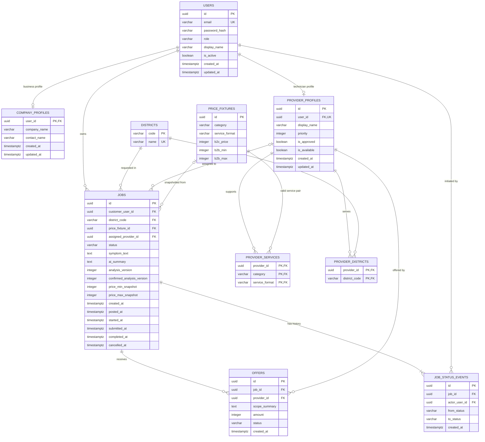
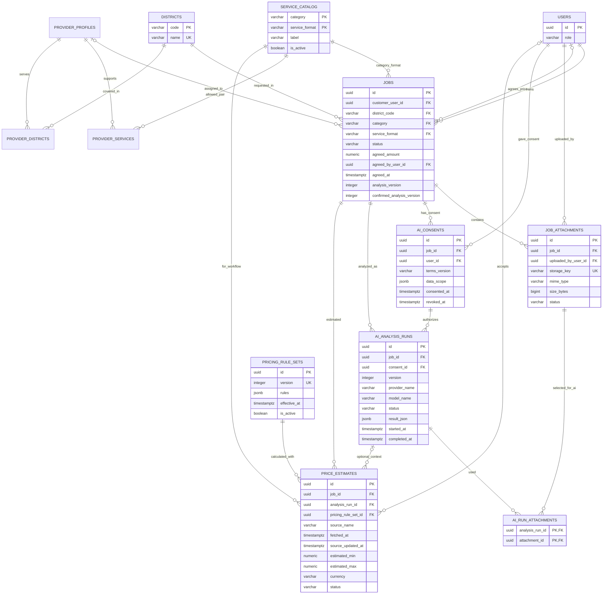
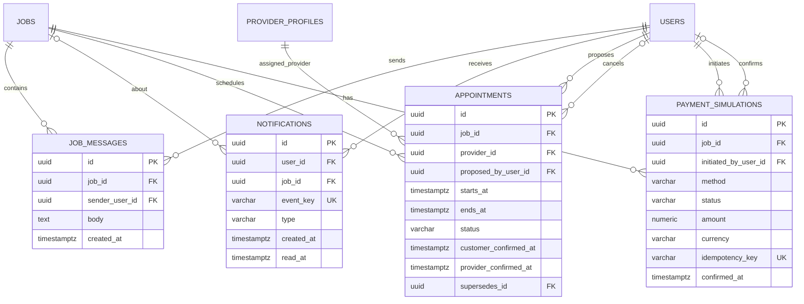
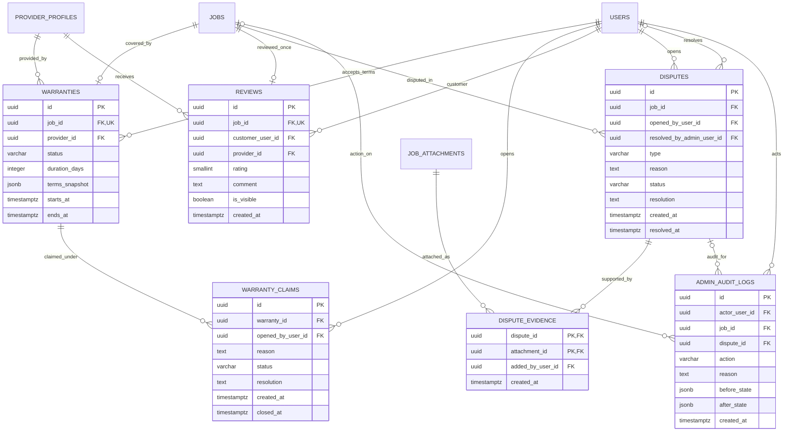

# Fixtech 1.0 — ขั้นตอนที่ 4: ER Diagram และพจนานุกรมข้อมูล

> **วิธีอ่านสำหรับผู้เริ่มต้น:** อ่าน §1 เพื่อเข้าใจ entity, key และ cardinality แล้วใช้ §9 เป็นแบบจำลองฉบับใช้งานที่มี 26 ตาราง ส่วนภาพย่อในส่วนก่อนหน้าใช้ช่วยทำความเข้าใจเท่านั้น ห้ามนำไปสร้างฐานจริง ใช้ `docs/fixtech-demo-v1.8-drawdb.sql` สำหรับ DrawDB และ `release/FixTech-demo-v1.8.database.sql` สำหรับติดตั้งบนฐานว่าง ชื่อไฟล์ทางเทคนิคยังคงเดิมเพื่อให้ชุดทดสอบทำงาน

> **Implementation link:** ขั้น 5 ใช้ schema นี้โดยไม่เพิ่ม/ลด 26 ตาราง; ดู [API และกฎการเปลี่ยนสถานะงาน](api-and-job-state-v1.md) สำหรับวิธีที่แต่ละ entity ถูกอ่าน/เขียนจาก workflow.

**อ้างอิง:** [ขั้น 1 — SRS 1.0](software-requirements-v1.md), [ขั้น 2 — ผู้ใช้และกรณีใช้งาน](mvp-demo-design-v1.md), [ขั้น 3 — แผนภาพกิจกรรม](mvp-activity-diagrams-v1.md) 
**สถานะ:** แบบจำลองข้อมูลและ DDL สำหรับ Demo ผ่านการติดตั้งและทดสอบบน PostgreSQL ที่ทิ้งได้ ใช้ Ollama ในเครื่องและราคา curated ห้ามถือเป็น production integration 
**ฐานข้อมูลเป้าหมาย:** PostgreSQL; เวลาเก็บเป็น `timestamptz`; UUID สร้างจากแอปเพื่อไม่บังคับติดตั้ง extension

**ตัวอย่าง FD/Normalization สำหรับอธิบายตาม CE396:** ในตารางสมมติที่แบน `job_id, customer_id, provider_id, provider_name, district_code, district_name` มี FD เช่น `job_id → customer_id, district_code` และ `district_code → district_name`; หากเก็บชื่อเขตซ้ำทุกงานจะเกิด update anomaly. Demo แยก `districts(code PK, name)` และให้ `jobs.district_code` เป็น FK จึงแก้ชื่อเขตที่เดียว. ตารางเชื่อม `provider_districts(provider_id, district_code)` มีคีย์ผสม ป้องกันคู่เดิมซ้ำ; `provider_services` แทนความสัมพันธ์ผู้ให้บริการกับชนิดบริการ. `company_profiles.user_id` เป็นทั้ง PK/FK ทำให้หนึ่งบัญชีบริษัทมีโปรไฟล์ได้ไม่เกินหนึ่ง. ข้อความนี้เป็น **ตัวอย่างเหตุผลการแยกตาราง** ไม่ใช่หลักฐานพิสูจน์ 3NF ครบทั้ง 26 ตาราง; สำหรับการนำเสนอ CE396 ต้องแสดง FD, candidate key และกรณี snapshot ที่ตั้งใจเก็บซ้ำทีละกลุ่มตาราง. ดู [ผลเทียบสไลด์](course-slide-alignment-review.md).

## 1. ขอบเขตและหลักการ

เนื้อหา §§1–8 เป็นแบบจำลอง baseline 1.0 เพื่อเก็บประวัติและห้ามใช้เป็น schema ปัจจุบัน. แบบข้อมูล ระบบสาธิต 1.0 อยู่ใน §9 และต้องสอดคล้องกับ SRS §13 และขั้น 2 §10.

§1 อธิบายขอบเขตข้อมูล core ของ baseline 1.0 เท่านั้น; expanded entities สำหรับไฟล์แนบ, chat, notifications, appointments, simulated payment, warranty, review, dispute และ AI/market integrations ระบุใน §9. ทีมช่างหลายสมาชิกยังไม่อยู่ใน Demo.

คำว่า “แสดงได้” หมายถึงข้อมูลในฐานข้อมูล ไม่ได้แปลว่า actor ทุก role มองเห็นได้: API ต้องตรวจ role, ownership/assignment และซ่อนข้อมูลส่วนบุคคลตามขั้น 2.

Session ไม่ใช่ข้อมูลธุรกิจใน ERD นี้. Demo ปัจจุบันใช้ cookie แบบ HttpOnly/SameSite ลงลายเซ็น มีเพียง user ID และเวลาหมดอายุ; server อ่าน role/สิทธิ์จาก `users` ทุกคำขอ ไม่ใส่ role/password ใน cookie. ไม่มี session table ฝั่ง server ใน 26 ตาราง. หากรุ่นถัดไปเพิ่ม session store/revocation ให้ถือเป็น infrastructure พร้อม migration แยก.

## 2. ER Diagram เชิงตรรกะ

เพื่อให้อ่านความสัมพันธ์ได้ชัด ERD แสดงเฉพาะคอลัมน์หลัก; รายชื่อคอลัมน์ครบพร้อม nullability และ constraint อยู่ใน Data Dictionary ด้านล่าง.

### Cardinality และ optionality

| ความสัมพันธ์ | cardinality | ความหมาย / กฎ |
|---|---|---|
| `users` — `company_profiles` | 1 ต่อ 0..1 | มี profile เฉพาะบัญชีบริษัท; บังคับ role กับ profile ให้ตรงกันใน service/seed |
| `users` — `provider_profiles` | 1 ต่อ 0..1 | ช่างหนึ่งบัญชีมี provider profile ได้หนึ่งรายการ; MVP ไม่รองรับทีมหลายสมาชิก |
| `users` — `jobs` | 1 ต่อ 0..หลาย | ทุก Job มี customer owner หนึ่งบัญชี; role ต้องเป็นลูกค้าทั่วไปหรือบริษัท |
| `districts` — `jobs` | 1 ต่อ 0..หลาย | ทุก Job ระบุเขตด้วย code ที่มีอยู่ใน seed |
| `provider_profiles` — `provider_services` | 1 ต่อ 0..หลาย | ความสามารถเป็นรายการคู่ category/service format ที่รองรับ |
| `provider_profiles` — `provider_districts` | 1 ต่อ 0..หลาย | พื้นที่รับงานเป็นรายการเขต; ตารางเชื่อมกันมี composite primary key |
| `price_fixtures` — `jobs` | 1 ต่อ 0..หลาย | Job ไม่มี fixture ก่อนวิเคราะห์สำเร็จ; หลังวิเคราะห์ชี้ fixture หนึ่งรายการ |
| `provider_profiles` — `jobs` | 1 ต่อ 0..หลาย | `assigned_provider_id` ว่างจนระบบจับคู่ B2C หรือบริษัทเลือก offer B2B |
| `jobs` — `offers` | 1 ต่อ 0..หลาย | เฉพาะ B2B ที่มี provider เข้าเกณฑ์ครบสองรายจึงสร้าง offer fixture 2 ราย |
| `jobs` — `job_status_events` | 1 ต่อ 1..หลาย | เก็บประวัติสร้าง Draft และทุก transition; event ไม่ลบ/แก้ย้อนหลังผ่านแอป |
| `users` — `job_status_events` | 1 ต่อ 0..หลาย | ผู้ใช้ที่เริ่มคำสั่งเปลี่ยนสถานะเป็น actor; event จาก API เก็บ actor ผู้เรียก ไม่สร้าง system account เพิ่ม |

## 3. พจนานุกรมข้อมูล (Data Dictionary)

ชนิดข้อมูลด้านล่างเป็น PostgreSQL. `NOT NULL`/`NULL` ระบุการบังคับค่าระดับ schema; กฎที่ข้ามหลายแถวหรือตารางให้บังคับใน transaction ฝั่ง server ตาม §4.

### 3.1 `users` — บัญชีเข้าสู่ระบบ

| คอลัมน์ | ชนิด / null | Key / default | ความหมายและกฎ |
|---|---|---|---|
| `id` | `uuid NOT NULL` | PK | UUID บัญชี; สร้างในแอป |
| `email` | `varchar(254) NOT NULL` | UNIQUE | อีเมลล็อกอิน; normalize เป็น lowercase ก่อนบันทึกและค้นหา |
| `password_hash` | `varchar(255) NOT NULL` | — | password hash เท่านั้น; ห้ามเก็บ/ส่ง password ตรง ๆ |
| `role` | `varchar(30) NOT NULL` | CHECK | หนึ่งใน `CUSTOMER_GENERAL`, `CUSTOMER_BUSINESS`, `TECHNICIAN`, `ADMIN` |
| `display_name` | `varchar(100) NOT NULL` | — | ชื่อแสดงที่ใช้ในเดโม; API จำกัดการเปิดเผยตาม role |
| `is_active` | `boolean NOT NULL` | `DEFAULT true` | ปิดการเข้าสู่ระบบโดยไม่ลบบัญชี/ประวัติ |
| `created_at` | `timestamptz NOT NULL` | `DEFAULT now()` | เวลาสร้างบัญชี |
| `updated_at` | `timestamptz NOT NULL` | `DEFAULT now()` | เวลาแก้ข้อมูลล่าสุด; แอปกำหนด `now()` ทุกครั้งที่ update |

### 3.2 `company_profiles` — ข้อมูลบริษัทขั้นต่ำ

| คอลัมน์ | ชนิด / null | Key / default | ความหมายและกฎ |
|---|---|---|---|
| `user_id` | `uuid NOT NULL` | PK, FK → `users.id` | ใช้ user ID เดียวกัน; ลบจริงไม่ได้ใน workflow MVP |
| `company_name` | `varchar(160) NOT NULL` | — | ชื่อบริษัทสังเคราะห์สำหรับเดโม |
| `contact_name` | `varchar(100) NOT NULL` | — | ชื่อผู้ติดต่อสังเคราะห์; ไม่เปิดให้ช่างเห็นจาก profile |
| `created_at` | `timestamptz NOT NULL` | `DEFAULT now()` | เวลาสร้าง profile |
| `updated_at` | `timestamptz NOT NULL` | `DEFAULT now()` | เวลาแก้ profile ล่าสุด; แอปกำหนด `now()` ทุกครั้งที่ update |

### 3.3 `provider_profiles` — ช่างรายบุคคลใน seed

| คอลัมน์ | ชนิด / null | Key / default | ความหมายและกฎ |
|---|---|---|---|
| `id` | `uuid NOT NULL` | PK | ID สำหรับการจับคู่และ offer |
| `user_id` | `uuid NOT NULL` | FK → `users.id`, UNIQUE | บัญชีช่างหนึ่งบัญชีต่อ profile |
| `display_name` | `varchar(100) NOT NULL` | — | ชื่อแสดงสำหรับผลเดโม; ไม่ใช่ข้อมูลติดต่อส่วนตัว |
| `priority` | `integer NOT NULL` | `CHECK >= 0` | ลำดับเลือก; น้อยกว่ามาก่อน; tie-break ด้วย `id ASC` |
| `is_approved` | `boolean NOT NULL` | `DEFAULT false` | seed เดโมตั้ง `true`; ไม่มีขั้นอนุมัติ Admin ใน MVP |
| `is_available` | `boolean NOT NULL` | `DEFAULT false` | seed ผู้ให้บริการที่รับงานได้ตั้ง `true` |
| `created_at` | `timestamptz NOT NULL` | `DEFAULT now()` | เวลาสร้าง profile |
| `updated_at` | `timestamptz NOT NULL` | `DEFAULT now()` | เวลาแก้ profile ล่าสุด; แอปกำหนด `now()` ทุกครั้งที่ update |

### 3.4 `districts` — เขตตัวอย่าง

| คอลัมน์ | ชนิด / null | Key / default | ความหมายและกฎ |
|---|---|---|---|
| `code` | `varchar(30) NOT NULL` | PK | รหัสคงที่ เช่น `BANG_NA`, `PATHUM_WAN`, `CHATUCHAK`; ใช้เป็น FK แทนชื่อภาษาไทย |
| `name` | `varchar(100) NOT NULL` | UNIQUE | ชื่อเขตแสดงผล; ชุด seed มี 3 เขตตามขั้น 1/2 |

### 3.5 `price_fixtures` — ราคา/ช่วงราคาคงที่เพื่อสาธิต

| คอลัมน์ | ชนิด / null | Key / default | ความหมายและกฎ |
|---|---|---|---|
| `id` | `uuid NOT NULL` | PK | ID fixture; สร้างใน seed |
| `category` | `varchar(20) NOT NULL` | ส่วนของ UNIQUE | `SOFTWARE` หรือ `HARDWARE` |
| `service_format` | `varchar(20) NOT NULL` | ส่วนของ UNIQUE | `ONLINE` หรือ `ONSITE`; คู่ที่อนุญาตคือ Software/Online และ Hardware/Onsite |
| `b2c_price` | `integer NOT NULL` | `CHECK > 0` | ราคาคงที่ B2C หน่วย THB: 250 หรือ 400 |
| `b2b_min` | `integer NOT NULL` | `CHECK > 0` | ขอบล่างราคาก่อนโพสต์ B2B: Software 250, Hardware 400 |
| `b2b_max` | `integer NOT NULL` | `CHECK >= b2b_min` | ขอบบน: Software 500, Hardware 800 |

**ข้อกำหนดระดับตาราง:** `UNIQUE (category, service_format)`; ค่าทั้งหมดเป็น integer THB เฉพาะ fixture เดโม. Fixture ต้องคงที่ตลอดงานเดโมและห้ามใช้สื่อว่าเป็นราคาตลาด/ราคาเชิงพาณิชย์.

เพิ่ม `CHECK ((category = 'SOFTWARE' AND service_format = 'ONLINE') OR (category = 'HARDWARE' AND service_format = 'ONSITE'))` เพื่อปิดคู่บริการที่ไม่อยู่ใน MVP.

### 3.6 `provider_services` — ความสามารถรับงาน

| คอลัมน์ | ชนิด / null | Key / default | ความหมายและกฎ |
|---|---|---|---|
| `provider_id` | `uuid NOT NULL` | PK part, FK → `provider_profiles.id` | ผู้ให้บริการ |
| `category` | `varchar(20) NOT NULL` | PK part, composite FK → `price_fixtures(category, service_format)` | หมวดงานที่รับ |
| `service_format` | `varchar(20) NOT NULL` | PK part, composite FK → `price_fixtures(category, service_format)` | รูปแบบบริการของหมวดนั้น |

**ข้อกำหนดระดับตาราง:** PK `(provider_id, category, service_format)` ป้องกันความสามารถซ้ำ; composite FK ป้องกันคู่ workflow ที่ไม่มี fixture.

### 3.7 `provider_districts` — เขตที่รับบริการ

| คอลัมน์ | ชนิด / null | Key / default | ความหมายและกฎ |
|---|---|---|---|
| `provider_id` | `uuid NOT NULL` | PK part, FK → `provider_profiles.id` | ผู้ให้บริการ |
| `district_code` | `varchar(30) NOT NULL` | PK part, FK → `districts.code` | เขตที่รับงาน |

**ข้อกำหนดระดับตาราง:** PK `(provider_id, district_code)`; provider หนึ่งรายมีหลายเขตและเขตหนึ่งมีหลาย provider.

### 3.8 `jobs` — งานตั้งแต่ Draft ถึงจบ

| คอลัมน์ | ชนิด / null | Key / default | ความหมายและกฎ |
|---|---|---|---|
| `id` | `uuid NOT NULL` | PK | ID งาน; สร้างในแอป |
| `customer_user_id` | `uuid NOT NULL` | FK → `users.id` | เจ้าของงาน; มาจาก session ฝั่ง server ไม่รับจาก body |
| `district_code` | `varchar(30) NOT NULL` | FK → `districts.code` | เขตใช้คัดกรองช่าง; ไม่เก็บที่อยู่จริง |
| `price_fixture_id` | `uuid NULL` | FK → `price_fixtures.id` | ว่างก่อน analyze สำเร็จ; หลัง analyze ชี้ fixture ที่ใช้สร้าง snapshot |
| `assigned_provider_id` | `uuid NULL` | FK → `provider_profiles.id` | ว่างก่อนจับคู่/เลือก offer; B2C ตั้งโดย matching, B2B ตั้งตาม offer ที่เลือก |
| `status` | `varchar(40) NOT NULL` | `DEFAULT 'DRAFT'`, CHECK | หนึ่งในสถานะ MVP ตาม §4.1; การเปลี่ยนทำผ่าน service เท่านั้น |
| `symptom_text` | `text NOT NULL` | length check | อาการที่ลูกค้ากรอก; API trim/reject ค่าว่างและจำกัด 1–1,000 ตัวอักษรตามขั้น 2 |
| `ai_summary` | `text NULL` | length check เมื่อมีค่า | ผลสรุป mock ล่าสุด; ไม่เกิน 1,000 ตัวอักษร ไม่ใช่บันทึกการสนทนาหรือผล AI ภายนอก |
| `manufacturer` | `varchar(100) NULL` | — | ยี่ห้อสำหรับลูกค้าบริษัท; ทั่วไปเว้นว่าง |
| `model` | `varchar(100) NULL` | — | รุ่นสำหรับลูกค้าบริษัท; ทั่วไปเว้นว่าง |
| `preferred_time_note` | `varchar(200) NULL` | — | ช่วงเวลาสะดวกเป็นข้อความในเดโม; ไม่ใช่การจอง slot/calendar |
| `analysis_version` | `integer NOT NULL` | `DEFAULT 0`, `CHECK >= 0` | เพิ่มหนึ่งเมื่อ analyze สำเร็จ; เริ่ม 0 ก่อน analyze |
| `confirmed_analysis_version` | `integer NULL` | `CHECK > 0` และไม่เกิน current version | รุ่น summary+price ที่ลูกค้ายืนยัน; reset เมื่อแก้ข้อมูลที่ต้อง analyze ใหม่หรือแก้ summary |
| `analyzed_at` | `timestamptz NULL` | — | เวลาวิเคราะห์สำเร็จล่าสุด |
| `summary_confirmed_at` | `timestamptz NULL` | — | เวลายืนยัน summary พร้อมยอมรับ snapshot ราคา |
| `price_min_snapshot` | `integer NULL` | `CHECK > 0` | ราคาต่ำสุดที่แสดงและยอมรับ; B2C เท่ากับราคาคงที่ ส่วน B2B เป็นขอบล่างช่วงราคา |
| `price_max_snapshot` | `integer NULL` | `CHECK >= price_min_snapshot` | ราคาสูงสุด; B2C เท่ากับ `price_min_snapshot`, B2B เป็นขอบบน |
| `cancel_reason` | `varchar(500) NULL` | conditional CHECK | เหตุผลที่ลูกค้ากรอกเมื่อยกเลิก; ต้องมีเมื่อสถานะ `CANCELLED`; จำกัดไม่เกิน 500 ตัวอักษรตามขั้น 2 |
| `completion_note` | `varchar(500) NULL` | — | หมายเหตุส่งงานเสร็จแบบสาธิต; ไม่ใช่ไฟล์/หลักฐานแนบ |
| `created_at` | `timestamptz NOT NULL` | `DEFAULT now()` | เวลาสร้าง Draft |
| `updated_at` | `timestamptz NOT NULL` | `DEFAULT now()` | เวลาแก้ข้อมูลล่าสุด; แอปกำหนด `now()` ทุกครั้งที่ update |
| `posted_at` | `timestamptz NULL` | — | เวลายืนยันเผยแพร่ |
| `started_at` | `timestamptz NULL` | — | เวลาช่างเริ่มงาน |
| `submitted_at` | `timestamptz NULL` | — | เวลาช่างส่งงานเสร็จ |
| `completed_at` | `timestamptz NULL` | — | เวลาลูกค้ายืนยันรับงาน |
| `cancelled_at` | `timestamptz NULL` | conditional CHECK | เวลายกเลิกก่อนเริ่ม |

**ข้อกำหนดระดับแถว:** snapshot ต่ำสุด/สูงสุดต้องเป็น `NULL` พร้อมกันหรือมีค่าทั้งคู่; เมื่อมีค่าต้อง `min <= max`; `confirmed_analysis_version` ต้องไม่เกิน `analysis_version`; เมื่อ `status = CANCELLED` ต้องมี `cancelled_at` และ `cancel_reason` มิฉะนั้นสองค่านี้ต้องเป็น `NULL`. สถานะและ timestamp ต้องเปลี่ยนร่วมกับ event ใน transaction.

**ข้อมูลที่ไม่เก็บซ้ำ:** category และ service format อ่านจาก `price_fixture_id` ผ่าน `price_fixtures`; ไม่เพิ่ม `customer_type` เพราะได้จาก `users.role`; ไม่เก็บชื่อเขตซ้ำใน Job.

### 3.9 `offers` — ข้อเสนอ fixture สำหรับ B2B

| คอลัมน์ | ชนิด / null | Key / default | ความหมายและกฎ |
|---|---|---|---|
| `id` | `uuid NOT NULL` | PK | ID offer |
| `job_id` | `uuid NOT NULL` | FK → `jobs.id` | งานบริษัทที่ได้รับ offer |
| `provider_id` | `uuid NOT NULL` | FK → `provider_profiles.id` | ผู้ให้บริการที่จัดอันดับเข้าเกณฑ์ |
| `scope_summary` | `text NOT NULL` | length check | ขอบเขตบริการ fixture; ห้ามใส่ข้อมูลติดต่อส่วนตัว |
| `amount` | `integer NOT NULL` | `CHECK > 0` | จำนวน THB fixture: Software 350/450 หรือ Hardware 550/700 |
| `status` | `varchar(20) NOT NULL` | CHECK, `DEFAULT 'AVAILABLE'` | `AVAILABLE`, `SELECTED`, `NOT_SELECTED` |
| `created_at` | `timestamptz NOT NULL` | `DEFAULT now()` | เวลาสร้าง offer |

**ข้อกำหนดระดับตาราง:** `UNIQUE (job_id, provider_id)`; partial unique index บน `job_id` เฉพาะแถว `status = 'SELECTED'` เพื่อให้เลือกได้ไม่เกินหนึ่ง offer ต่อ Job. การมี offer ครบ 2 รายและการเป็น B2B ตรวจใน service/transaction.

### 3.10 `job_status_events` — ประวัติสถานะ

| คอลัมน์ | ชนิด / null | Key / default | ความหมายและกฎ |
|---|---|---|---|
| `id` | `uuid NOT NULL` | PK | ID event; append-only |
| `job_id` | `uuid NOT NULL` | FK → `jobs.id` | งานที่เปลี่ยนสถานะ |
| `actor_user_id` | `uuid NOT NULL` | FK → `users.id` | ผู้ใช้ที่เรียกคำสั่งต้นเหตุ; system matching จากการ publish ใช้ customer ผู้ publish เป็น actor |
| `from_status` | `varchar(40) NULL` | CHECK เมื่อไม่ว่าง | สถานะก่อนหน้า; `NULL` เฉพาะ event สร้าง Draft แรก |
| `to_status` | `varchar(40) NOT NULL` | CHECK | สถานะใหม่ที่อยู่ในชุด MVP |
| `created_at` | `timestamptz NOT NULL` | `DEFAULT now()` | เวลาที่ server บันทึก transition |

**ข้อกำหนด:** insert event และ update Job ใน DB transaction เดียวกัน; application ไม่มี update/delete event. ใช้ CHECK `((from_status IS NULL AND to_status = 'DRAFT') OR (from_status IS NOT NULL AND from_status <> to_status))`; initial event เป็น `(NULL, DRAFT)`. Transition ที่ถูกต้องตาม state machine ตรวจใน service.

## 4. กฎความถูกต้องและการทำงานร่วมกัน

### 4.1 ชุด enum/status ที่อนุญาต

| คอลัมน์ | ค่าที่รับได้ |
|---|---|
| `users.role` | `CUSTOMER_GENERAL`, `CUSTOMER_BUSINESS`, `TECHNICIAN`, `ADMIN` |
| `price_fixtures.category` | `SOFTWARE`, `HARDWARE` |
| `price_fixtures.service_format` | `ONLINE`, `ONSITE`; CHECK อนุญาตเฉพาะ `SOFTWARE/ONLINE` และ `HARDWARE/ONSITE` |
| `jobs.status` | `DRAFT`, `READY_TO_PUBLISH`, `POSTED`, `MATCHED`, `WAITING_FOR_SELECTION`, `ASSIGNED`, `NO_PROVIDER_FOUND`, `IN_PROGRESS`, `WAITING_FOR_CUSTOMER_CONFIRMATION`, `COMPLETED`, `CANCELLED` |
| `job_status_events.from_status` / `to_status` | Same status set as `jobs.status`; `from_status` may be `NULL` only for initial `(NULL, DRAFT)` event |
| `offers.status` | `AVAILABLE`, `SELECTED`, `NOT_SELECTED` |

ใช้ `varchar + CHECK` ใน MVP เพื่อให้นักศึกษาอ่าน/seed ง่าย; ไม่ใช้ PostgreSQL ENUM เพราะการเพิ่ม/แก้ค่าใน migration ซับซ้อนขึ้นโดยไม่ช่วย flow นี้.

### 4.2 Invariant ที่ต้องตรวจข้ามตารางใน server

1. `customer_user_id` ต้องเป็น role ลูกค้าทั่วไปหรือบริษัท; company profile มีได้เฉพาะ `CUSTOMER_BUSINESS`; provider profile มีได้เฉพาะ `TECHNICIAN`. ช่อง manufacturer/model/preferred-time ใช้กับฟอร์มบริษัทและ API ตรวจตาม UC-03; nullable ใน schema เพื่อรองรับแถวลูกค้าทั่วไป. บังคับ role/profile ใน seed/service เพราะ CHECK ปกติข้ามตารางไม่ได้.
2. `price_fixture_id`, category, service format และ role ลูกค้าต้องสัมพันธ์กับ workflow ที่เปิด; B2C/B2B price snapshot ต้องตรงกับ fixture และห้ามรับราคา/role/customer ID จาก client.
3. `READY_TO_PUBLISH` ต้องมี analyze ปัจจุบัน, price snapshot ครบ, summary confirmation และ `confirmed_analysis_version = analysis_version`. แก้ symptom/เขต/ข้อมูลอุปกรณ์/เวลาสะดวกให้ล้างผลวิเคราะห์ ราคา snapshot และ confirmation; แก้ summary อย่างเดียวให้ล้าง confirmation และตั้งกลับ DRAFT.
4. `POSTED` เป็น transition ของ Job เดิมที่ลูกค้ายืนยัน; ห้าม INSERT Job ซ้ำ. ในการ publish B2C ให้ match ผู้ให้บริการที่ approved/available, รับ service pair และ district ตรงกัน แล้ว sort `priority ASC, provider_id ASC`; ตั้ง `MATCHED` หรือ `NO_PROVIDER_FOUND`.
5. B2B publish สร้าง offer fixture 2 รายเฉพาะเมื่อ eligible providers ครบสองราย; มิฉะนั้นตั้ง `NO_PROVIDER_FOUND`. การเลือก offer ตรวจ `job_id`, สถานะ `AVAILABLE` และสิทธิ์ owner; ใน transaction เปลี่ยน offer ที่เลือกเป็น `SELECTED`, รายการอื่นเป็น `NOT_SELECTED`, `assigned_provider_id` ให้ตรงกับ provider ที่เลือก และ Job เป็น `ASSIGNED`.
6. Job state transition, timestamps, offer changes (ถ้ามี), และ `job_status_events` บันทึกใน transaction เดียว. State และ transition ต้องเป็นไปตามขั้น 2/3; ห้าม client แก้ `status` โดยตรง.
7. `COMPLETED` หมายถึงลูกค้ากดยืนยันรับใน demo; หลังสถานะนี้จึงสร้าง payment simulation/direct-received confirmation และเริ่ม warranty ตาม snapshot ได้. ไม่มีเงินจริงหรือหลักฐานซ่อมจริง. ยกเลิกได้เฉพาะก่อน `IN_PROGRESS`.
8. ทุก query/API ตรวจ role และ ownership/assignment ฝั่ง server; เมื่อต้องซ่อนว่ามี Job อยู่หรือไม่ ให้ตอบ `404` ตามขั้น 2. ปิดบัญชีด้วย `is_active = false`; ไม่ hard-delete ผู้ใช้/งาน/ประวัติ.

### 4.3 Indexes ขั้นต่ำ

| Index | เหตุผล |
|---|---|
| `UNIQUE users(email)` | login และป้องกันบัญชีอีเมลซ้ำ |
| `UNIQUE provider_profiles(user_id)` | จำกัดหนึ่ง provider profile ต่อบัญชีช่าง |
| `UNIQUE price_fixtures(category, service_format)` | fixture หนึ่งรายการต่อ workflow; ใช้ composite FK ของ `provider_services` |
| PK `(provider_id, category, service_format)` บน `provider_services` | ค้น capability/ป้องกันข้อมูลซ้ำ |
| PK `(provider_id, district_code)` บน `provider_districts` | ค้นเขตให้บริการ/ป้องกันข้อมูลซ้ำ |
| `jobs(customer_user_id, created_at DESC)` | หน้ารายการงานของลูกค้า |
| `jobs(assigned_provider_id, status)` | หน้ารายการงานช่างที่ได้รับมอบหมาย |
| `jobs(status, created_at DESC)` | รายการงาน read-only ของ Admin และค้นตามคิวสถานะ |
| `UNIQUE offers(job_id, provider_id)` | ไม่สร้าง offer ซ้ำจาก provider เดียวกันในงานเดียว |
| partial `UNIQUE offers(job_id) WHERE status = 'SELECTED'` | ป้องกันเลือกข้อเสนอเกินหนึ่งรายการต่อ Job |
| `job_status_events(job_id, created_at, id)` | เรียง timeline ของงานอย่างคงที่ |

ไม่เพิ่ม index ให้ทุกคอลัมน์; ใช้เฉพาะคีย์/เส้นทาง query ที่ UI/API ในขั้น 2 ต้องใช้.

## 5. Normalization และเหตุผลการตัดสินใจ

- แบบจำลองแยกบัญชี (`users`), โปรไฟล์บริษัท/ช่าง, เขตและความสามารถช่าง, ราคา fixture, งาน, offers และประวัติสถานะเป็นคนละ entity ตามความสัมพันธ์ใน ERD.
- `provider_services` และ `provider_districts` แก้ความสัมพันธ์ many-to-many ด้วยตารางเชื่อมและ composite PK.
- ไม่มี `category`, `service_format`, ชื่อลูกค้า, ชื่อช่าง หรือชื่อเขตซ้ำใน `jobs`; ใช้ FK/JOIN ลด update anomaly.
- ราคา fixture แยกจาก `jobs` เพื่อเก็บ configuration demo หนึ่งชุด; snapshot min/max บน Job เก็บค่าที่ลูกค้ายอมรับ ณ การวิเคราะห์ เพื่อไม่ให้หน้าประวัติเปลี่ยนตาม fixture ในภายหลัง. fixture ห้ามแก้/ลบระหว่าง demo.
- `job_status_events` เป็นประวัติ append-only; `jobs.status` เป็นสถานะปัจจุบันเพื่ออ่านง่าย. การซ้ำค่าจาก event สู่ current status เป็นการเก็บ projection เพื่อใช้งาน ไม่ใช่การสร้างประวัติสำเนา.
- Model มุ่ง 3NF สำหรับ MVP; การเก็บ `analysis_version` และ price snapshot เป็นข้อมูล state/snapshot ที่มีเหตุผลด้าน audit ของการยืนยัน ไม่ normalize ออก.

## 6. Seed ขั้นต่ำที่ต้องทำซ้ำได้

1. `districts`: บางนา (`BANG_NA`), ปทุมวัน (`PATHUM_WAN`), จตุจักร (`CHATUCHAK`).
2. `price_fixtures`: `SOFTWARE/ONLINE` = B2C 250, B2B 250–500; `HARDWARE/ONSITE` = B2C 400, B2B 400–800.
3. Users: ลูกค้าทั่วไปอย่างน้อย 2, บริษัท 1 พร้อม `company_profiles`, Admin 1 และช่างเพียงพออย่างน้อย 2 รายต่อ workflow; รหัสผ่านทุกบัญชีเป็น hash.
4. Provider seed: approved/available; เติม `provider_services`, `provider_districts`, `priority` ให้ครอบคลุม test ทั้งมี/ไม่มีผู้สมัคร; `provider_id` ใช้ tie-break คงที่.
5. Offer fixtures: software 350/450 และ hardware 550/700 ผูก provider ตามลำดับ ranking; seed/reset ต้องให้ผลซ้ำเดิม.
6. ห้ามใช้ข้อมูลบุคคลจริง; การ reset ล้าง/สร้างเฉพาะข้อมูล demo ในลำดับที่เคารพ FK และไม่ลบ migration/schema.

## 7. Traceability กับขั้น 1, 2 และ 3

| ประเด็น | ขั้น 1 — SRS 1.0 | ขั้น 2 — Use Case/API | ขั้น 3 — Activity Diagram | การแทนในขั้น 4 |
|---|---|---|---|---|
| บัญชี/role และ privacy | §1.4 Must 1, 7; ตรวจ role/ownership | actor/authorization, UC-01/06 | lane ลูกค้า/ระบบ/ช่างและตรวจสิทธิ์ | `users`, role-specific profiles; API บังคับสิทธิ์ก่อนอ่าน/เขียน |
| B2C/B2B workflow, ราคา | §1.4 Must 2, 4 | UC-02/03; deterministic mock และ price fixtures | analyze → review → confirm summary+price → publish | `jobs`, `price_fixtures`; analysis version/confirmed version และ snapshot |
| เขต/ช่างเหมาะสม | §1.4 Must 5; 3 เขต seed | ranking/filter ตาม service, เขต, readiness และ priority | B2C match หรือ B2B offer 2 ราย; NO_PROVIDER_FOUND | `districts`, `provider_services`, `provider_districts`, `provider_profiles` |
| เลือก provider/offer | §1.4 Must 5 | B2C assign หนึ่งราย; B2B เลือกหนึ่ง offer | `MATCHED` หรือ `WAITING_FOR_SELECTION` → `ASSIGNED` | `jobs.assigned_provider_id`, `offers`; unique selected offer และ transaction |
| วงจรสถานะ/ยกเลิก | §1.4 Must 6 | UC-04/05; transition และเหตุผลยกเลิก | Draft ถึง Completed/Cancelled; ห้ามยกเลิกหลังเริ่ม | `jobs.status`, lifecycle timestamps, `job_status_events` |
| ทดสอบ/reset | §1.4 Must 7/8 | fixture, API constraints, acceptance tests | ทางเลือกหลักและผลไม่มี provider | PK/FK/UNIQUE/CHECK, indexes, stable seed; test invariant ตาม §4/6 |

### ข้อสรุปความสอดคล้อง

- ขั้น 4 **ขยาย** ERD เชิงแนวคิด/data dictionary ขั้น 2 ไม่ได้สร้าง workflow ใหม่หรือเปลี่ยน contract.
- สถานะ, การวิเคราะห์/ยืนยันราคา, matching, offers และการยกเลิกยึดขั้น 2 และภาพลำดับขั้น 3; ไม่มี table/column สำหรับฟีเจอร์ production ที่ SRS ตัดออกจาก MVP.
- ชื่อและค่าหลักในขั้น 4 ผูกกับ route/use case ขั้น 2; ก่อนเขียน migration ให้ใช้เอกสารนี้เป็น schema baseline และทำ test ของ constraints/transaction ตาม §4.
- Mermaid ER diagram แสดงรูปแบบ entity/relationship เชิงตรรกะ; ยังไม่ใช่ SQL migration และยังไม่ใช่ physical execution plan.

## 8. Checklist ก่อนเริ่ม implementation ฐานข้อมูล

> Checklist นี้เป็นบันทึก baseline 1.0 และไม่ใช่ gate ปัจจุบัน. สำหรับ ระบบสาธิต 1.0 ให้ใช้สถานะ/แนวทางใน §9.7; รายการที่ยังเป็นงาน implementation ให้นำไปแตกเป็น tasks/tests โดยไม่เลื่อนการเริ่มงานทั้งหมด.

- [ ] ทีมยืนยันชื่อคอลัมน์/ความยาวข้อความให้ตรง API validation ในขั้น 2.
- [ ] Migration สร้างตารางตาม dependency order และใช้ FK/PK/UNIQUE/CHECK/partial index ตามเอกสาร.
- [ ] Seed/reset ทำซ้ำได้และมีกรณี provider พบ/ไม่พบ, offer สองราย, priority tie.
- [ ] Automated tests ตรวจข้อกำหนดข้ามตารางและ rollback เมื่อ offer/transition แข่งกัน.
- [ ] API ใช้ parameterized query, session role และ owner จาก server; ไม่เชื่อ status/customer/provider IDs จาก client.
- [ ] เอกสาร/หน้าจอระบุราคาและผล AI เป็นข้อมูลสาธิต; ไม่ชวนให้เข้าใจว่าเป็นราคาจริงหรือการซ่อมจริง.

## 9. ส่วนขยายแบบจำลองข้อมูลสำหรับ ระบบสาธิต 1.0

หัวข้อนี้เป็น target data model หลังขยาย Demo และ **แทน** model 1.0 ในส่วนที่ขัดกัน. ตาราง core เดิม 10 ตารางยังเป็นฐาน แต่มีการปรับ pricing model และเพิ่ม domain entities ตาม feature set ใหม่. Target นี้มี 26 domain tables: 10 core/current tables (รวม `SERVICE_CATALOG` แทน `PRICE_FIXTURES`) และ 16 ตารางเพิ่มใน §9.1–9.3. Session store เป็น infrastructure ของ middleware; ไม่รวมใน domain ERD.

### 9.1 Intake, files, consent, AI และราคาอ้างอิง curated

### 9.2 Communication, appointments และ simulated payments

### 9.3 Warranty, reviews, disputes และ audit

### 9.4 Data Dictionary ฉบับเต็ม 26 ตาราง

ชนิดเงินใน 1.0 ใช้ `numeric(12,2)` และ `currency char(3)` (`THB` ใน Demo); ไม่ใช้ floating point. ทุก UUID สร้างโดยแอป; เวลาใช้ `timestamptz DEFAULT now()` ยกเว้นระบุเป็น nullable. ตารางใน §9.4 รวมความหมายและกฎของคอลัมน์ครบทั้ง 26 ตาราง; SQL ที่ลิงก์เป็น canonical สำหรับชนิดจริง, nullability, key และ constraint. §3 เป็น dictionary ของ baseline 1.0 เท่านั้น ไม่ใช่ dictionary ปัจจุบัน.

[SQL schema ฉบับเต็มสำหรับ Fixtech 1.0](fixtech-demo-v1.8-drawdb.sql)

| ตาราง / คอลัมน์ | ชนิด / null | Key / constraint | ความหมายและข้อบังคับ |
|---|---|---|---|
| `service_catalog.category` | `varchar(20) NOT NULL` | PK part | `SOFTWARE` หรือ `HARDWARE` |
| `service_catalog.service_format` | `varchar(20) NOT NULL` | PK part; CHECK คู่ที่อนุญาต | Demo เปิดเฉพาะ `SOFTWARE/ONLINE`, `HARDWARE/ONSITE`; คู่ผสมและ PICKUP ต้องถูกปฏิเสธ |
| `service_catalog.label` | `varchar(120) NOT NULL` | — | ข้อความแสดง workflow |
| `service_catalog.is_active` | `boolean NOT NULL DEFAULT true` | — | ปิดตัวเลือกโดยไม่ลบความสัมพันธ์เก่า |
| `provider_services.provider_id` | `uuid NOT NULL` | PK part, FK → `provider_profiles.id` | Provider ที่รับความสามารถนี้ |
| `provider_services.category` / `service_format` | `varchar(20) NOT NULL` | composite PK/FK → `service_catalog` | คู่ workflow ที่ provider รับ; แทน composite FK ไป `price_fixtures` ใน 1.0 |
| `provider_districts.provider_id` / `district_code` | `uuid/varchar(30) NOT NULL` | composite PK; FK → provider/district | เขตที่ provider รับงาน; uniqueness ป้องกันรายการซ้ำ |
| `jobs.category` | `varchar(20) NOT NULL` | composite FK → `service_catalog(category, service_format)` | หมวด workflow ของงาน; เป็นคอลัมน์ target 1.0 แทนการอนุมานจาก `price_fixture_id` |
| `jobs.service_format` | `varchar(20) NOT NULL` | composite FK → `service_catalog(category, service_format)` | รูปแบบบริการของงาน; ใช้คู่ category เดียวกัน |
| `jobs.status` | `varchar(40) NOT NULL` | CHECK | คงค่าหลักเดิมและเพิ่ม `WAITING_FOR_APPOINTMENT`, `SCHEDULED`, `DISPUTED`; transitions ตามขั้น 2 §10.3/ขั้น 3 §7.3 |
| `jobs.agreed_amount` | `numeric(12,2) NULL` | CHECK > 0 | ยอดราคาที่ลูกค้ายอมรับ; B2C มาจาก estimate ยอดเดียว, B2B มาจาก offer ที่เลือก; ต้องมีพร้อมผู้ยืนยัน/เวลา ก่อนเข้าสถานะ SCHEDULED |
| `jobs.agreed_by_user_id` / `agreed_at` | `uuid/timestamptz NULL` | FK → `users.id`; ต้องมีพร้อมกับ agreed_amount | ลูกค้าเจ้าของงานและเวลายืนยันยอด; ยอดที่ตกลงล็อกเมื่อ Job เป็น SCHEDULED; Demo ไม่รองรับคำขอเปลี่ยนราคาเพิ่มหลังนัด |
| `job_attachments.id` | `uuid NOT NULL` | PK | metadata ของภาพ ไม่เก็บ binary ใน PostgreSQL |
| `job_attachments.job_id` | `uuid NOT NULL` | FK → `jobs.id`, index | Job เจ้าของภาพ |
| `job_attachments.uploaded_by_user_id` | `uuid NOT NULL` | FK → `users.id` | ผู้ส่ง; ต้องเป็น owner หรือ actor ที่ได้รับอนุญาตใน dispute |
| `job_attachments.storage_key` | `varchar(500) NOT NULL` | UNIQUE | opaque key ใน private storage; ห้ามเป็น public URL/path ที่ client กำหนด |
| `job_attachments.original_filename` | `varchar(255) NOT NULL` | — | ชื่อแสดงที่ sanitize แล้ว; ไม่ใช้เป็น storage key |
| `job_attachments.mime_type` | `varchar(30) NOT NULL` | CHECK | MIME ตรวจจากเนื้อหาจริง: JPEG/PNG/WebP |
| `job_attachments.size_bytes` | `bigint NOT NULL` | `CHECK 1..10485760` | ขนาดจริง; ไม่เกิน 10 MiB |
| `job_attachments.sha256` | `char(64) NULL` | — | checksum สำหรับ integrity; ไม่ใช้แทน authorization |
| `job_attachments.status` | `varchar(20) NOT NULL` | CHECK | `ACTIVE` หรือ `DELETED`; quota นับเฉพาะ active; สูงสุด 3 ต่อ Job |
| `ai_consents.id` | `uuid NOT NULL` | PK | หลักฐาน consent แต่ละครั้ง |
| `ai_consents.job_id` | `uuid NOT NULL` | FK → `jobs.id` | Draft/Job ที่ยินยอม |
| `ai_consents.user_id` | `uuid NOT NULL` | FK → `users.id` | ต้องเป็น owner |
| `ai_consents.terms_version` | `varchar(30) NOT NULL` | — | version ของข้อความเปิดเผยข้อมูล/วัตถุประสงค์ |
| `ai_consents.data_scope` | `jsonb NOT NULL` | schema validation | ระบุ text/image IDs ที่อนุญาตส่ง; ห้ามมี contact/address เต็ม |
| `ai_consents.consented_at` | `timestamptz NOT NULL` | server time | เวลายินยอม |
| `ai_consents.revoked_at` | `timestamptz NULL` | — | ถอน consent; หลังถอนห้ามใช้กับ run ใหม่ |
| `ai_analysis_runs.id` | `uuid NOT NULL` | PK | AI call หนึ่งครั้ง |
| `ai_analysis_runs.job_id` | `uuid NOT NULL` | FK → `jobs.id`; UNIQUE `(job_id, version)` | ผูก run กับงานและลำดับวิเคราะห์ |
| `ai_analysis_runs.consent_id` | `uuid NOT NULL` | FK → `ai_consents.id` | consent ที่ยัง valid ตอนเริ่ม run |
| `ai_analysis_runs.version` | `integer NOT NULL` | `CHECK > 0` | version เพิ่มต่อ Job |
| `ai_analysis_runs.provider_name` | `varchar(80) NOT NULL` | — | ชื่อ provider ที่ configuration เลือก |
| `ai_analysis_runs.model_name` | `varchar(120) NOT NULL` | — | ชื่อ model/version; ห้ามเก็บ credential |
| `ai_analysis_runs.status` | `varchar(20) NOT NULL` | CHECK | `SUCCEEDED`, `FAILED`, `INVALID_RESPONSE` |
| `ai_analysis_runs.result_json` | `jsonb NULL` | schema validation ตาม `type` | analysis เก็บ summary/category/missing info/safe guidance; Q&A เก็บ `{type:'CHAT',question,answer}` (สูงสุด 20 รอบต่อ Draft); ไม่มีราคาที่ AI คิด; price estimate ต้องอ้าง analysis run ไม่ใช่ chat run |
| `ai_analysis_runs.error_code` | `varchar(60) NULL` | — | error code ที่ sanitize แล้ว; ห้ามเก็บ prompt/secret/stack trace |
| `ai_analysis_runs.started_at` / `completed_at` | `timestamptz NOT NULL/NULL` | — | เวลาจาก server สำหรับ latency/audit |
| `ai_run_attachments.analysis_run_id` | `uuid NOT NULL` | PK part, FK → `ai_analysis_runs.id` | run ที่ใช้ภาพ |
| `ai_run_attachments.attachment_id` | `uuid NOT NULL` | PK part, FK → `job_attachments.id` | ภาพที่ผู้ใช้เลือก; service ตรวจว่าเป็น Job เดียวกันและอยู่ใน consent scope |
| `pricing_rule_sets.id` | `uuid NOT NULL` | PK | versioned calculation configuration |
| `pricing_rule_sets.version` | `integer NOT NULL` | UNIQUE | version ที่ price snapshot อ้างอิง |
| `pricing_rule_sets.rules_json` | `jsonb NOT NULL` | schema validation | labor/cost-of-living/complexity/urgency/travel/profit/commission factors; seed-controlled, no admin editor in this demo |
| `pricing_rule_sets.effective_at` | `timestamptz NOT NULL` | — | เวลาเริ่มใช้ rule set |
| `pricing_rule_sets.is_active` | `boolean NOT NULL` | — | ต้องมี active rule set สำหรับ workflow ที่เปิด |
| `price_estimates.id` | `uuid NOT NULL` | PK | การขอประเมินหนึ่งครั้ง; immutable snapshot |
| `price_estimates.job_id` | `uuid NOT NULL` | FK → `jobs.id`; UNIQUE `(job_id, version)` | งานที่ขอราคา |
| `price_estimates.version` | `integer NOT NULL` | `CHECK > 0` | ลำดับ estimate ในงาน |
| `price_estimates.analysis_run_id` | `uuid NULL` | FK → `ai_analysis_runs.id` | ผล AI ที่ใช้เป็น context; null ได้เมื่อ manual flow |
| `price_estimates.rule_set_id` | `uuid NOT NULL` | FK → `pricing_rule_sets.id` | สูตรที่ใช้คำนวณ |
| `price_estimates.source_name` / `source_reference` | `varchar(100) NULL` / `varchar(500) NULL` | ต้องมีสำหรับผลที่มีราคา; NULL ได้เฉพาะ `UNAVAILABLE` | API/source และ reference ที่ตรวจสอบได้; ห้ามแต่ง source; เมื่อไม่มี source/fetch สำเร็จให้บันทึก `UNAVAILABLE` โดยไม่สร้าง reference ปลอม |
| `price_estimates.fetched_at` / `source_updated_at` | `timestamptz NOT NULL` / `timestamptz NULL` | เวลาดึงบังคับ; source update ต้องมีสำหรับผลที่มีราคา | เวลาเรียก source; สำหรับ `CURATED_PUBLIC_EXAMPLES` เก็บวันทบทวน catalog (ไม่ใช่เวลาตลาดสด) และตรวจอายุก่อนยอมรับ |
| `price_estimates.source_snapshot` | `jsonb NOT NULL` | sanitized | input data ที่จำเป็นต่อ audit; ไม่เก็บ response ที่มี PII/secret |
| `price_estimates.estimated_min` / `estimated_max` | `numeric(12,2) NULL` | positive, min ≤ max | ช่วงประเมิน THB; null เฉพาะ status ที่ไม่มีผลสำเร็จ |
| `price_estimates.currency` | `char(3) NOT NULL` | `DEFAULT 'THB'`, CHECK | Demo รับ THB เท่านั้น |
| `price_estimates.status` | `varchar(20) NOT NULL` | CHECK | `ESTIMATED`, `ACCEPTED`, `STALE`, `UNAVAILABLE`, `SUPERSEDED`; partial unique index ให้ `ACCEPTED` ได้หนึ่ง row ต่อ Job |
| `price_estimates.accepted_by_user_id` / `accepted_at` | `uuid NULL` / `timestamptz NULL` | FK → `users.id` | ลูกค้าและเวลายอมรับ snapshot; ต้องมีคู่กันเมื่อ status ACCEPTED |
| `job_messages.id` | `uuid NOT NULL` | PK | ข้อความ async หนึ่งรายการ |
| `job_messages.job_id` | `uuid NOT NULL` | FK → `jobs.id`, index `(job_id, created_at, id)` | Job ที่สนทนา |
| `job_messages.sender_user_id` | `uuid NOT NULL` | FK → `users.id` | owner หรือ assigned provider เท่านั้น |
| `job_messages.body` | `varchar(2000) NOT NULL` | trim/non-empty | plain text; sanitize output; ไม่รับ chat file ใน 1.0 |
| `job_messages.created_at` | `timestamptz NOT NULL` | server time | เวลาส่ง |
| `notifications.id` | `uuid NOT NULL` | PK | in-app notification |
| `notifications.user_id` | `uuid NOT NULL` | FK → `users.id`, index `(user_id, created_at DESC)` | recipient ผู้มีสิทธิ์ |
| `notifications.job_id` | `uuid NULL` | FK → `jobs.id` | งานที่เกี่ยวข้อง ถ้ามี |
| `notifications.event_key` | `varchar(160) NOT NULL` | UNIQUE `(user_id, event_key)` | idempotency key ต่อ recipient/event |
| `notifications.type` | `varchar(50) NOT NULL` | allowlist ที่ service ตรวจตาม SRS FR-093; ไม่มี DB CHECK | ประเภท event จากเหตุการณ์ที่อนุญาต; notification ต้องไม่เปิดข้อมูลให้ผู้ไม่มีสิทธิ์ |
| `notifications.title` / `body` | `varchar(160) NOT NULL` / `varchar(500) NOT NULL` | — | ข้อความแจ้งเตือน ไม่ใส่ข้อมูลลับ/รายละเอียด dispute เกินสิทธิ์ |
| `notifications.created_at` / `read_at` | `timestamptz NOT NULL` / `timestamptz NULL` | — | เวลาสร้าง/อ่าน |
| `appointments.id` | `uuid NOT NULL` | PK | proposal/version นัดหมาย |
| `appointments.job_id` | `uuid NOT NULL` | FK → `jobs.id`, index | งานที่นัด |
| `appointments.provider_id` | `uuid NOT NULL` | FK → `provider_profiles.id` | provider ที่ assigned |
| `appointments.proposed_by_user_id` | `uuid NOT NULL` | FK → `users.id` | owner/provider ที่เสนอ |
| `appointments.starts_at` / `ends_at` | `timestamptz NOT NULL` | `CHECK starts_at < ends_at` | เวลาเก็บ UTC; input/display Asia/Bangkok; ห้ามเวลาอดีตตอนยืนยัน |
| `appointments.status` | `varchar(30) NOT NULL` | CHECK | `PROPOSED`, `CONFIRMED`, `RESCHEDULE_REQUESTED`, `CANCELLED`, `COMPLETED` |
| `appointments.customer_confirmed_at` / `provider_confirmed_at` | `timestamptz NULL` | — | ต้องมีทั้งคู่เพื่อ `CONFIRMED` |
| `appointments.supersedes_id` | `uuid NULL` | composite FK `(job_id, supersedes_id)` → `(job_id, id)` | proposal ใหม่อ้างถึงรายการก่อนหน้าของ Job เดียวกัน; NULL สำหรับรายการแรก |
| `appointments.cancelled_by_user_id` / `cancel_reason` | `uuid NULL` / `varchar(500) NULL` | FK → `users.id` | ต้องมีเมื่อยกเลิก |
| `payment_simulations.id` | `uuid NOT NULL` | PK | record การจำลองเท่านั้น |
| `payment_simulations.job_id` | `uuid NOT NULL` | FK → `jobs.id`, index | Job ที่เกี่ยวข้อง; อนุญาตสร้างหลัง Job `COMPLETED` ตาม service rule |
| `payment_simulations.initiated_by_user_id` | `uuid NOT NULL` | FK → `users.id` | ลูกค้าที่เลือกวิธี/เริ่มจำลอง |
| `payment_simulations.method` | `varchar(30) NOT NULL` | CHECK | `PLATFORM_SIMULATED` หรือ `DIRECT`; B2B จำกัด platform ด้วย service rule |
| `payment_simulations.status` | `varchar(40) NOT NULL` | CHECK | `PENDING`, `PLATFORM_SIMULATED_PAID`, `PROVIDER_CONFIRMED_DIRECT`, `FAILED` |
| `payment_simulations.amount` | `numeric(12,2) NOT NULL` | `CHECK > 0` | snapshot จำนวนเงินที่ตกลง; ห้ามรับยอดจาก client โดยไม่ตรวจ server state |
| `payment_simulations.currency` | `char(3) NOT NULL` | `DEFAULT 'THB'`, CHECK | THB เท่านั้น |
| `payment_simulations.idempotency_key` | `varchar(100) NOT NULL` | UNIQUE | ป้องกัน retry สร้างรายการจำลองซ้ำ |
| `payment_simulations.confirmed_by_user_id` / `confirmed_at` | FK/เวลา nullable | FK → `users.id` | ลูกค้าสำหรับ platform simulation; provider สำหรับ direct confirmation |
| `payment_simulations.created_at` / `updated_at` | `timestamptz NOT NULL` | default/managed | เวลาเปลี่ยน payment state; no card/bank/reference credential fields |
| `warranties.id` | `uuid NOT NULL` | PK | เงื่อนไข warranty ของงาน |
| `warranties.job_id` | `uuid NOT NULL` | FK → `jobs.id`, UNIQUE | warranty หนึ่งรายการต่อ Job |
| `warranties.provider_id` | `uuid NOT NULL` | FK → `provider_profiles.id` | provider ที่รับผิดชอบ terms |
| `warranties.status` | `varchar(20) NOT NULL` | CHECK | `NOT_APPLICABLE`, `ACTIVE`, `EXPIRED` |
| `warranties.duration_days` | `smallint NULL` | CHECK 7/14/30 | null เฉพาะไม่มี warranty |
| `warranties.terms_snapshot` | `jsonb NOT NULL` | — | ขอบเขต/ข้อยกเว้น/ระยะเวลาที่ลูกค้าเห็นและยอมรับ; immutable หลัง COMPLETED |
| `warranties.accepted_by_user_id` / `accepted_at` | FK/เวลา NOT NULL | FK → `users.id` | ลูกค้ายืนยัน terms ก่อน complete |
| `warranties.starts_at` / `ends_at` | `timestamptz NULL/NULL` | `ends_at > starts_at` | เริ่มจาก Job COMPLETED เมื่อ ACTIVE; NOT_APPLICABLE ไม่มีช่วง |
| `warranty_claims.id` | `uuid NOT NULL` | PK | ticket ขอรับ warranty |
| `warranty_claims.warranty_id` | `uuid NOT NULL` | FK → `warranties.id`, index | warranty ที่เคลม; ต้อง active ณ เวลาเปิด |
| `warranty_claims.opened_by_user_id` | `uuid NOT NULL` | FK → `users.id` | ลูกค้าเจ้าของ Job |
| `warranty_claims.reason` | `varchar(2000) NOT NULL` | trim/non-empty | รายละเอียดเคลม |
| `warranty_claims.status` | `varchar(20) NOT NULL` | CHECK | `OPEN`, `UNDER_REVIEW`, `RESOLVED`, `REJECTED`, `CLOSED` |
| `warranty_claims.resolution` | `varchar(2000) NULL` | — | ผลติดตาม Admin/provider; ไม่มี auto-refund |
| `warranty_claims.created_at` / `closed_at` | `timestamptz NOT NULL/NULL` | — | เวลาสร้าง/ปิด |
| `reviews.id` | `uuid NOT NULL` | PK | review หนึ่งรายการ |
| `reviews.job_id` | `uuid NOT NULL` | FK → `jobs.id`, UNIQUE | review ได้หนึ่งครั้งต่อ Job ที่ COMPLETED |
| `reviews.customer_user_id` | `uuid NOT NULL` | FK → `users.id` | owner ของ Job |
| `reviews.provider_id` | `uuid NOT NULL` | FK → `provider_profiles.id` | provider assigned ของ Job |
| `reviews.rating` | `smallint NOT NULL` | CHECK 1..5 | คะแนนดาว |
| `reviews.comment` | `varchar(1000) NULL` | — | ข้อความความเห็น; ห้ามใส่ข้อมูลส่วนบุคคลเกินจำเป็น |
| `reviews.is_visible` | `boolean NOT NULL DEFAULT true` | — | flag สำหรับแสดง; การ moderation/hide โดย Admin ไม่อยู่ใน expanded Demo |
| `reviews.created_at` | `timestamptz NOT NULL` | server time | เวลาส่ง; แก้/ลบไม่รองรับใน Demo |
| `disputes.id` | `uuid NOT NULL` | PK | ข้อพิพาทหนึ่งเรื่อง; Job อาจมีหลาย dispute ที่เปิดคนละเวลา |
| `disputes.job_id` | `uuid NOT NULL` | FK → `jobs.id`, index | Job ต้นเหตุ |
| `disputes.opened_by_user_id` | `uuid NOT NULL` | FK → `users.id` | owner หรือ assigned provider เท่านั้น |
| `disputes.type` | `varchar(40) NOT NULL` | CHECK | `SERVICE_QUALITY`, `PRICE_OR_SCOPE`, `PAYMENT`, `WARRANTY`, `CANCELLATION`, `OTHER` |
| `disputes.reason` | `varchar(2000) NOT NULL` | trim/non-empty | เหตุผลที่จำกัดการมองเห็น |
| `disputes.status` | `varchar(20) NOT NULL` | CHECK | `OPEN`, `UNDER_REVIEW`, `RESOLVED`, `REJECTED`, `CLOSED` |
| `disputes.resolved_by_admin_user_id` | `uuid NULL` | FK → `users.id` | Admin ผู้บันทึกผล |
| `disputes.resolution` | `varchar(2000) NULL` | — | ผล/เหตุผลปิดเรื่อง; ต้องมีเมื่อปิด |
| `disputes.created_at` / `resolved_at` | `timestamptz NOT NULL/NULL` | — | เวลาสร้าง/ตัดสิน |
| `dispute_evidence.dispute_id` | `uuid NOT NULL` | PK part, FK → `disputes.id` | dispute ที่ใช้หลักฐาน |
| `dispute_evidence.attachment_id` | `uuid NOT NULL` | PK part, FK → `job_attachments.id` | ภาพหลักฐาน; server ตรวจ attachment.job_id = dispute.job_id |
| `dispute_evidence.added_by_user_id` | `uuid NOT NULL` | FK → `users.id` | คู่กรณีที่เพิ่มหลักฐาน |
| `dispute_evidence.created_at` | `timestamptz NOT NULL` | server time | เวลาแนบเข้าคดี |
| `admin_audit_logs.id` | `uuid NOT NULL` | PK | ประวัติการกระทำ Admin ที่เปลี่ยน dispute/warranty |
| `admin_audit_logs.actor_user_id` | `uuid NOT NULL` | FK → `users.id` | ต้องมี role ADMIN ณ action |
| `admin_audit_logs.job_id` / `dispute_id` | `uuid NULL` | FK → `jobs.id` / `disputes.id` | context ของ action; อย่างน้อยหนึ่ง context ตาม action |
| `admin_audit_logs.action` | `varchar(60) NOT NULL` | allowlist | เช่น `DISPUTE_RESOLVED`, `WARRANTY_CLAIM_UPDATED` |
| `admin_audit_logs.reason` | `varchar(1000) NOT NULL` | — | เหตุผล admin |
| `admin_audit_logs.before_state` / `after_state` | `jsonb NULL` / `jsonb NOT NULL` | sanitized | snapshot สถานะก่อน/หลัง; ห้ามมี secret/ข้อมูลไฟล์ดิบ |
| `admin_audit_logs.created_at` | `timestamptz NOT NULL` | server time | append-only; ห้าม update/delete โดย application |

#### คอลัมน์ปัจจุบันที่สืบทอดจาก core model และคอลัมน์ประกอบที่ต้องครบ

รายการต่อไปนี้เติมคอลัมน์ที่ไม่ซ้ำกับตารางด้านบน เพื่อให้ Data Dictionary ครอบคลุมทุกคอลัมน์ใน DDL ทั้ง 26 ตาราง. `DEFAULT now()` เป็นค่าเริ่มต้นจากฐานข้อมูล; `updated_at` ต้องถูกเปลี่ยนโดย service เมื่อแก้แถว.

| ตาราง / คอลัมน์ | ชนิด / null | Key / constraint | ความหมายและข้อบังคับ |
|---|---|---|---|
| `users.id` | `uuid NOT NULL` | PK | รหัสผู้ใช้ภายในระบบ |
| `users.email` | `varchar(254) NOT NULL` | UNIQUE | อีเมลบัญชี; normalize ก่อนบันทึกและห้ามใช้เป็น public identifier |
| `users.password_hash` | `varchar(255) NOT NULL` | — | password hash จาก algorithm ที่เหมาะสม; ห้ามเก็บ password ดิบ |
| `users.role` | `varchar(30) NOT NULL` | CHECK 4 roles | `CUSTOMER_GENERAL`, `CUSTOMER_BUSINESS`, `TECHNICIAN`, `ADMIN`; ตรวจสิทธิ์ฝั่ง server |
| `users.display_name` | `varchar(100) NOT NULL` | — | ชื่อแสดงผลที่จำเป็น; ไม่ใช้แทนข้อมูลติดต่อ |
| `users.is_active` | `boolean NOT NULL DEFAULT true` | — | เปิด/ระงับบัญชี; ตรวจทุก request ที่ authenticated |
| `users.created_at` / `updated_at` | `timestamptz NOT NULL DEFAULT now()` | — | เวลาสร้าง/แก้โปรไฟล์; `updated_at` จัดการโดย service |
| `company_profiles.user_id` | `uuid NOT NULL` | PK, FK → `users.id` | บัญชีบริษัทหนึ่งต่อผู้ใช้; service ตรวจ role เป็น `CUSTOMER_BUSINESS` |
| `company_profiles.company_name` | `varchar(160) NOT NULL` | — | ชื่อบริษัทสำหรับแสดงในงานของเจ้าของ |
| `company_profiles.contact_name` | `varchar(100) NOT NULL` | — | ผู้ประสานงานที่ผู้ใช้ระบุ; จำกัดการแสดงตามสิทธิ์ |
| `company_profiles.created_at` / `updated_at` | `timestamptz NOT NULL DEFAULT now()` | — | เวลาสร้าง/แก้โปรไฟล์; `updated_at` จัดการโดย service |
| `provider_profiles.id` | `uuid NOT NULL` | PK | รหัส provider/ช่างในระบบ |
| `provider_profiles.user_id` | `uuid NOT NULL` | UNIQUE, FK → `users.id` | บัญชี provider; service ตรวจ role `TECHNICIAN` |
| `provider_profiles.display_name` | `varchar(100) NOT NULL` | — | ชื่อที่แสดงแก่ลูกค้าโดยไม่เปิดเผยข้อมูลส่วนตัวเกินจำเป็น |
| `provider_profiles.priority` | `integer NOT NULL DEFAULT 0` | CHECK `>= 0` | ลำดับ matching แบบ deterministic; ค่าน้อยกว่ามี priority สูงกว่า |
| `provider_profiles.is_approved` / `is_available` | `boolean NOT NULL DEFAULT false` | — | สถานะอนุมัติ/พร้อมรับงาน; matching เลือกเฉพาะ provider ที่ผ่านเงื่อนไข |
| `provider_profiles.created_at` / `updated_at` | `timestamptz NOT NULL DEFAULT now()` | — | เวลาสร้าง/แก้โปรไฟล์; `updated_at` จัดการโดย service |
| `districts.code` | `varchar(30) NOT NULL` | PK | รหัสเขตแบบคงที่ ใช้เป็น FK แทนชื่อที่แสดง |
| `districts.name` | `varchar(100) NOT NULL` | UNIQUE | ชื่อเขตตัวอย่างที่แสดงในเว็บไซต์ |
| `jobs.id` | `uuid NOT NULL` | PK | รหัส Job; สร้างโดย application |
| `jobs.customer_user_id` | `uuid NOT NULL` | FK → `users.id` | เจ้าของ Job; role และ ownership ตรวจใน service |
| `jobs.district_code` | `varchar(30) NOT NULL` | FK → `districts.code` | เขตตัวอย่างสำหรับ workflow/matching; ไม่เก็บที่อยู่เต็มหรือพิกัด |
| `jobs.assigned_provider_id` | `uuid NULL` | FK → `provider_profiles.id` | provider ที่รับผิดชอบ; NULL ก่อน matching/assignment |
| `jobs.symptom_text` | `text NOT NULL` | CHECK ความยาว trim 1–1,000 | อาการตามที่ลูกค้ากรอก; ตัดข้อมูลติดต่อที่ไม่จำเป็นก่อนส่ง AI |
| `jobs.ai_summary` | `text NULL` | CHECK ความยาวไม่เกิน 1,000 | สรุปปัจจุบันจาก AI ที่ผ่าน validation หรือการแก้ด้วยมือ |
| `jobs.manufacturer` / `model` | `varchar(100) NULL` | — | ยี่ห้อ/รุ่นที่ลูกค้าบริษัทให้; อาจว่างสำหรับลูกค้าทั่วไป |
| `jobs.preferred_time_note` | `varchar(200) NULL` | — | ข้อความช่วงเวลาที่สะดวก; เวลานัดที่ยืนยันจริงเก็บใน `appointments` |
| `jobs.analysis_version` | `integer NOT NULL DEFAULT 0` | CHECK `>= 0` | version วิเคราะห์ล่าสุด; เพิ่มเมื่อวิเคราะห์ใหม่ |
| `jobs.confirmed_analysis_version` | `integer NULL` | CHECK `> 0` และไม่เกิน `analysis_version` | version summary ที่ลูกค้ายืนยันก่อน publish |
| `jobs.analyzed_at` / `summary_confirmed_at` | `timestamptz NULL` | — | เวลาวิเคราะห์/ยืนยัน summary ล่าสุด |
| `jobs.cancel_reason` | `varchar(500) NULL` | ต้องมีเมื่อ status `CANCELLED` | เหตุผลยกเลิก; pair กับ `cancelled_at` |
| `jobs.completion_note` | `varchar(500) NULL` | — | หมายเหตุช่างตอนส่งงานให้ลูกค้าตรวจรับ |
| `jobs.created_at` / `updated_at` | `timestamptz NOT NULL DEFAULT now()` | — | เวลาสร้าง/แก้ Job; `updated_at` จัดการโดย service |
| `jobs.posted_at` / `started_at` / `submitted_at` / `completed_at` / `cancelled_at` | `timestamptz NULL` | — | เวลาเกิด transition ตามชื่อ; service ต้องบันทึกพร้อม status event ใน transaction เดียวกัน |
| `offers.id` | `uuid NOT NULL` | PK | รหัสข้อเสนอ |
| `offers.job_id` / `provider_id` | `uuid NOT NULL` | FK → `jobs.id` / `provider_profiles.id`; UNIQUE คู่ | งานและ provider seed ที่เสนอ; provider หนึ่งรายเสนอซ้ำใน Job เดียวไม่ได้ |
| `offers.scope_summary` | `text NOT NULL` | — | ขอบเขตงานในข้อเสนอที่ลูกค้าใช้เปรียบเทียบ |
| `offers.amount` | `numeric(12,2) NOT NULL` | CHECK `> 0` | ยอดข้อเสนอ THB; ไม่ใช่ราคา market API และห้ามนำมาปะปน |
| `offers.status` | `varchar(20) NOT NULL DEFAULT 'AVAILABLE'` | CHECK | `AVAILABLE`, `SELECTED`, `NOT_SELECTED`; partial unique index จำกัด offer ที่เลือกหนึ่งรายการต่อ Job |
| `offers.created_at` | `timestamptz NOT NULL DEFAULT now()` | — | เวลาเสนอ |
| `job_status_events.id` | `uuid NOT NULL` | PK | รหัสเหตุการณ์สถานะ |
| `job_status_events.job_id` / `actor_user_id` | `uuid NOT NULL` | FK → `jobs.id` / `users.id` | Job และผู้กระทำ; role/state ตรวจใน service |
| `job_status_events.from_status` | `varchar(40) NULL` | CHECK ตาม allowlist `jobs.status`; NULL ได้เฉพาะ event แรก `NULL → DRAFT` | สถานะก่อน transition; event ถัดไปต้องมีค่าและไม่ซ้ำกับ `to_status` |
| `job_status_events.to_status` | `varchar(40) NOT NULL` | CHECK ตาม allowlist `jobs.status` | สถานะปลายทางของ event |
| `job_status_events.created_at` | `timestamptz NOT NULL DEFAULT now()` | — | เวลาบันทึก event จาก server; ห้ามแก้ประวัติผ่าน API |
| `job_attachments.created_at` | `timestamptz NOT NULL DEFAULT now()` | — | เวลาสร้าง metadata; object จริงอยู่ private storage |
| `price_estimates.category` / `service_format` | `varchar(20) NOT NULL` | composite FK → `service_catalog` | workflow ที่ใช้คิดราคาของ snapshot |
| `price_estimates.created_at` | `timestamptz NOT NULL DEFAULT now()` | — | เวลาบันทึก snapshot/ผล unavailable |
| `appointments.created_at` | `timestamptz NOT NULL DEFAULT now()` | — | เวลาสร้าง proposal |

### 9.5 การเปลี่ยน schema core จาก 1.0

1. `PRICE_FIXTURES` แบบราคา 250/400 และ range คงที่ **ไม่เป็น source สำหรับหน้ารัน Demo**. ใช้ `SERVICE_CATALOG(category, service_format)` เป็น lookup workflow; static fixture คงได้เฉพาะ automated tests.
2. ใน target 1.0 ให้ `JOBS` เก็บ `category` และ `service_format` เป็น FK คู่ไป `SERVICE_CATALOG`; ไม่ใช้ `price_fixture_id`. ย้ายช่วง/ยอด snapshot ไป `PRICE_ESTIMATES`; `jobs.price_min_snapshot`/`price_max_snapshot` จาก 1.0 เลิกเป็น source of truth และไม่สร้างซ้ำใน fresh schema.
3. `jobs.ai_summary` เป็นค่าปัจจุบันที่ใช้แสดงผล; รายละเอียด version/provider/model/result เก็บใน `AI_ANALYSIS_RUNS`. `analysis_version` และ `confirmed_analysis_version` ยังคงเป็น pointer/state ที่ API ตรวจ.
4. B2B `OFFERS` ยังเป็นข้อมูล provider seed/simulation; ต้องติดป้ายว่าไม่ใช่ quote จากช่างจริง. `amount` เป็นข้อมูล offer แยกจาก live market estimate; หากไม่ผ่านเงื่อนไขราคาที่แสดง ต้องให้ลูกค้ายืนยันราคาใหม่ ห้ามแอบแก้ snapshot.

### 9.6 Constraints, indexes และธุรกรรมใหม่

- `SERVICE_CATALOG` PK `(category, service_format)` และ CHECK ให้มีเพียง `SOFTWARE/ONLINE` หรือ `HARDWARE/ONSITE`; provider-service, Job และ estimate FK มายังคู่นี้.
- Attachment quota ใช้ active rows เท่านั้น; request ที่ชนเพดานพร้อมกันต้อง lock Job/ใช้ transaction; storage object ต้อง private และ API ตรวจ authorization ก่อน stream.
- AI run สร้างได้เมื่อ consent active; `AI_RUN_ATTACHMENTS` ทุกแถวต้องเป็น attachment ของ Job เดียวกันและอยู่ใน `data_scope`; consent revoke ป้องกัน run ใหม่.
- การเรียก AI อยู่นอก DB transaction; ก่อนบันทึกผลให้ lock Job แล้วเทียบ row version ที่อ่านก่อนเรียก พร้อมตรวจ consent เดิมยัง active. การแก้ Draft/ถอน consent ระหว่างรอโมเดลต้องไม่สร้าง analysis run หรือ summary จากข้อมูลเก่า.
- Estimate ต้องผูก rule-set version และ sanitized inputs; `fetched_at` เก็บเวลาพยายามเรียกเสมอ. สถานะที่มีราคา (`ESTIMATED`, `ACCEPTED`, `STALE`, `SUPERSEDED`) ต้องมี source name/reference/update timestamp และช่วงราคาครบ; `UNAVAILABLE` ต้องไม่มี source reference/ช่วงราคาและห้าม publish. Status `ACCEPTED` ได้สูงสุดหนึ่ง row ต่อ Job; publish ตรวจว่า accepted estimate ยัง fresh ตาม source policy และ match analysis version.
- การเรียกแหล่งราคาภายนอกทำก่อนเปิด transaction; ก่อนบันทึก estimate ให้ lock Job และเทียบ PostgreSQL row version (`xmin`) ที่อ่านก่อนเรียกกับค่าปัจจุบัน. ถ้ามีการแก้ Draft ระหว่างรอ ให้คืน `409 JOB_CHANGED` และไม่เก็บผลที่คำนวณจากข้อมูลเก่า. `xmin` เป็น metadata ของ PostgreSQL ไม่ใช่คอลัมน์/ตารางใหม่ใน ERD.
- B2C accepted estimate ต้องเป็นยอดเดียวและบันทึกเป็น jobs.agreed_amount ก่อน publish; B2B accepted estimate เป็นช่วงราคาและ offer ที่ลูกค้าเลือกกำหนด agreed_amount. SCHEDULED/IN_PROGRESS ต้องมี provider, agreed amount, actor และ timestamp. agreed_amount เปลี่ยนไม่ได้หลัง SCHEDULED; payment amount ต้องคัดลอกจาก agreed_amount ฝั่ง server.
- Appointment active overlap ตรวจด้วย transaction/lock provider row + query overlap; unique active proposal ต่อ Job; `supersedes_id` อ้างถึง appointment ก่อนหน้าของ Job เดียวกัน; confirm ซ้ำ idempotent.
- `PAYMENT_SIMULATIONS.idempotency_key` unique; validate method ตาม `users.role`; ไม่สร้าง schema fields เก็บหมายเลขบัตร/บัญชี.
- Warranty unique ต่อ Job; status/duration/start/end ต้องสัมพันธ์; Review unique ต่อ Job; dispute evidence ต้องอยู่ใน Job เดียวกับ dispute; Admin resolution และ audit insert ทำ transaction เดียวกัน.
- เพิ่ม indexes: attachments `(job_id,status)`, AI runs `(job_id,version DESC)`, estimates `(job_id,version DESC)` และ partial unique accepted-per-job, messages `(job_id,created_at,id)`, notifications `(user_id,read_at,created_at DESC)`, appointments `(provider_id,starts_at,ends_at)` และ `(job_id,status)`, payment simulations `(job_id,created_at DESC)`, claims `(warranty_id,status)`, disputes `(job_id,status,created_at DESC)`, audit `(dispute_id,created_at DESC)`.

### 9.7 Expanded traceability กับขั้น 1–3

| SRS 1.0 | Use Case/API ขั้น 2 | Activity ขั้น 3 | ER/Data ขั้น 4 |
|---|---|---|---|
| §13.2 AI/ภาพ/ราคา (source ปัจจุบันดู SRS §13.7) | UC-07; upload, consent, analyze, price estimate | §7.1 | `SERVICE_CATALOG`, attachments, consent, AI runs, rule sets, estimates |
| §13.2 chat/notifications | UC-08; messages/notifications | §7.2 | `JOB_MESSAGES`, `NOTIFICATIONS` |
| §13.2 appointments/payment simulation | UC-08/09; appointment/payment routes | §7.2–7.3 | `APPOINTMENTS`, `PAYMENT_SIMULATIONS` |
| §13.2 warranty/reviews/disputes | UC-10; claims/review/dispute/Admin | §7.2–7.4 | `WARRANTIES`, `WARRANTY_CLAIMS`, `REVIEWS`, `DISPUTES`, evidence, audit |

**ความพร้อมขั้น 5:** ใช้ [DDL สำหรับติดตั้งฐาน Demo ใหม่](../release/FixTech-demo-v1.8.database.sql) เฉพาะกับฐานว่าง [SQL สำหรับ drawDB](fixtech-demo-v1.8-drawdb.sql) เป็น DDL เดียวกันแต่ไม่มี transaction wrapper การติดตั้ง DDL และ workflow PostgreSQL ผ่านบน cluster ที่ทิ้งได้ตาม [ผลตรวจระบบ](validation.md) ห้ามนำไป migrate หรือทับฐาน FixTech v4/ฐานที่มีข้อมูลสำคัญ ใช้ข้อมูลสังเคราะห์, private local storage และ retention 30 วันตาม SRS NFR-016

> **ข้อสรุปขั้น 5 (1.0):** ไม่เปลี่ยนตารางหรือความสัมพันธ์ `ai_analysis_runs` เก็บ provider/model/output ของ Ollama และหลักฐานความยินยอม ส่วน `price_estimates.source_snapshot` เก็บ `referenceType=CURATED_PUBLIC_EXAMPLES`, เวลาทบทวน, URL แหล่งข้อมูล, ช่วงราคาที่เลือก, หมายเหตุ, input และเวอร์ชันสูตร ข้อมูลเหล่านี้เป็นตัวอย่างสาธารณะที่คัดเลือกไว้ ไม่ใช่ราคาตลาดสด DDL และ workflow ผ่านการตรวจบน PostgreSQL ที่ทิ้งได้ ดูรายละเอียดใน [ผลตรวจระบบ](validation.md)

### 9.8 ภาพรวม ER Diagram ครบ 26 ตารางจาก SQL

ผังนี้รวม entity ทั้ง 26 ตารางไว้ในภาพเดียว. SVG เป็นภาพรวมเพื่ออ่านความสัมพันธ์หลัก; ERD Mermaid ด้านล่างเป็นรายการ relationship/cardinality ฉบับปัจจุบัน และ DDL เป็นแหล่งอ้างอิง physical schema. ในแต่ละกล่องแสดง PK/FK หลัก; รายการคอลัมน์ทั้งหมดอยู่ใน §9.4. เส้น `||` คือฝั่งที่ต้องมีหนึ่งรายการ; `o|` คือศูนย์หรือหนึ่ง; `o{` คือศูนย์หรือหลาย. ความสัมพันธ์ที่อาศัย role/status หรือเวลายังต้องตรวจใน service ตาม §9.6.

[เปิดภาพ ER Diagram 26 ตารางแบบขยาย](fixtech-demo-v1.8-26-tables.svg)

```mermaid
erDiagram
 USERS ||--o| COMPANY_PROFILES : company_account
 USERS ||--o| PROVIDER_PROFILES : technician_account
 USERS ||--o{ JOBS : owns
 USERS o|--o{ JOBS : agrees_price
 DISTRICTS ||--o{ JOBS : requested_in
 SERVICE_CATALOG ||--o{ JOBS : work_type
 PROVIDER_PROFILES o|--o{ JOBS : assigned_to
 PROVIDER_PROFILES ||--o{ PROVIDER_SERVICES : offers_service
 SERVICE_CATALOG ||--o{ PROVIDER_SERVICES : available_work_type
 PROVIDER_PROFILES ||--o{ PROVIDER_DISTRICTS : covers
 DISTRICTS ||--o{ PROVIDER_DISTRICTS : covered_district
 JOBS ||--o{ OFFERS : receives
 PROVIDER_PROFILES ||--o{ OFFERS : proposes
 JOBS ||--|{ JOB_STATUS_EVENTS : records
 USERS ||--o{ JOB_STATUS_EVENTS : acts
 JOBS ||--o{ JOB_ATTACHMENTS : contains
 USERS ||--o{ JOB_ATTACHMENTS : uploads
 JOBS ||--o{ AI_CONSENTS : records_consent
 USERS ||--o{ AI_CONSENTS : consents
 JOBS ||--o{ AI_ANALYSIS_RUNS : analyzed_in
 AI_CONSENTS ||--o{ AI_ANALYSIS_RUNS : authorizes
 AI_ANALYSIS_RUNS ||--o{ AI_RUN_ATTACHMENTS : selects
 JOB_ATTACHMENTS ||--o{ AI_RUN_ATTACHMENTS : selected_image
 JOBS ||--o{ PRICE_ESTIMATES : estimated_for
 USERS o|--o{ PRICE_ESTIMATES : accepts
 AI_ANALYSIS_RUNS o|--o{ PRICE_ESTIMATES : context_for
 PRICING_RULE_SETS ||--o{ PRICE_ESTIMATES : calculates
 SERVICE_CATALOG ||--o{ PRICE_ESTIMATES : prices_work_type
 JOBS ||--o{ JOB_MESSAGES : conversation
 USERS ||--o{ JOB_MESSAGES : sends
 USERS ||--o{ NOTIFICATIONS : receives
 JOBS o|--o{ NOTIFICATIONS : about
 JOBS ||--o{ APPOINTMENTS : schedules
 PROVIDER_PROFILES ||--o{ APPOINTMENTS : attends
 USERS ||--o{ APPOINTMENTS : proposes
 USERS o|--o{ APPOINTMENTS : cancels
 APPOINTMENTS o|--o{ APPOINTMENTS : superseded_by
 JOBS ||--o{ PAYMENT_SIMULATIONS : payment_record
 USERS ||--o{ PAYMENT_SIMULATIONS : initiates
 USERS o|--o{ PAYMENT_SIMULATIONS : confirms
 JOBS ||--o| WARRANTIES : warranty
 PROVIDER_PROFILES ||--o{ WARRANTIES : provides
 USERS ||--o{ WARRANTIES : accepts_terms
 WARRANTIES ||--o{ WARRANTY_CLAIMS : claims
 USERS ||--o{ WARRANTY_CLAIMS : opens_claim
 JOBS ||--o| REVIEWS : receives_review
 USERS ||--o{ REVIEWS : writes_review
 PROVIDER_PROFILES ||--o{ REVIEWS : reviewed_provider
 JOBS ||--o{ DISPUTES : dispute
 USERS ||--o{ DISPUTES : opens_dispute
 USERS o|--o{ DISPUTES : resolves
 DISPUTES ||--o{ DISPUTE_EVIDENCE : evidence
 JOB_ATTACHMENTS ||--o{ DISPUTE_EVIDENCE : evidence_image
 USERS ||--o{ DISPUTE_EVIDENCE : adds_evidence
 USERS ||--o{ ADMIN_AUDIT_LOGS : admin_action
 JOBS o|--o{ ADMIN_AUDIT_LOGS : audited_job
 DISPUTES o|--o{ ADMIN_AUDIT_LOGS : audited_dispute

 USERS {
 uuid id PK
 }
 COMPANY_PROFILES {
 uuid user_id PK,FK
 }
 PROVIDER_PROFILES {
 uuid id PK
 uuid user_id FK
 }
 DISTRICTS {
 varchar code PK
 }
 SERVICE_CATALOG {
 varchar category PK
 varchar service_format PK
 }
 PROVIDER_SERVICES {
 uuid provider_id PK,FK
 varchar category PK,FK
 varchar service_format PK,FK
 }
 PROVIDER_DISTRICTS {
 uuid provider_id PK,FK
 varchar district_code PK,FK
 }
 JOBS {
 uuid id PK
 uuid customer_user_id FK
 varchar district_code FK
 varchar category FK
 varchar service_format FK
 uuid assigned_provider_id FK
 numeric agreed_amount
 uuid agreed_by_user_id FK
 timestamptz agreed_at
 }
 OFFERS {
 uuid id PK
 uuid job_id FK
 uuid provider_id FK
 }
 JOB_STATUS_EVENTS {
 uuid id PK
 uuid job_id FK
 uuid actor_user_id FK
 }
 JOB_ATTACHMENTS {
 uuid id PK
 uuid job_id FK
 uuid uploaded_by_user_id FK
 }
 AI_CONSENTS {
 uuid id PK
 uuid job_id FK
 uuid user_id FK
 }
 AI_ANALYSIS_RUNS {
 uuid id PK
 uuid job_id FK
 uuid consent_id FK
 }
 AI_RUN_ATTACHMENTS {
 uuid analysis_run_id PK,FK
 uuid attachment_id PK,FK
 }
 PRICING_RULE_SETS {
 uuid id PK
 }
 PRICE_ESTIMATES {
 uuid id PK
 uuid job_id FK
 uuid analysis_run_id FK
 uuid rule_set_id FK
 uuid accepted_by_user_id FK
 }
 JOB_MESSAGES {
 uuid id PK
 uuid job_id FK
 uuid sender_user_id FK
 }
 NOTIFICATIONS {
 uuid id PK
 uuid user_id FK
 uuid job_id FK
 }
 APPOINTMENTS {
 uuid id PK
 uuid job_id FK
 uuid provider_id FK
 uuid proposed_by_user_id FK
 uuid supersedes_id FK
 uuid cancelled_by_user_id FK
 }
 PAYMENT_SIMULATIONS {
 uuid id PK
 uuid job_id FK
 uuid initiated_by_user_id FK
 uuid confirmed_by_user_id FK
 }
 WARRANTIES {
 uuid id PK
 uuid job_id FK
 uuid provider_id FK
 uuid accepted_by_user_id FK
 }
 WARRANTY_CLAIMS {
 uuid id PK
 uuid warranty_id FK
 uuid opened_by_user_id FK
 }
 REVIEWS {
 uuid id PK
 uuid job_id FK
 uuid customer_user_id FK
 uuid provider_id FK
 }
 DISPUTES {
 uuid id PK
 uuid job_id FK
 uuid opened_by_user_id FK
 }
 DISPUTE_EVIDENCE {
 uuid dispute_id PK,FK
 uuid attachment_id PK,FK
 uuid added_by_user_id FK
 }
 ADMIN_AUDIT_LOGS {
 uuid id PK
 uuid actor_user_id FK
 uuid job_id FK
 uuid dispute_id FK
 }
```

