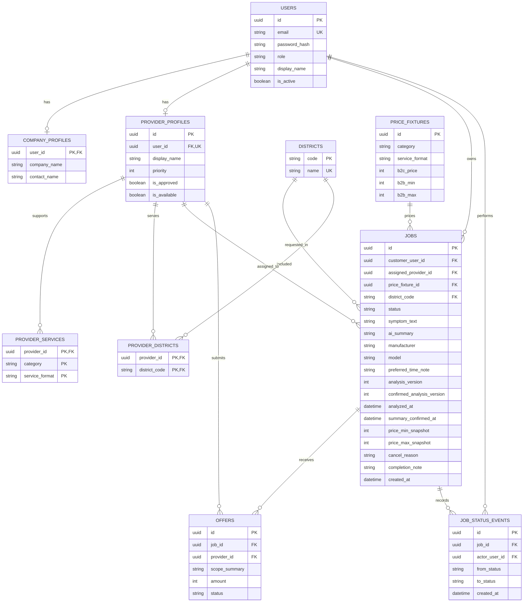

# Fixtech MVP Demo — ขั้นตอนที่ 2: Use Cases, ERD และ API

> **ฉบับใช้งาน:** Actor/สิทธิ์, Use Case, state, data dictionary และ API ใน §§2–9 ที่ระบุ baseline v1.7 เป็นประวัติเท่านั้น ไม่ใช่พฤติกรรมของ Demo. ข้อกำหนดปัจจุบันอยู่ใน SRS §§1.4/13, decision §13.7 (v1.8.4) และเอกสารนี้ §10; หากขัดกันให้ยึด decision ล่าสุด. สำหรับขั้น 5 ใช้ Ollama local และ curated price references แบบ non-live; diagram/ข้อความที่เรียก live price เป็นข้อกำหนดก่อนการตัดสิน v1.8.4.

> **ขอบเขตปัจจุบัน:** §10 เป็นข้อกำหนด Use Case/API/state/traceability สำหรับ Demo v1.8. §§1–9 เป็น snapshot ทางประวัติศาสตร์ที่คงไว้เพื่อ trace การตัดสินใจ; ห้ามนำข้อความที่ขัดกันมาใช้แทน §10.

> **Implementation link:** route/payload และ transition ที่ implement จริงใน API v1.8 ให้ยึด [ขั้น 5 — API และกฎการเปลี่ยนสถานะงาน](api-and-job-state-v1.md); จุดที่แตกต่างจาก design เดิมรวบรวมไว้ใน §8 ของขั้น 5.

**อ้างอิง baseline:** [SRS v1.8 Expanded Demo](software-requirements-v1.md)<br>
**สถานะ:** แบบออกแบบสำหรับ expanded student demo เท่านั้น; ยังไม่ใช่ production design<br>
**เทคโนโลยีเป้าหมาย:** HTML/CSS/JavaScript, Node.js/Express, PostgreSQL

## 1. หลักการและขอบเขต

ส่วน §§1–9 เป็น baseline v1.7 เชิงประวัติ; ข้อกำหนด Demo ปัจจุบันใช้ v1.8 ใน §10 ประกอบกับ SRS §13. ให้ถือ §10 แทนข้อความที่ขัดกันใน baseline.

ขอบเขต baseline v1.7 ในส่วนนี้ใช้บัญชีและข้อมูล seed, AI mock, ราคา/ข้อเสนอ fixture, เขตตัวอย่าง 3 เขต และวงจรงานจำลองจนลูกค้ายืนยันรับ. ข้อความ “ไม่มี” ในย่อหน้านี้เป็นประวัติของ v1.7 เท่านั้น; Demo ปัจจุบันให้ยึดรายการขยายใน §10.

กฎข้อมูลตัวอย่างที่ยึดร่วมกัน:

| รายการ | ค่าตั้งต้น |
|---|---|
| หมวดงาน | `SOFTWARE` = โปรแกรม Windows เปิดไม่ได้; `HARDWARE` = ตรวจอาการคอมพิวเตอร์ |
| รูปแบบบริการ | `SOFTWARE` ใช้ `ONLINE`; `HARDWARE` ใช้ `ONSITE` เท่านั้น |
| เขตตัวอย่าง | บางนา (`BANG_NA`), ปทุมวัน (`PATHUM_WAN`), จตุจักร (`CHATUCHAK`); ใช้รหัสเขตคงที่ในฐานข้อมูล ไม่ใช้ข้อความชื่อเขตเป็น foreign key |
| ราคา B2C | Software online = 250 THB; Hardware onsite = 400 THB |
| ช่วงราคา B2B | Software = 250–500 THB; Hardware = 400–800 THB |
| ข้อเสนอจำลอง B2B | Software = 350/450 THB; Hardware = 550/700 THB; เรียงผูกกับ provider ตาม priority แล้ว provider ID |
| การจัดอันดับ B2C | กรอง provider ที่ seed ว่าพร้อม, รับหมวด/รูปแบบบริการ และเขตนั้น; เรียง `priority ASC, provider_id ASC`; เลือกคนแรก |
| จำนวน seed | ลูกค้าทั่วไปอย่างน้อย 2 บัญชี, บริษัท 1, Admin 1; provider อย่างน้อย 2 รายต่อ workflow; provider ทุกคนใน seed ถือว่าอนุมัติ/พร้อม |

จำนวนเงินเก็บเป็นจำนวนเต็มหน่วยบาทสำหรับ fixture ชุดนี้. ราคาและข้อเสนอทุกหน้าต้องติดป้าย “ราคาเพื่อสาธิต”. การเปลี่ยนราคาหรือเพิ่มหมวด/รูปแบบไม่ใช่การตั้งค่าใน UI; ต้องแก้ seed และ test พร้อมกัน.

## 2. Actor และสิทธิ์

| Actor | สิทธิ์ในเดโม |
|---|---|
| ลูกค้าทั่วไป | สร้าง/ดู/ยกเลิกงานของตน; ยืนยันสรุปและรับงานเสร็จ; เห็นเพียงผลจับคู่/ชื่อแสดงสาธิต ไม่เห็นโปรไฟล์หรือข้อมูลติดต่อส่วนตัวของช่าง |
| ลูกค้าบริษัท | สร้าง/ดู/ยกเลิกงานของตน; ดูข้อเสนอของงานตน, เลือกหนึ่งข้อเสนอ, ยืนยันรับงานเสร็จ; ไม่เห็นโปรไฟล์/ข้อมูลติดต่อส่วนตัวของช่าง |
| ช่าง | ดูเฉพาะงานที่จับคู่หรือถูกเลือกให้; เริ่มงานและส่งงานเสร็จ; ไม่เห็นโปรไฟล์หรือข้อมูลติดต่อส่วนตัวของลูกค้า |
| Admin | ดูรายการงานทั้งหมดแบบ read-only; ไม่มีอนุมัติ provider หรือแก้ราคาในเดโม |

ผู้ใช้ที่ไม่ใช่เจ้าของงาน/ช่างที่ได้รับมอบหมาย/Admin ต้องเปิดดูรายละเอียดหรือเปลี่ยนงานนั้นไม่ได้. เมื่อไม่อนุญาตให้คืน `404 NOT_FOUND` สำหรับ Job เพื่อไม่เปิดเผยว่ามีงานของบัญชีอื่นอยู่หรือไม่. Role มาจาก session ฝั่ง server เท่านั้น ห้ามรับ role หรือ `customer_id` จาก request body.

## 3. Use Cases

### UC-01 เข้าระบบด้วยบัญชี seed

**Actor:** ทุก role. **ก่อนเริ่ม:** มีบัญชี seed active.<br>
**หลักสำเร็จ:** ผู้ใช้กรอกอีเมล/รหัสผ่านถูกต้อง → server ตรวจ password hash → สร้าง session → ส่งข้อมูลผู้ใช้ที่ไม่รวม password hash.<br>
**ทางเลือก/ข้อผิดพลาด:** ข้อมูลไม่ถูกต้องหรือบัญชี inactive → `401 INVALID_CREDENTIALS`; ไม่บอกว่าอีเมลใดมีบัญชี. Logout ทำลาย session ฝั่ง server.

### UC-02 ลูกค้าทั่วไปสร้างงานและจับคู่ช่าง

1. ลูกค้าเลือก workflow ที่เปิดให้ (Software online หรือ Hardware onsite), เลือกเขต และกรอกอาการ; `POST /jobs` ตรวจข้อมูลและสร้าง Job สถานะ DRAFT.
2. `POST /analyze` เรียก deterministic mock และคืนสรุปพร้อมราคา fixture/ป้ายสาธิตในการตอบกลับเดียวกัน. ใน test ใช้ template ที่แน่นอนตาม workflow และข้อความ input.
3. ลูกค้าตรวจสรุปและราคา 250 หรือ 400 บาทพร้อมกัน; แก้สรุปได้. หากแก้อาการ/เขตต้องวิเคราะห์และยืนยันใหม่; หากแก้เฉพาะสรุปให้ยืนยันข้อความใหม่โดยใช้ผลวิเคราะห์/ราคาเดิม.
4. เมื่อลูกค้ากดยืนยันสรุปและราคาที่แสดง ระบบบันทึกรุ่นที่ยืนยันและเปลี่ยนสถานะเป็น READY_TO_PUBLISH. การกดยืนยันนี้เป็นการยอมรับราคาสำหรับเดโมด้วย.
5. ลูกค้ายืนยันเผยแพร่; server ตรวจข้อมูล, ผลวิเคราะห์, fixture/snapshot และรุ่นที่ยืนยัน. ภายใน transaction เปลี่ยน Job เดิมจาก READY_TO_PUBLISH เป็น POSTED, ค้น provider ที่เข้าเกณฑ์, เลือกผู้มี priority สูงสุดและตั้ง MATCHED/ผู้ให้บริการ หรือกำหนด NO_PROVIDER_FOUND หากไม่มีผู้สมัคร.
6. ลูกค้าเห็นผลจับคู่หรือข้อความว่าไม่มีช่าง. งานไม่มีผู้สมัครยังคง NO_PROVIDER_FOUND และดู/ยกเลิกได้; การเริ่ม matching ใหม่/ปรับเงื่อนไขไม่อยู่ในเดโม.

### UC-03 ลูกค้าบริษัทโพสต์และเลือกข้อเสนอ

1. บริษัทเลือก workflow/เขต และกรอกอาการ, ยี่ห้อ/รุ่น, ช่วงเวลาสะดวก; `POST /jobs` ตรวจข้อมูลและสร้าง Job สถานะ DRAFT.
2. `POST /analyze` คืนสรุป mock และช่วงราคา fixture/ป้ายสาธิตในการตอบกลับเดียวกัน. บริษัทตรวจทั้งสรุปและช่วงราคาก่อนตัดสินใจ.
3. บริษัทแก้สรุปได้; หากแก้อาการ, เขต, ยี่ห้อ/รุ่น หรือเวลาสะดวก ต้องวิเคราะห์ใหม่; หากแก้เฉพาะสรุปใช้ผลวิเคราะห์และราคาเดิมได้ แต่ต้องยืนยันข้อความใหม่.
4. เมื่อลูกค้ากดยืนยันสรุปและช่วงราคาที่แสดง ระบบบันทึกรุ่นที่ยืนยันและเปลี่ยนสถานะเป็น READY_TO_PUBLISH. การกดยืนยันนี้เป็นการยอมรับช่วงราคาสำหรับเดโมด้วย.
5. เมื่อลูกค้ายืนยันเผยแพร่ ระบบเปลี่ยน Job เดิมเป็น POSTED แล้วสร้าง offer fixture 2 รายและเปลี่ยนเป็น WAITING_FOR_SELECTION ใน transaction เดียวกัน.
6. บริษัทเปรียบเทียบราคา/ขอบเขตและเลือกหนึ่งรายการ; API ตรวจว่า offer เป็นของ Job นี้และยังเลือกได้; transaction บันทึก offer ที่เลือก, ปิด offer อื่น และเปลี่ยน Job เป็น ASSIGNED.
7. หากไม่มี provider/ข้อเสนอครบ 2 ราย ให้ Job เป็น NO_PROVIDER_FOUND และแสดงข้อความ; ห้ามสร้างข้อเสนอขึ้นเองใน runtime. บริษัทเลือกเก็บสถานะนี้ไว้หรือยกเลิกได้.

### UC-04 ช่างทำงานและลูกค้ายืนยันรับ

1. ช่างเห็นเฉพาะงานที่ assigned_provider_id ตรงกับ profile ของตน.
2. หลังจับคู่/เลือก offer แล้ว คู่กรณีแชตและนัดหมาย; Job เป็น SCHEDULED เมื่อทั้งสองฝ่ายยืนยันช่วงเวลาและราคา/ขอบเขตงานแล้ว.
3. เฉพาะ assigned provider เริ่มงานจาก SCHEDULED; Job เป็น IN_PROGRESS.
4. ช่างส่งงานเสร็จ; Job เป็น WAITING_FOR_CUSTOMER_CONFIRMATION และลูกค้าเห็น warranty terms มี/ไม่มีเพื่อยืนยันก่อนตรวจรับ.
5. ลูกค้ายืนยันรับแล้ว Job เป็น COMPLETED; หลังจากนั้นจึงบันทึก payment simulation/direct-received ตามชนิดลูกค้า, เริ่ม warranty ตาม snapshot, และเปิดสิทธิ์ review.
6. ลูกค้าหรือช่างเปิด dispute ได้ตามเงื่อนไข; Admin ตรวจและบันทึกผลโดยมี audit log.
7. การเรียกซ้ำหรือเปลี่ยนสถานะผิดลำดับคืน 409 INVALID_STATE_TRANSITION โดยไม่สร้าง event ซ้ำ.

### UC-05 ยกเลิกก่อนเริ่ม

ลูกค้าเจ้าของงานยกเลิกได้ก่อน IN_PROGRESS รวมถึงระหว่างรอนัดหรือหลังยืนยันนัด โดยปล่อยช่วงนัดและแจ้งคู่กรณี. หลังเริ่มงานไม่ยกเลิกตรง ๆ; หากมีปัญหาให้เปิด dispute ตาม §10. ช่าง/Admin ไม่มีปุ่มยกเลิกแทนลูกค้า. ระบบบันทึกเหตุผล ผู้กระทำ และเวลา.

### UC-06 Admin ตรวจรายการงาน

Admin เรียกดูรายการและรายละเอียดงานเพื่อสาธิตได้แบบ read-only. API ปฏิเสธคำขอแก้ไขราคา, อนุมัติ provider หรือเปลี่ยนสถานะในบทบาท Admin.

## 4. State model (historical baseline v1.7 — ห้ามใช้แทน §10.3)

> ตาราง transition ด้านล่างเป็นประวัติ v1.7; state model ปัจจุบันของ Demo v1.8 อยู่ใน §10.3 และ Activity Diagram ขั้น 3 §7.3.

| สถานะ | ความหมาย |
|---|---|
| DRAFT | ร่างข้อมูล; อาจยังไม่มีผลวิเคราะห์/ราคา หรือถูกย้อนกลับเมื่อแก้ข้อมูลที่มีผลต่อผลวิเคราะห์ |
| READY_TO_PUBLISH | มีผลวิเคราะห์/ราคา fixture ปัจจุบัน และลูกค้ายืนยันสรุปพร้อมยอมรับราคาหรือช่วงราคานั้นแล้ว |
| POSTED | ลูกค้ายืนยันเผยแพร่แล้ว ระหว่างระบบจัดผล matching |
| MATCHED | B2C จับคู่ provider หนึ่งรายแล้ว |
| WAITING_FOR_SELECTION | B2B มี offer fixture ให้ลูกค้าเลือก |
| ASSIGNED | บริษัทเลือก offer แล้ว ผูก provider หนึ่งราย |
| NO_PROVIDER_FOUND | ไม่มี provider เข้าเกณฑ์ตาม test data; เก็บงานและแจ้งลูกค้า |
| IN_PROGRESS | ช่างที่ได้รับมอบหมายเริ่มงานแล้ว |
| WAITING_FOR_CUSTOMER_CONFIRMATION | ช่างส่งงานเสร็จ รอลูกค้ายืนยัน |
| COMPLETED | ลูกค้ายืนยันรับงานแล้ว (สถานะจำลอง ไม่ได้ยืนยันการซ่อมจริง) |
| CANCELLED | ลูกค้ายกเลิกก่อนเริ่มงาน |

Transitions ที่อนุญาต:

| จาก | ไป | ผู้ทำ/เงื่อนไข |
|---|---|---|
| DRAFT | READY_TO_PUBLISH | หลังระบบวิเคราะห์ mock/มี fixture ราคาแล้ว ลูกค้ายืนยันสรุปและยอมรับราคา/ช่วงราคาที่แสดง |
| READY_TO_PUBLISH | POSTED | ลูกค้าเจ้าของงานยืนยันเผยแพร่ |
| POSTED | MATCHED | ระบบเลือก provider ให้ B2C |
| POSTED | WAITING_FOR_SELECTION | ระบบสร้าง offer fixture ให้ B2B |
| POSTED | NO_PROVIDER_FOUND | ไม่มีผู้สมัครตามชุดข้อมูลทดสอบ |
| WAITING_FOR_SELECTION | ASSIGNED | ลูกค้าเลือก offer หนึ่งรายการ |
| MATCHED / ASSIGNED | IN_PROGRESS | provider ที่ได้รับมอบหมายเริ่มงาน |
| IN_PROGRESS | WAITING_FOR_CUSTOMER_CONFIRMATION | provider ส่งงานเสร็จ |
| WAITING_FOR_CUSTOMER_CONFIRMATION | COMPLETED | ลูกค้าเจ้าของงานยืนยัน |
| DRAFT / READY_TO_PUBLISH / POSTED / MATCHED / WAITING_FOR_SELECTION / ASSIGNED / NO_PROVIDER_FOUND | CANCELLED | ลูกค้าเจ้าของงานยกเลิกก่อนเริ่ม |

ทุก transition ตรวจสถานะเดิมและ role ที่ server. การเลือก offer ใช้ DB transaction/row lock หรือวิธีเทียบเท่า เพื่อให้มี offer ที่ SELECTED ได้ไม่เกินหนึ่งรายการต่อ Job. สถานะที่ไม่อยู่ในตารางต้องถูกปฏิเสธ.

## 5. ERD ระดับแนวคิด (historical baseline v1.7 — ให้ใช้ Data Model ขั้น 4 §9)



## 6. Data dictionary และข้อจำกัด

| ตาราง | เก็บอะไร / ฟิลด์หลัก | ข้อจำกัดที่ต้องมี |
|---|---|---|
| `users` | บัญชี seed: `id`, `email`, `password_hash`, `role`, `display_name`, `is_active` | `email` unique; role เป็น `CUSTOMER_GENERAL`, `CUSTOMER_BUSINESS`, `TECHNICIAN`, `ADMIN`; ห้ามเก็บ password ตรง ๆ |
| `company_profiles` | `user_id`, `company_name`, `contact_name` | PK/FK เป็น `users.id`; สร้างได้เฉพาะบัญชี CUSTOMER_BUSINESS |
| `provider_profiles` | `id`, `user_id`, `display_name`, `priority`, `is_approved`, `is_available` | `user_id` unique; seed provider ต้อง approved/available |
| `districts` | `code`, `name` | seed บางนา/ปทุมวัน/จตุจักร; code เป็น PK |
| `provider_services` | ความสามารถ provider ต่อ category/service format | composite PK `(provider_id, category, service_format)`; รับเฉพาะคู่ที่มี price fixture |
| `provider_districts` | เขตที่ provider รับบริการ | composite PK `(provider_id, district_code)` |
| `price_fixtures` | ราคา/ช่วงราคา 2 คู่ workflow | unique `(category, service_format)` แบบ composite (ไม่ unique แยกแต่ละคอลัมน์); check `b2c_price > 0`, `b2b_min > 0`, `b2b_max >= b2b_min`; THB only; fixture ห้ามลบ/แก้ระหว่างงานเดโม |
| `jobs` | เจ้าของ, อาการ, เขต, summary, ข้อมูลอุปกรณ์/เวลาของบริษัท, status, provider, snapshot ราคา, cancel/completion note, timestamps | FK ทุกความสัมพันธ์; `price_fixture_id` nullable ขณะ DRAFT ก่อนวิเคราะห์ แล้วชี้ fixture ที่เลือก; category/service format อ่านจาก fixture ผ่าน JOIN ไม่เก็บซ้ำ; ราคา snapshot เป็น nullable ก่อนวิเคราะห์ (B2C min=max); `analysis_version` เริ่ม 0 และเพิ่มทุกครั้งที่วิเคราะห์; `confirmed_analysis_version` nullable จนลูกค้ายืนยันสรุปและยอมรับราคาของ snapshot รุ่นนั้น แล้ว publish ได้เมื่อเท่ากับรุ่นปัจจุบัน; `assigned_provider_id` nullable ก่อน matching |
| `offers` | offer fixture ต่อ Job/provider, scope summary, amount, status (`AVAILABLE`, `SELECTED`, `NOT_SELECTED`) | unique `(job_id, provider_id)`; amount > 0; `scope_summary` เป็นข้อความบริการที่ seed กำหนด ไม่ใช่ข้อมูลติดต่อ; partial unique index ให้มี status SELECTED ได้สูงสุดหนึ่งแถวต่อ job |
| `job_status_events` | ประวัติ transition และ actor | append-only ผ่าน application; FK งาน/ผู้กระทำ; บันทึก event ใน transaction เดียวกับการเปลี่ยน status |

ฟิลด์เพิ่มเติมใน `jobs`: `manufacturer`, `model`, `preferred_time_note` ใช้กับบริษัทและเป็น nullable สำหรับลูกค้าทั่วไป; `analysis_version`, `confirmed_analysis_version`, `analyzed_at`, `summary_confirmed_at`, `posted_at`, `started_at`, `submitted_at`, `completed_at`, `cancelled_at` ใช้เก็บรุ่น/เวลา โดย `summary_confirmed_at` คือเวลาที่ลูกค้ายืนยันสรุปพร้อมยอมรับ price snapshot รุ่นนั้น; `cancel_reason` และ `completion_note` เป็นข้อความตามขนาดจำกัด; `customer_user_id` เป็นเจ้าของจริงและห้ามรับจาก client. `price_fixture_id` และ snapshot ราคาถูกตั้งเมื่อวิเคราะห์สำเร็จ. category/service format ได้จาก fixture (SOFTWARE/ONLINE หรือ HARDWARE/ONSITE) จึงไม่เก็บซ้ำใน `jobs`; `price_fixtures` มี unique constraint แบบ composite `(category, service_format)`.

การแก้ `symptomText`, `districtCode`, `manufacturer`, `model` หรือ `preferredTimeNote` ใน DRAFT/READY_TO_PUBLISH จะล้าง `analyzed_at`, `price_fixture_id`, snapshot ราคา และ `confirmed_analysis_version`, ตั้งกลับ DRAFT; ต้องเรียก analyze และยืนยันใหม่ เพราะข้อมูลอุปกรณ์/พื้นที่อาจมีผลต่อผลวิเคราะห์หรือการจับคู่. การแก้ `aiSummary` อย่างเดียวคงผลวิเคราะห์/ราคาเดิมแต่ล้าง `confirmed_analysis_version`/`summary_confirmed_at` และตั้ง DRAFT เพื่อให้ยืนยันข้อความใหม่. `analyze` ใช้ได้เฉพาะ DRAFT และบันทึกผล/ราคา fixture ปัจจุบันพร้อมเพิ่ม `analysis_version`. `confirm-summary` ใช้ได้เมื่อมี analyzed_at/fixture และยืนยันสรุปปัจจุบันเท่านั้น แล้วคัดลอก `analysis_version` ไป `confirmed_analysis_version` และตั้ง READY_TO_PUBLISH. `publish` ต้องตรวจข้อมูลและ fixture ยังตรงกัน, มี analyzed_at และ `confirmed_analysis_version = analysis_version`; ถ้าไม่ครบปฏิเสธโดยไม่เปลี่ยนสถานะ.

ทุกเวลาใช้ `timestamptz` และ server เป็นผู้กำหนด. ใช้ integer THB สำหรับ fixture นี้; หากขยายสู่เงินจริง/ภาษีต้องออกแบบชนิดเงินใหม่ก่อน ไม่อนุมานจากเดโม.

## 7. API contract (REST `/api/v1`, historical baseline v1.7 — ห้ามใช้แทน API addendum §10.2)

> Endpoint ตารางนี้เป็น baseline ก่อนขยาย; API เพิ่มเติม/ข้อกำหนดปัจจุบันอยู่ใน §10.2. UC-04/UC-05 และ route เริ่มงานในตารางนี้ปรับให้ตรงกับ v1.8 แล้ว.

### 7.1 รูปแบบทั่วไป

- JSON request/response; session cookie ฝั่ง server, `HttpOnly`, `SameSite`; ใช้ CSRF token สำหรับ state-changing request หากใช้ cookie session.
- Role อ่านจาก session เท่านั้น. ทุก route ที่รับ `{jobId}` ตรวจ ownership/assignment ก่อนคืนข้อมูล.
- สำเร็จคืน `{ "data": ..., "meta": ... }`; ผิดพลาดคืน `{ "error": { "code": "...", "message": "...", "fields": {} }, "requestId": "..." }`.
- HTTP ที่ใช้: `200` อ่าน/แก้/เปลี่ยนสถานะ, `201` สร้าง, `400` validation, `401` ไม่ได้ login, `403` role ไม่มีสิทธิ์, `404` ไม่พบ/ไม่มีสิทธิ์ดู, `409` state/selection conflict, `500` ข้อผิดพลาดที่ไม่คาดหมาย.

### 7.2 Endpoint

| Method / Path | Role | Request หลัก | ผลสำเร็จ / เงื่อนไข |
|---|---|---|---|
| `POST /auth/login` | Public | `email`, `password` | 200; สร้าง session; ข้อมูลตอบกลับไม่รวม hash |
| `POST /auth/logout` | ผู้ login | ไม่มี | 204; ทำลาย session |
| `GET /auth/me` | ผู้ login | ไม่มี | 200; `id`, `role`, `displayName` |
| `GET /demo/catalog` | ผู้ login | ไม่มี | 200; workflow, districts, ราคา/ป้าย demo ที่เปิดให้เลือก |
| `POST /jobs` | ลูกค้าทั่วไป/บริษัท | `category`, `serviceFormat`, `symptomText`, `districtCode`; บริษัทเพิ่ม `manufacturer`, `model`, `preferredTimeNote` | 201; สร้าง DRAFT โดย `customer_user_id` มาจาก session |
| `POST /jobs/{jobId}/analyze` | เจ้าของ Job, DRAFT | ไม่มี | 200; mock summary + price fixture + `isDemo: true`, บันทึก analyzed_at และเพิ่ม analysis_version; สถานะยัง DRAFT |
| `PATCH /jobs/{jobId}` | เจ้าของ Job, DRAFT/READY_TO_PUBLISH | `symptomText`, `aiSummary`, `districtCode`, บริษัทเพิ่ม `manufacturer`, `model`, `preferredTimeNote` | 200; เปลี่ยนข้อมูลแล้วล้าง confirmation/ย้อน DRAFT ตามกติกาใน §6; category/serviceFormat เปลี่ยนผ่านการสร้าง Draft ใหม่ในเดโม |
| `POST /jobs/{jobId}/confirm-summary` | เจ้าของ Job, DRAFT ที่วิเคราะห์แล้ว | ไม่มี | 200; UI เรียกจากปุ่ม “ยืนยันสรุปและราคา/ช่วงราคา”; ต้องมี analyzed_at/fixture; บันทึกรุ่นที่ยืนยันและตั้ง READY_TO_PUBLISH |
| `POST /jobs/{jobId}/publish` | เจ้าของ Job, READY_TO_PUBLISH | ไม่มี | 200; เปลี่ยน Job เดิม READY_TO_PUBLISH → POSTED (ไม่ INSERT Job ใหม่); re-check ผลวิเคราะห์, fixture, snapshot และรุ่นที่ยืนยัน; matching/offer ใน transaction; ผลเป็น MATCHED, WAITING_FOR_SELECTION หรือ NO_PROVIDER_FOUND |
| `GET /jobs` | ลูกค้า/ช่าง | query `status`, `page` (optional) | 200; เฉพาะรายการที่ role นั้นมีสิทธิ์ |
| `GET /jobs/{jobId}` | เจ้าของ/assigned provider/Admin | ไม่มี | 200; อื่นคืน 404 |
| `GET /jobs/{jobId}/offers` | เจ้าของบริษัท | ไม่มี | 200; คืน `id`, `providerLabel` (ชื่อสาธิต), `scopeSummary`, `amount`, `currency`, `isDemo`; ไม่คืนข้อมูลติดต่อ/โปรไฟล์ส่วนตัว |
| `POST /jobs/{jobId}/offers/{offerId}/select` | เจ้าของบริษัท, WAITING_FOR_SELECTION | ไม่มี | 200; เลือกได้ offer ของ Job เดียวกัน; transaction ทำให้มีผู้ชนะหนึ่งราย; conflict คืน 409 |
| `POST /jobs/{jobId}/start` | assigned provider; SCHEDULED (นัดสองฝ่ายยืนยันและตกลงราคาแล้ว) | ไม่มี | 200; IN_PROGRESS; สถานะ MATCHED/ASSIGNED ใช้เฉพาะ baseline v1.7 |
| `POST /jobs/{jobId}/submit-completion` | assigned provider; IN_PROGRESS | `completionNote` | 200; WAITING_FOR_CUSTOMER_CONFIRMATION |
| `POST /jobs/{jobId}/confirm-completion` | เจ้าของ Job; WAITING_FOR_CUSTOMER_CONFIRMATION | ไม่มี | 200; COMPLETED |
| `POST /jobs/{jobId}/cancel` | เจ้าของ Job; ก่อน IN_PROGRESS | `reason` | 200; CANCELLED; หลังเริ่มงานคืน 409 |
| `GET /admin/jobs` | Admin | `status`, `page` (optional) | 200; read-only list; ห้าม mutation ผ่าน Admin ในเดโม |

### 7.3 ตัวอย่าง

`POST /api/v1/jobs`:

```json
{
  "category": "SOFTWARE",
  "serviceFormat": "ONLINE",
  "symptomText": "โปรแกรมเปิดแล้วปิดทันที",
  "districtCode": "BANG_NA"
}
```

`POST /api/v1/jobs/{jobId}/analyze` ตอบตัวอย่าง:

```json
{
  "data": {
    "jobId": "<uuid>",
    "status": "DRAFT",
    "analysisVersion": 1,
    "category": "SOFTWARE",
    "aiSummary": "โปรแกรม Windows เปิดแล้วปิดทันที; ยังไม่ทราบข้อความ error",
    "price": { "min": 250, "max": 250, "currency": "THB", "isDemo": true }
  }
}
```

หลังลูกค้าตรวจสรุปและราคา/ช่วงราคาแล้วกดปุ่ม “ยืนยันสรุปและราคา/ช่วงราคา” ซึ่งเรียก `POST /jobs/{jobId}/confirm-summary` ระบบตอบ `200` ด้วย `{ "data": { "jobId": "<uuid>", "status": "READY_TO_PUBLISH", "confirmedAnalysisVersion": 1, "priceAccepted": true } }`. `priceAccepted` เป็น response acknowledgement ของการกดยืนยัน ไม่มีคอลัมน์แยกในฐานข้อมูล; `confirmed_analysis_version` ชี้ไปยังรุ่นที่มีทั้งสรุปและ price snapshot ที่ลูกค้ายอมรับ. Client ส่งราคาเองไม่ได้. หากยังไม่เคย analyze ให้ `409 INVALID_STATE_TRANSITION`.

ผล `POST /jobs/{jobId}/publish` สำหรับ B2C ที่พบช่าง:

```json
{
  "data": {
    "jobId": "<uuid>",
    "status": "MATCHED",
    "price": { "min": 250, "max": 250, "currency": "THB", "isDemo": true },
    "provider": { "id": "<uuid>", "label": "ช่างตัวอย่าง A", "isDemo": true }
  }
}
```

ผล B2B ใช้ `status: "WAITING_FOR_SELECTION"` และคืน `offers` สองรายการ โดยแต่ละรายการมี `id`, `providerLabel`, `scopeSummary`, `amount`, `currency: "THB"`, `isDemo: true`. `scopeSummary` มาจากข้อความ seed เช่น Software: “ตรวจอาการโปรแกรม Windows เปิดไม่ได้และแนะนำวิธีแก้ผ่านออนไลน์”; Hardware: “ตรวจอาการคอมพิวเตอร์เบื้องต้น ณ จุดบริการ”. หากไม่มี provider ให้คืน HTTP 200 เป็น `{ "data": { "jobId": "<uuid>", "status": "NO_PROVIDER_FOUND", "message": "ยังไม่มีช่างสำหรับเงื่อนไขนี้", "isDemo": true } }`.

`GET /jobs/{jobId}/offers` คืนรายการรูปแบบเดียวกัน. การเลือกข้อเสนอสำเร็จคืน `{ "data": { "jobId": "<uuid>", "status": "ASSIGNED", "selectedOfferId": "<uuid>", "provider": { "id": "<uuid>", "label": "ช่างตัวอย่าง A", "isDemo": true } } }`. การเริ่มงาน, ส่งงานเสร็จ, ยืนยันเสร็จ และยกเลิก คืน `200` พร้อม `{ "data": { "jobId": "<uuid>", "status": "<สถานะใหม่>" } }`; ทุก action ตรวจ transition และสิทธิ์ฝั่ง server.

### 7.4 Validation และ error codes

| Code | HTTP | ใช้เมื่อ |
|---|---:|---|
| `VALIDATION_ERROR` | 400 | field หาย/ชนิดไม่ถูกต้อง/ค่าหมวดกับบริการไม่ใช่คู่ที่รองรับ |
| `INVALID_CREDENTIALS` | 401 | login ไม่สำเร็จ โดยไม่เปิดเผยว่าบัญชีมีอยู่หรือไม่ |
| `FORBIDDEN` | 403 | role ไม่อนุญาตให้ใช้ endpoint |
| `NOT_FOUND` | 404 | Job/offer ไม่มี หรือ requester ไม่มีสิทธิ์อ่าน |
| `INVALID_STATE_TRANSITION` | 409 | เรียก action ไม่ตรงกับสถานะปัจจุบัน |
| `OFFER_ALREADY_SELECTED` | 409 | มี offer ชนะแล้ว/มีคำขอแข่งกันเลือก |
| `INTERNAL_ERROR` | 500 | ข้อผิดพลาดทั่วไป; ไม่ส่ง stack trace/secret ให้ client |

`NO_PROVIDER_FOUND` เป็นผลลัพธ์ปกติของ publish ไม่ใช่ error: HTTP 200 และ `data.status = "NO_PROVIDER_FOUND"`. `PATCH` ไม่รับ category/serviceFormat; หากต้องเปลี่ยน workflow ให้ยกเลิก Draft แล้วสร้างใหม่ เพื่อให้ fixture ไม่คลาดเคลื่อน.

รับ input เป็นข้อความ plain text; จำกัดความยาว `symptomText` 1–1,000 ตัวอักษร, `aiSummary` ไม่เกิน 1,000, `manufacturer`/`model` ไม่เกิน 100, `preferredTimeNote` ไม่เกิน 200, `completionNote` ไม่เกิน 500 และ `reason` ยกเลิกไม่เกิน 500. Trim ช่องว่าง, reject ค่าว่าง, ใช้ parameterized queries, และไม่แสดง HTML ที่ผู้ใช้กรอกเป็น markup.

## 8. Traceability: Must → Use Case / Data / API / Test

| SRS v1.7 Must | Use Case | Data/API หลัก | Acceptance/Test |
|---|---|---|---|
| 1 บัญชี/สิทธิ์ | UC-01, UC-06 | users, profiles; `/auth/*`, `/admin/jobs` | เข้าระบบทุก role, role rejection, cross-owner 404 |
| 2 ข้อมูลงาน | UC-02, UC-03 | jobs, districts, price_fixtures; `POST /jobs` | รองรับสองคู่ category/service และข้อมูลบริษัท |
| 3 AI mock | UC-02, UC-03 | jobs.ai_summary; `/analyze`, `/confirm-summary` | ผล deterministic, ป้าย demo, แก้สรุปก่อน publish และยืนยันรุ่นปัจจุบัน |
| 4 ราคา | UC-02, UC-03 | price_fixtures, job snapshots | ทดสอบราคา/ช่วงราคาตาม fixture, AI ไม่กำหนดราคา, ห้าม publish ก่อนลูกค้ายืนยันสรุปและยอมรับ snapshot ราคา |
| 5 matching/offers | UC-02, UC-03 | provider tables, offers; `/publish`, `/offers/{id}/select` | eligibility/priority, no provider, selected offer เดียว |
| 6 วงจรงาน | UC-04, UC-05 | jobs, job_status_events; start/submit/confirm/cancel | transition valid/invalid, completion, cancel pre-start |
| 7 UI/data persistence | UC-01–06 | ทุก entity; README setup/seed/reset | role-scoped pages, persist หลัง restart, reset ซ้ำได้ |
| 8 Automated tests | ทุก UC | test fixtures | ราคา, matching, offer race, transitions, authorization |

## 9. สิ่งที่ทีมทำต่อในขั้น implementation

1. ทบทวนแบบนี้ร่วมกันและแบ่งเจ้าของงานในทีม; หากไม่เห็นด้วยให้แก้เอกสารนี้ก่อนเขียน code.
2. สร้าง ER diagram ในเครื่องมือที่วิชาใช้ และแปลง data dictionary เป็น PostgreSQL schema/migrations.
3. ทำ API contract tests และ seed/reset scripts ก่อนหรือพร้อมกับหน้า UI.
4. เริ่มทำ vertical slice UC-01 → UC-02 ให้ครบก่อน; จากนั้น UC-03 → UC-04; ปิดท้ายสิทธิ์/ยกเลิก/Admin/tests.
5. Baseline v1.7 ใช้เป็นประวัติ; สำหรับ scope ปัจจุบันให้ใช้ SRS v1.8 §13 และเอกสารนี้ §10 ซึ่งแทนข้อจำกัดเดิมที่ขัดกัน. ลำดับ vertical slice ในรายการเดิมเป็นแนวทาง v1.7; สำหรับ v1.8 ให้เริ่ม adapter interfaces/test doubles ควบคู่กับ schema และ core workflow แล้วทำ integration spike ก่อนเปิดเรียก AI/market API จริง. ห้ามหยิบ feature อื่นนอก scope v1.8 เข้ามาโดยไม่ได้ตกลง change.

## 10. Expanded Demo v1.8 — Use Case/API Addendum

ข้อกำหนดในหัวข้อนี้เป็น revision หลัง v1.7 และใช้แทนรายละเอียดที่ขัดกันใน §§1–9. แกนเดิมยังคงอยู่: บัญชี seed, สอง workflow, provider seed, B2C matching, B2B เลือก offer. Demo ปัจจุบันใช้ Ollama/Gemma 3 4B local หลัง consent และ curated public price references แบบ non-live; automated tests ใช้ test adapters. รายละเอียดคอลัมน์ครบอยู่ใน [ขั้น 4 Expanded Data Model](mvp-data-model-v1.md); route และพฤติกรรมล่าสุดให้ยึด [ขั้น 5](api-and-job-state-v1.md).

### 10.1 Use cases ที่เพิ่ม/เปลี่ยน

#### UC-07 แนบภาพ วิเคราะห์ด้วย Ollama local และประเมินราคาอ้างอิงคัดสรร

1. ลูกค้าสร้าง/เปิด Draft เดิมและแนบภาพ JPEG/PNG/WebP ได้สูงสุด 3 ภาพ ภาพละ 10 MiB; server ตรวจชนิดจริง/ขนาด/สิทธิ์และเก็บใน private storage.
2. ก่อน analyze ระบบแสดง consent ระบุข้อความ/ภาพที่จะส่งให้ Ollama local ผ่าน loopback; ใช้ข้อมูลสังเคราะห์เท่านั้น. การปกปิด PII ในข้อความเป็น best effort และไม่ปกปิดข้อมูลในภาพ. หากไม่ยินยอม ให้กรอกสรุปเองโดยไม่เรียก AI.
3. `POST /analyze` เรียก Ollama/Gemma 3 4B local เมื่อเปิด provider, validate structured result และเก็บ provider/model/version/status/output ที่จำเป็น; ผลเป็นคำแนะนำเบื้องต้นที่อาจผิด ไม่ใช่คำวินิจฉัยรับประกัน. Provider unavailable/invalid output ต้องคง Draft.
4. `POST /price-estimates` ใช้ curated public reference catalog ที่เก็บ URL/วันทบทวน ไม่เรียก live-market API หรือ scrape runtime; Pricing Service คำนวณ snapshot จาก reference และ versioned demo rules. AI ห้ามคิดราคา. B2C ได้ยอดเดียวจาก low reference; B2B ได้ช่วงจาก low/high reference. แสดงแหล่ง, วันทบทวน และ non-live caveat.
5. ลูกค้า B2C ยอมรับยอดเดียวก่อน publish; Job เก็บยอดตกลง. บริษัทเห็นช่วงก่อน publish; หลัง matching ระบบแสดง scope และยอดแน่นอนของแต่ละ offer โดยระบุชัดเมื่อยอดอยู่นอกช่วงหรือ scope ต่างจาก estimate. บริษัทกดเลือก offer หลังเห็นข้อมูลครบถือเป็นการยืนยันยอด/ขอบเขต และระบบบันทึก agreed_amount/by/at; จึงอนุญาตให้นัดหมาย. ยอดที่ตกลงล็อกเมื่อ Job เป็น SCHEDULED; Demo ไม่มี workflow ขอเปลี่ยนราคาเพิ่มหลังนัด. Payment simulation ใช้ agreed_amount จาก server เท่านั้น.
6. หาก AI ไม่พร้อม/ผลไม่ผ่าน schema หรือไม่มี compatible curated price mapping: คง Draft, แจ้งสาเหตุ, ไม่สร้างราคา/ผลสำเร็จปลอม; ผู้ใช้กรอกสรุปเองหรือแก้/ลองใหม่ตามเงื่อนไข. ห้ามเผยแพร่จนมี summary ที่ยืนยันและ accepted price snapshot ที่ผ่าน freshness policy.

#### UC-08 สื่อสารและนัดหมาย

หลัง provider ได้รับมอบหมาย ลูกค้าและ provider อ่าน/ส่งข้อความ asynchronous ที่ผูกกับ Job ได้; ระบบสร้าง in-app notification ให้ recipient ที่เกี่ยวข้อง. ไม่เปิด public profile/contact จากการส่งข้อความ.

ลูกค้าหรือ provider เสนอช่วงนัดหมายโดยระบุเวลาเริ่ม/สิ้นสุด; อีกฝ่ายยืนยันหรือขอเวลาใหม่. ระบบตรวจเวลาไม่เป็นอดีต, `starts_at < ends_at`, provider ไม่มีช่วงยืนยันซ้อน และทุกฝ่ายเห็นเวลา Asia/Bangkok. Job เปลี่ยนเป็น `SCHEDULED` เมื่อ appointment มีการยืนยันจากทั้ง customer และ provider; ก่อนถึงสถานะนี้ห้ามเริ่มงาน. การยกเลิกต้องมีผู้กระทำ/เหตุผล/เวลาและแจ้งอีกฝ่าย. ไม่มี calendar integration.

#### UC-09 ชำระเงินจำลอง

หลัง Job เป็น `COMPLETED` ลูกค้าบริษัทเลือกได้เฉพาะการจำลองชำระผ่านแพลตฟอร์ม. ลูกค้าทั่วไปเลือก platform simulation หรือ `DIRECT`; กรณี `DIRECT` ช่างกดยืนยันว่าได้รับแล้ว ซึ่งไม่ใช่หลักฐานจาก Fixtech. ไม่มี gateway,เงินจริง, card number, bank credential หรือการโอน. ทุกหน้าติดป้าย “จำลอง — ไม่มีการโอนเงินจริง”; คำขอ retry ต้องไม่สร้างรายการซ้ำ.

#### UC-10 ปิดงาน รับประกัน รีวิว และข้อพิพาท

ก่อนลูกค้ายืนยันตรวจรับ provider ระบุว่ามี/ไม่มี warranty; ถ้ามีเลือกเงื่อนไข 7/14/30 วันและขอบเขตให้ลูกค้าเห็น แล้วลูกค้ายืนยัน snapshot. เมื่อลูกค้ายืนยันรับ Job เป็น COMPLETED ระบบสร้าง/เริ่ม warranty จากเวลานั้น. ลูกค้าเปิด warranty ticket ในช่วงนั้นได้; เป็น ticket ให้ Admin/provider ติดตาม ไม่มีคืนเงินอัตโนมัติ.

ลูกค้าให้ rating 1–5 และข้อความ optional ได้หนึ่งครั้งต่อ Job ที่ COMPLETED. ลูกค้าหรือ provider เปิด dispute ด้วยประเภท (`SERVICE_QUALITY`, `PRICE_OR_SCOPE`, `PAYMENT`, `WARRANTY`, `CANCELLATION`, `OTHER`)/เหตุผลและแนบ attachment ของ Job ได้; คู่กรณี/Admin เห็นเท่านั้น. Admin บันทึก resolution/เหตุผลและปิด dispute. AI ไม่ตัดสินข้อพิพาท.

### 10.2 API addendum

ทุก endpoint ใช้ auth/ownership policy เดิมและตรวจความสัมพันธ์ Job-actor; internal provider API key ห้ามส่งเข้า client. ตารางนี้เป็น API addendum ระดับ workflow; inventory path/field ที่ตรงกับ implementation ล่าสุดอยู่ใน [ขั้น 5 §3–6](api-and-job-state-v1.md). ไฟล์ภาพใช้ raw request body พร้อม `Content-Type` และ `X-File-Name` (ไม่ใช่ multipart); API แชตคืนสูงสุด 100 รายการโดยไม่มี cursor pagination ใน Demo.

| Method / Path | Actor / เงื่อนไข | ผลหลัก |
|---|---|---|
| `PATCH /jobs/{jobId}` | เจ้าของ Draft; แก้ symptom/district; ฟิลด์บริษัทเฉพาะบัญชีบริษัท | ตรวจเขต/ฟิลด์, เปลี่ยนข้อมูลจริงจึงถอน consent และล้าง summary เพื่อวิเคราะห์ใหม่; ค่าที่เท่าเดิมไม่เขียนซ้ำ |
| `POST /jobs/{jobId}/attachments` | เจ้าของ Job; raw image body, `Content-Type`, `X-File-Name`; ไม่เกิน 3 รูป/10 MiB ต่อรูป | บันทึก private object + metadata; คืน attachment ID |
| `GET /jobs/{jobId}/attachments/{attachmentId}` | เจ้าของ, provider ที่ assigned, Admin ที่เกี่ยวกับ dispute | stream/download หลัง authorize; ห้าม public URL ถาวร |
| `DELETE /jobs/{jobId}/attachments/{attachmentId}` | เจ้าของ Draft/Job ตาม policy | soft-delete metadata/object; ห้ามลบไฟล์ที่ใช้เป็นหลักฐาน dispute โดยไม่ปิด case |
| `POST /jobs/{jobId}/ai-consents` | เจ้าของ Job | บันทึก consent ต่อการวิเคราะห์และข้อมูลที่อนุญาตส่ง |
| `POST /jobs/{jobId}/ai-consents/{consentId}/revoke` | เจ้าของ Job | ถอน consent; ห้ามนำไปใช้กับการวิเคราะห์ครั้งถัดไป |
| `POST /jobs/{jobId}/analyze` | เจ้าของ Draft + consent active | เรียก Ollama/Gemma 3 4B local ผ่าน loopback เมื่อเปิดใช้; response มี structured summary, category, missing info, safe guidance, provider/model, version/status; ไม่รวมราคา; Draft เปลี่ยนระหว่างรอให้ `409 JOB_CHANGED`, ถอน consent ให้ปฏิเสธผลเก่า |
| `GET /jobs/{jobId}/ai-chat` / `POST /jobs/{jobId}/ai-chat` | เจ้าของ Draft; POST `{question}` ต้องมี consent active | GET อ่านประวัติ; POST บันทึก Q&A ได้ไม่เกิน 20 รอบต่อ Draft ใน `ai_analysis_runs`; Draft เปลี่ยนระหว่างรอให้ `409 JOB_CHANGED`; ถ้าไม่มี AI chat provider การ POST คืน 503 |
| `POST /jobs/{jobId}/price-estimates` | เจ้าของ Draft | อ่าน curated public reference + Pricing Service; คืนช่วง/ชนิดราคา, currency, source URL/review date, fetchedAt, freshness, formula version; ถ้า Draft เปลี่ยนระหว่างรอ reference ให้ `409 JOB_CHANGED` และไม่เก็บ snapshot เก่า; ไม่มี mapping/estimate ใช้ไม่ได้ให้ `ESTIMATE_UNAVAILABLE` โดยไม่ publish |
| `GET /jobs/{jobId}/messages` / `POST /jobs/{jobId}/messages` | เจ้าของและ assigned provider หลังมอบหมาย | อ่านล่าสุดได้สูงสุด 100 รายการ/ส่งข้อความ plain text; ยังไม่มี cursor pagination; สร้าง in-app notification |
| `GET /jobs/{jobId}/events` | owner/assigned provider/Admin | อ่านประวัติการเปลี่ยนสถานะโดยไม่เปิดเผย actor UUID |
| `POST /jobs/{jobId}/manual-summary`, `/confirm-summary`, `/publish` | เจ้าของ Draft/Ready ตาม state | ใช้สรุปมือเป็น fallback, ยืนยัน summary/estimate, แล้วเผยแพร่ตามลำดับ |
| `POST /jobs/{jobId}/price-estimates/{estimateId}/accept` | เจ้าของ Draft | ยอมรับ estimate สด; B2C บันทึกราคาเดียว, B2B รอ offer ที่เลือก |
| `GET /jobs/{jobId}/appointments` / `GET /jobs/{jobId}/payment-simulations` | คู่กรณีของ Job | อ่านสถานะนัด/การจำลองชำระเงินโดยไม่เปิด UUID คู่กรณี |
| `GET /admin/warranty-claims` / `POST /admin/warranty-claims/{claimId}/resolve` | Admin | ดูและบันทึกผล ticket รับประกันพร้อม audit |
| `GET /notifications` / `POST /notifications/{id}/read` | ผู้ใช้เจ้าของ notification | อ่าน/mark-read เฉพาะของตน |
| `POST /jobs/{jobId}/appointments` | owner/provider ที่เกี่ยวข้อง | เสนอช่วงเวลาและสร้าง appointment proposal |
| `POST /appointments/{appointmentId}/confirm` | อีกฝ่ายที่เกี่ยวข้อง | ยืนยัน; เมื่อครบสองฝ่ายสถานะ `CONFIRMED`; ปฏิเสธเวลาชนด้วย 409 |
| `POST /appointments/{appointmentId}/reschedule` / `/cancel` | ฝ่ายที่เกี่ยวข้อง | เสนอเวลาใหม่/ยกเลิกพร้อม reason และ notification |
| `POST /jobs/{jobId}/warranty-terms` | assigned provider; Job WAITING_FOR_CUSTOMER_CONFIRMATION | เสนอ offered true/false, duration (7/14/30 เมื่อ true), scope/exclusions; เก็บรุ่น terms |
| `POST /jobs/{jobId}/warranty-terms/accept` | ลูกค้าเจ้าของ Job; Job WAITING_FOR_CUSTOMER_CONFIRMATION | ยืนยัน terms version ล่าสุด; ต้องผ่านก่อน confirm completion |
| `POST /jobs/{jobId}/confirm-completion` | ลูกค้าเจ้าของ Job; warranty terms version ได้รับการยืนยัน | เปลี่ยน Job เป็น COMPLETED; สร้าง warranty snapshot/ช่วงคุ้มครองถ้ามี |
| `POST /jobs/{jobId}/payment-simulations` | ลูกค้าเจ้าของ Job; Job `COMPLETED` | สร้างรายการหลังจบงานด้วย jobs.agreed_amount จาก server; B2B รับเฉพาะ `PLATFORM_SIMULATED`, B2C รับ platform/direct; client ห้ามส่ง/กำหนดยอด |
| `POST /payment-simulations/{id}/confirm-platform` | ลูกค้า; simulation เท่านั้น | เปลี่ยนเป็น `PLATFORM_SIMULATED_PAID`; ไม่เรียก gateway |
| `POST /payment-simulations/{id}/confirm-direct-received` | provider ที่ assigned | บันทึกคำยืนยันรับตรง; ไม่ยืนยันแทนลูกค้า/ธนาคาร |
| `POST /jobs/{jobId}/warranty-claims` | ลูกค้า; warranty ACTIVE | เปิด ticket และแจ้งคู่กรณี/Admin |
| `POST /jobs/{jobId}/reviews` | ลูกค้า; Job COMPLETED | สร้าง review หนึ่งรายการต่อ Job |
| `POST /jobs/{jobId}/disputes` | ลูกค้าหรือ provider ที่เกี่ยวข้อง | เปิด dispute พร้อม reason/type/evidence attachment IDs |
| `GET /admin/disputes` / `POST /admin/disputes/{id}/resolve` | Admin | อ่านคดีที่ได้รับมอบหมาย, บันทึก resolution/เหตุผล, ปิดและแจ้งคู่กรณี; audit log |

### 10.3 State domains และ transaction rules

เก็บสถานะการเงิน/นัด/รับประกันแยกจาก jobs.status. ลำดับ Job ที่ใช้จริงคือ DRAFT → READY_TO_PUBLISH → POSTED; จากนั้น B2C ไป MATCHED → WAITING_FOR_APPOINTMENT ส่วน B2B ไป WAITING_FOR_SELECTION → ASSIGNED → WAITING_FOR_APPOINTMENT; เมื่อไม่มีผู้ให้บริการไป NO_PROVIDER_FOUND. ทั้งสอง workflow ต่อจากนั้นไป SCHEDULED → IN_PROGRESS → WAITING_FOR_CUSTOMER_CONFIRMATION → COMPLETED. ยกเลิกได้ก่อน IN_PROGRESS; dispute ทำให้ Job เป็น DISPUTED และ Admin ต้องบันทึกผลก่อนคืนสถานะตามสถานะต้นทาง: งานที่ยังไม่เคย completed คืนไป WAITING_FOR_CUSTOMER_CONFIRMATION หรือยกเลิกได้; งานที่มี `completed_at` แล้วเลือกได้เฉพาะ KEEP_COMPLETED; ห้ามย้อนงานที่เสร็จแล้วไปตรวจรับซ้ำหรือยกเลิกย้อนหลัง. งานเริ่มได้เมื่อ provider assigned, appointment confirmed และ agreed_amount มีค่า; การชำระเงิน (จำลองหรือช่างยืนยันรับตรง) บันทึกหลัง Job เป็น COMPLETED เท่านั้น.

| จาก | ไป | เงื่อนไขหลัก |
|---|---|---|
| DRAFT | READY_TO_PUBLISH | AI/manual summary และ price estimate สดผ่าน; ลูกค้ายอมรับผลและราคา |
| READY_TO_PUBLISH | POSTED | ลูกค้ายืนยัน publish |
| POSTED | MATCHED / WAITING_FOR_SELECTION / NO_PROVIDER_FOUND | B2C match หนึ่งราย / B2B สร้าง offers สองราย / ไม่มีผู้เข้าเกณฑ์ |
| WAITING_FOR_SELECTION | ASSIGNED | บริษัทเลือก offer; agreed_amount บันทึกจาก offer หลังยืนยันราคา |
| MATCHED / ASSIGNED | WAITING_FOR_APPOINTMENT | มี provider ที่รับผิดชอบแล้ว |
| WAITING_FOR_APPOINTMENT | SCHEDULED | ลูกค้าและ provider ยืนยัน appointment เดียวกัน; agreed_amount ต้องมี |
| SCHEDULED | WAITING_FOR_APPOINTMENT / IN_PROGRESS / CANCELLED | ยกเลิกหรือเลื่อนนัดก่อนเริ่ม / assigned provider เริ่มงาน / ลูกค้ายกเลิกก่อนเริ่ม |
| IN_PROGRESS | WAITING_FOR_CUSTOMER_CONFIRMATION | provider ส่งงานเสร็จ |
| WAITING_FOR_CUSTOMER_CONFIRMATION | COMPLETED / DISPUTED | ลูกค้ายืนยัน completion หลังรับทราบ warranty terms / มีผู้เปิดข้อพิพาท |
| COMPLETED | DISPUTED | เปิดข้อพิพาทตามเงื่อนไขหลังงาน |
| DISPUTED | WAITING_FOR_CUSTOMER_CONFIRMATION / COMPLETED / CANCELLED | ถ้ายังไม่มี `completed_at`: RETURN_TO_CUSTOMER หรือ CANCEL; ถ้ามี `completed_at`: KEEP_COMPLETED เท่านั้น; Admin บันทึก resolution และ audit |
| สถานะก่อน IN_PROGRESS | CANCELLED | ลูกค้ายกเลิก; ปิด offer/proposal และปล่อยนัดที่ยัง active |

payment_simulations.amount ต้องคัดลอกจาก jobs.agreed_amount ฝั่ง server; ห้ามรับจำนวนเงินจาก client.

| Domain | State ที่ใช้ใน Demo |
|---|---|
| Appointment | `PROPOSED`, `CONFIRMED`, `RESCHEDULE_REQUESTED`, `CANCELLED`, `COMPLETED` |
| Payment simulation | `PENDING`, `PLATFORM_SIMULATED_PAID`, `PROVIDER_CONFIRMED_DIRECT`, `FAILED` |
| Warranty | `NOT_APPLICABLE`, `ACTIVE`, `EXPIRED` |
| Warranty claim | `OPEN`, `UNDER_REVIEW`, `RESOLVED`, `REJECTED`, `CLOSED` |
| Review | `VISIBLE`, `HIDDEN` (หนึ่งรายการต่อ Job; moderation ไม่อยู่ใน Demo v1.8) |
| Dispute | `OPEN`, `UNDER_REVIEW`, `RESOLVED`, `REJECTED`, `CLOSED` |

การเปลี่ยน Job, appointment, payment simulation, dispute และ notification row ใช้ DB transaction เดียวกันตาม schema 26 ตาราง; ถ้าการบันทึก notification ใน DB ล้มเหลว domain transaction จะ rollback ด้วย (ไม่ใช่ post-commit/outbox). ตรวจ concurrency ของ appointment overlap และการ confirm payment/dispute ซ้ำ. External AI/market API ทำงานนอก DB transaction; บันทึกผล/ความล้มเหลวกลับด้วย version/correlation ID และไม่ทิ้งสถานะกึ่งสำเร็จ.

### 10.4 Data/API traceability supplement

| Added capability | Entity family (full definition in Step 4) | Main operation / test |
|---|---|---|
| Photo storage and consented AI | `job_attachments`, `ai_consents`, `ai_analysis_runs` | upload ACL/type/size/quota, consent/revoke, AI schema/provider timeout |
| Curated price and accepted snapshot | `price_estimates`, pricing configuration/version | reviewedAt/freshness/failure, reproducible snapshot, no AI-generated price |
| Chat and in-app notices | `job_messages`, `notifications` | participant-only access, recipient-only notifications, duplicate event retry |
| Scheduling | `appointments` | two-party confirmation, past/overlap/concurrency/reschedule |
| Simulated payment | `payment_simulations` | B2B platform-only, B2C platform/direct, no gateway, idempotency |
| Aftercare and trust | `warranties`, `warranty_claims`, `reviews`, `disputes`, `admin_audit_logs` | warranty timing/terms, review unique job, dispute ACL/resolution/audit |

Step 2 v1.7 ERD remains the core model reference only; the complete expanded relationships and column definitions are in [Step 4](mvp-data-model-v1.md). Admin remains read-only for ordinary jobs and gains only the scoped warranty/dispute actions above; no provider approval or editable price catalog is added in this revision.

### 10.5 Integration boundary and Step 7 implementation

Demo v1.8.4 ใช้ Ollama/Gemma 3 4B แบบ local และ curated reference catalog ที่ดูแลใน source; ไม่ใช่ cloud AI/live-market integration. ขั้น 7 implementation, PostgreSQL workflow, stale guards และ browser price/stale checks ผ่านตาม [เอกสารขั้น 7](step-7-pricing-matching-decisions.md) และ [validation report](validation.md). ห้ามสมมติ rating, experience, distance, workload หรือ actual provider quotes ที่ Demo ยังไม่มี. การเพิ่มปัจจัยที่ต้องการข้อมูลใหม่ให้แยกเป็น future scope/change request พร้อม SRS/API/schema/tests update.
