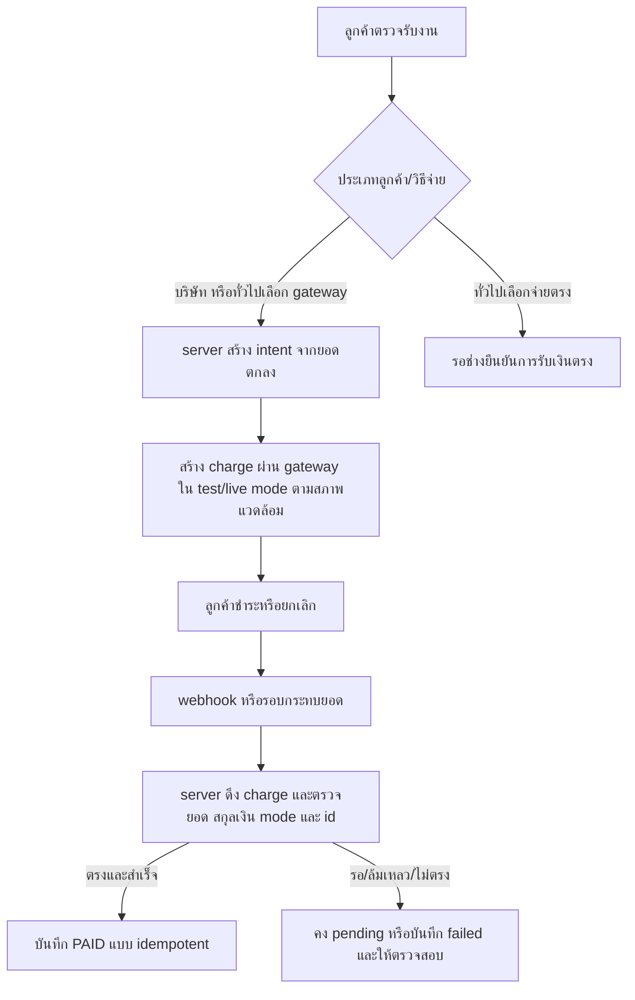
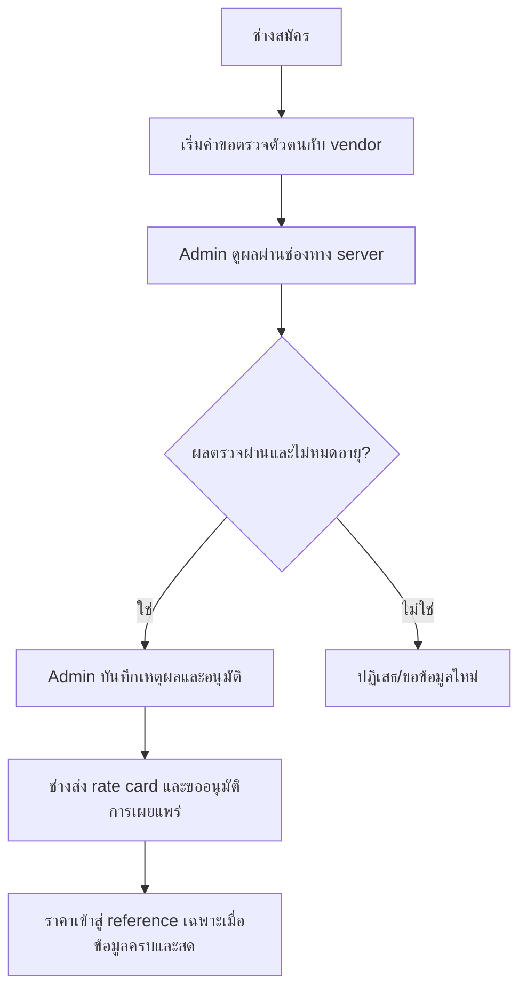

# Fixtech 1.0 — แบบสร้างและตรวจรับระบบ Production

**สถานะ:** ข้อกำหนดสำหรับการพัฒนาต่อ ไม่ใช่ผลตรวจรับ Production ระบบสาธิต 1.0 ยังคงแยกจากรุ่นนี้ ดู [สถานะจริง](production-readiness-review.md) และ [migration 0001](../release/migrations/0001_production_foundations.sql)

## 1. ข้อกำหนดซอฟต์แวร์

- **P-PAY-01** ลูกค้าบริษัทชำระผ่าน gateway ของแพลตฟอร์มเท่านั้น; ลูกค้าทั่วไปเลือก gateway หรือชำระกับช่างโดยตรง. วิธีตรงเป็นเพียงคำยืนยันของช่าง ไม่แสดงว่า gateway ตรวจเงินจริง.
- **P-PAY-02** ยอดชำระมาจาก `jobs.agreed_amount` ฝั่ง server เท่านั้น, บันทึกเป็นสตางค์, หนึ่งคำขอสร้าง intent ต้องมี idempotency key และไม่สร้าง charge ซ้ำเมื่อ retry.
- **P-PAY-03** สถานะ gateway `PAID` มาจากการตรวจ charge ผ่าน API ด้วย server credential หลัง webhook หรือการกระทบยอด; browser return ไม่เปลี่ยนสถานะ. รองรับ failed, expired, refund, partial refund, chargeback และรายงานยอดรายวัน.
- **P-KYC-01** ช่างสมัครและรับงานได้หลังข้อมูลวิชาชีพ/พื้นที่ถูก Admin อนุมัติและผลตรวจตัวตนจากผู้ให้บริการยังไม่หมดอายุ. เก็บ reference/ผลตรวจเท่าที่จำเป็น; เอกสารบัตรและภาพใบหน้าไม่อยู่ในตาราง Fixtech.
- **P-PRICE-01** ป้าย “ราคาเครือข่าย Fixtech” ใช้ rate card ที่ช่างอนุญาตและยังไม่หมดอายุอย่างน้อย 3 ช่างต่างกันต่อหมวด/รูปแบบ/เขต; ห้ามเรียกว่า “ราคาตลาดทั้งกรุงเทพ”. ถ้าไม่มี coverage ให้ขอราคาใหม่หรือเจ้าหน้าที่ช่วย ไม่สร้างตัวเลขเอง.
- **P-PRICE-02** B2C เห็น quote ของช่างที่พร้อมรับงานก่อนโพสต์และต้องกดยอมรับ; ถ้า quote/ช่างหมดอายุก่อนเผยแพร่ต้องประเมินใหม่. B2B เห็นช่วงอ้างอิงก่อนโพสต์และเลือกข้อเสนอจริงของทีมช่างภายหลัง.
- **P-OPS-01** เก็บ audit การอนุมัติ, การเปลี่ยนราคา, webhook/refund และการเข้าถึงข้อมูล; ระบุ retention, backup, monitoring และวิธีคืนข้อมูล. ทดสอบ security/privacy และ WCAG 2.2 AA ก่อนเปิดให้คนจริง.
- **P-SCOPE** บริการในกรุงเทพต้องมีเขตและจำนวนช่างจริงตามหมวดงานก่อนเปิดรับแต่ละคู่บริการ. การรับอุปกรณ์เข้าศูนย์และงาน Software/Hardware เพิ่มเติมต้องขยาย `service_catalog` และขั้นตอนรับส่งก่อนอ้างว่าครอบคลุมทุกบริการ.

## 2. Use cases และผลลัพธ์

| Actor | กรณี | ผลสำเร็จ | กรณีต้องหยุด |
|---|---|---|---|
| ลูกค้าทั่วไป | ตรวจราคา → ยืนยัน → จับคู่ → นัด → ตรวจรับ → ชำระ | ได้ quote/ช่างที่ตรงกัน; gateway แสดงผลยืนยันจาก server หรือช่างยืนยันชำระตรง | quote หมดอายุ, ไม่มีช่าง, gateway pending/failed |
| ลูกค้าบริษัท | กรอกเงื่อนไข → ช่วงราคา → รับข้อเสนอ → เลือก → gateway | ได้ข้อเสนอจริงและใบยืนยันยอดชำระตามเงื่อนไขธุรกิจ | ข้อเสนอหมดอายุหรือพยายามเลือกชำระตรง |
| ช่าง/ทีม | สมัคร → eKYC → รอ Admin → เปิด rate card → รับงาน | รับเฉพาะงานในเขต/หมวดที่อนุมัติและตัวตนไม่หมดอายุ | ตรวจไม่ผ่าน, หมดอายุ, เอกสารไม่ครบ, rate card หมดอายุ |
| Admin | ตรวจคำขอ/ราคา/ข้อพิพาท/ยอด | ผลมีผู้อนุมัติ เหตุผล เวลา และ audit | ข้อมูล vendor ไม่ตรง, การอนุมัติตนเอง, ผลซ้ำ/ผิดลำดับ |

## 3. Activity และจุดตัดสิน

## 4. ERD และ Data Dictionary

`0001_production_foundations.sql` เพิ่ม 8 ตารางบน 26 ตารางของ Demo: `schema_migrations`, `provider_verification_cases`, `provider_verification_events`, `provider_rate_cards`, `market_reference_snapshots`, `payment_intents`, `payment_webhook_events`, `payment_refunds`. FK เชื่อม `users`, `provider_profiles`, `districts`, `service_catalog` และ `jobs`. ยอดใช้ `bigint amount_minor` (สตางค์); รูปบัตร/ใบหน้า/เลขบัตรเต็มไม่เก็บในตารางนี้. ดัชนีบังคับ active rate card หนึ่งรายการต่อช่าง/หมวด/รูปแบบ/เขต และ open gateway intent หนึ่งรายการต่องาน.

ก่อนติดตั้ง Production จริงยังต้องออกแบบ migration ต่อสำหรับการจ่ายช่าง/ledger ตาม merchant contract, ประเภทบริการเพิ่ม, ข้อมูลรับส่งเข้าศูนย์, retention และการลบข้อมูล. ห้ามเปลี่ยน 26 ตารางเดิมโดยแก้ไฟล์ DDL ที่เคยติดตั้งแล้ว.

## 5. API และกฎสถานะ (สัญญาที่จะพัฒนา)

| API | สิทธิ์ | ผล | กฎสำคัญ |
|---|---|---|---|
| `POST /api/jobs/:id/payment-intents` | เจ้าของงาน | `intentId`, `status`, checkout URL/QR ตามช่องทาง | สถานะงาน `COMPLETED`, จำนวนจาก server, company=GATEWAY, idempotency |
| `GET /api/jobs/:id/payment-intents` | เจ้าของงาน/ช่างที่รับงาน/Admin ตามข้อมูลที่อนุญาต | สถานะจาก DB | ไม่เปิดเผย secret/webhook body |
| `POST /api/webhooks/opn` | gateway notification | HTTP 2xx เมื่อบันทึก/รับซ้ำ | payload จำกัดขนาด, dedupe event, ดึง charge ผ่าน Opn ก่อนอัปเดตเงิน |
| `POST /api/payment-intents/:id/refunds` | Admin ที่มีสิทธิ์ | `refundId`, pending | ยอดไม่เกินยอดที่ยังคืนได้; ผลสำเร็จจาก gateway เท่านั้น |
| `POST /api/providers/me/verification-cases` | ช่าง | case reference | consent/notice ก่อนเริ่ม; ไม่รับเลขบัตรผ่าน API ทั่วไป |
| `POST /api/admin/verification-cases/:id/decide` | Admin | ผลอนุมัติ/ปฏิเสธ | ตรวจ vendor ซ้ำ; ห้ามอนุมัติตนเอง; audit |
| `POST /api/providers/me/rate-cards` | ช่างผ่านตรวจ | Draft rate card | ส่งราคา/ขอบเขต/เขต/วันหมดอายุและยืนยันสิทธิ์ใช้ข้อมูล |
| `POST /api/admin/rate-cards/:id/approve` | Admin | rate card active | ตรวจ vendor status และปิดรุ่นเก่าแบบ transaction |

กฎ payment: `PENDING → AWAITING_CUSTOMER → PAID/FAILED/EXPIRED`; ผลเก่าหรือ event ซ้ำไม่ย้อน `PAID`. `PAID → REFUND_PENDING → PARTIALLY_REFUNDED/REFUNDED` ต้องอาศัยผลคืนเงินจาก gateway. [payment event service](../src/production/payment-events.js) ทำเฉพาะส่วนตรวจกลับและ event deduplication; API ตารางด้านบนยังไม่เปิดใช้งาน.

## 6. Wireframe หน้าจอที่ต้องเพิ่ม

- ลูกค้า: การ์ดราคาแสดงผู้เสนอ ขอบเขต ค่าแรง/อะไหล่/เดินทาง แหล่งและอายุข้อมูล; ปุ่มยืนยันถูกปิดเมื่อ quote หมดอายุ. หน้า checkout แสดงยอดผู้รับเงิน สถานะ pending/failed/paid และทางกลับที่ไม่แสดง paid ก่อน server ยืนยัน.
- ช่าง: หน้าเริ่มตรวจตัวตน แจ้งวัตถุประสงค์และระยะเก็บข้อมูล; สถานะ pending/verified/rejected/expired; หน้า rate card พร้อมขอบเขตและวันหมดอายุ.
- Admin: คิวตรวจช่าง ราคาและยอดผิดปกติ, webhook ที่ต้อง retry, refund/reconciliation; ทุกการตัดสินใจมีเหตุผลและเวลาบันทึก.
- ทุกบทบาท: loading/error/empty state, keyboard และ screen reader, zoom/reflow และ responsive ต้องตรวจหลังสร้างหน้าจอจริง.

## 7. สูตรราคาและการจับคู่

1. กรองผู้ให้บริการตามสถานะอนุมัติ, ผลตรวจตัวตนล่าสุด, ความพร้อม, หมวด/รูปแบบ/เขต และ rate card ที่ยังมีผล.
2. ราคาอ้างอิงเครือข่ายเกิดจากช่างต่างกันอย่างน้อย 3 รายที่ให้สิทธิ์ใช้ข้อมูล; เก็บ snapshot ตัวอย่างต่ำ/สูง, จำนวนช่าง, `observed_at`, `valid_until` และเวอร์ชันสูตร. ไม่อนุมานว่าเป็นค่ากลางตลาดทั้งกรุงเทพ.
3. B2C เลือกช่างที่พร้อมและราคาเสนอของคนนั้นก่อนลูกค้ายืนยัน; เมื่อลูกค้าเผยแพร่ให้ตรวจความสดและความพร้อมใหม่ภายใต้ transaction. ถ้าเปลี่ยนให้ขอการยืนยันราคาใหม่.
4. B2B ใช้ช่วงราคาเป็นข้อมูลเบื้องต้น; จำนวนเงินที่ต้องชำระคือข้อเสนอที่ลูกค้าเลือก ไม่ใช่ขอบบน/ล่างของช่วงอ้างอิง.
5. ต้นทุนและค่าบริการแพลตฟอร์มต้องแยกจากราคาแรงงานและแสดงก่อนยืนยัน. CPI เป็นตัวชี้วัดรายเดือน ไม่ใช่ราคาซ่อมสด. สูตรสุดท้ายต้องทดสอบกับต้นทุน/ข้อตกลงจริง.

## เกณฑ์ปิดงาน Production

ต้องผ่าน sandbox ของ gateway และ eKYC ด้วยบัญชีผู้ให้บริการจริง, ราคาที่ได้รับอนุญาตครบ segment ที่เปิดขาย, migration/rollback บน staging, UI ทั้ง 4 บทบาท, reconciliation/refund, security/privacy review, WCAG 2.2 AA และผู้รับผิดชอบด้านธุรกิจอนุมัติรูปแบบรับเงิน. จนกว่าจะครบ ให้คงตัวกั้น `NODE_ENV=production`.
