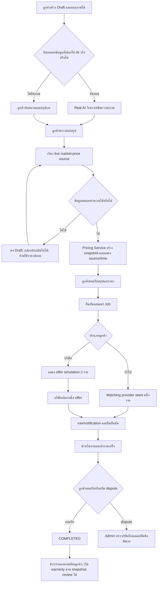

# Fixtech Software Requirements Specification (SRS) v1.8 — Expanded Demo

> **เอกสารฉบับใช้งาน:** ใช้ขอบเขต Demo v1.8 ใน §§1.4 และ 13 เป็นเกณฑ์ปัจจุบัน. ข้อความที่ระบุ `baseline v1.7` ใน §§2–12 เป็นประวัติหรือข้อกำหนดผลิตภัณฑ์เป้าหมาย ไม่ใช่ acceptance ของ Demo. Decision record §13.7 (v1.8.4) เป็นคำตัดสินล่าสุดและแทนข้อกำหนด external AI/live-market API ที่ขัดกันใน §13.1–13.6. Demo ใช้ผู้ให้บริการ seed และข้อมูลสังเคราะห์ ไม่ใช่ตลาดซ่อมจริง.

ข้อกำหนด FR/BR/NFR ใน §§4–6 เป็น catalog ของผลิตภัณฑ์เป้าหมาย; ให้ถือเป็น Demo Must เฉพาะรายการที่ §13.2 เรียกใช้ หรือข้อกำหนดความปลอดภัย/ความถูกต้องที่ §1.4/§13 ระบุชัด. ค่า `M/S/C` ใน catalog ไม่ได้ทำให้ทุกข้อเป็นขอบเขต Demo โดยอัตโนมัติ.

**เอกสาร:** ข้อกำหนดซอฟต์แวร์ Fixtech ฉบับ 1.8  
**สถานะ:** Expanded Demo v1.8 (ข้อกำหนดเป้าหมายสำหรับงานรายวิชา; ไม่ใช่ production)  
**ขอบเขต:** MVP ส่งงานสำหรับทีม 3 คน ภายในเวลารายวิชา  
**ผลิตภัณฑ์:** เว็บแพลตฟอร์มจับคู่ลูกค้ากับช่างซ่อมคอมพิวเตอร์และอุปกรณ์อิเล็กทรอนิกส์  

> ขอบเขตปัจจุบันคือ Fixtech Demo v1.8 ซึ่งปรับมาจาก workspace FixTech v4 โดยเปลี่ยน workflow, roles, schema และเอกสารให้ตรงกับ marketplace ใน SRS นี้. schema/การทดสอบ v4 เดิมเก็บใน `archive/fixtech-v4/` เพื่ออ้างอิงเท่านั้น; ห้ามนำข้อมูลหรือ workflow v4 มาใช้กับ Demo โดยอัตโนมัติ. การติดตั้ง Demo เป็น fresh schema และไม่มีการ migrate ข้อมูล v4.

## 1. วัตถุประสงค์และขอบเขต

Fixtech เป็นเว็บแพลตฟอร์มสำหรับแจ้งและบริหารบริการแก้ไขปัญหาคอมพิวเตอร์และอุปกรณ์อิเล็กทรอนิกส์ด้าน Hardware และ Software ในทุกเขตของกรุงเทพมหานคร ระบบช่วยรวบรวมข้อมูล วิเคราะห์อาการเบื้องต้น ประเมินราคา สร้างโพสต์งาน และจับคู่ลูกค้ากับช่างหรือทีมช่าง พร้อมติดตามงานจนเสร็จ

เอกสารนี้กำหนดพฤติกรรมที่ระบบต้องมี ข้อจำกัดทางธุรกิจ และคุณภาพขั้นต่ำสำหรับ MVP โดยแยกความสามารถที่ต้องทำในรุ่นแรกออกจากแนวทางพัฒนาภายหลัง ข้อกำหนดแต่ละข้อมีรหัสเพื่อเชื่อมไปยัง Use Case, API, แบบจำลองข้อมูล และกรณีทดสอบในขั้นตอนถัดไป

### 1.1 เป้าหมาย

- ให้ลูกค้าแจ้งปัญหาได้โดยไม่ต้องรู้ศัพท์เทคนิคทั้งหมด
- ช่วยประเมินรายละเอียดและค่าใช้จ่ายก่อนยืนยันจ้างบริการ
- แนะนำหรือจับคู่ช่างตามทักษะ พื้นที่ ความพร้อม และความน่าเชื่อถือ
- ทำให้สถานะงาน ราคา การสื่อสาร และหลักฐานตรวจสอบย้อนหลังได้
- ออกแบบระบบให้เพิ่มพื้นที่ บริการ และผู้ให้บริการภายนอกได้ภายหลัง

### 1.2 ผู้ใช้และผู้มีส่วนเกี่ยวข้อง

| รหัส | ผู้ใช้ | เป้าหมายหลัก |
|---|---|---|
| ACT-01 | ลูกค้าทั่วไป | แจ้งปัญหา รับราคาประเมิน และได้ช่างที่เหมาะสม |
| ACT-02 | ผู้ใช้บริษัท | แจ้งงานองค์กร รับช่วงราคาคร่าว ๆ และเลือกข้อเสนอจากช่าง/ทีม |
| ACT-03 | ช่างบุคคล | จัดการทักษะ พื้นที่ ความพร้อม และดำเนินงานที่ได้รับ |
| ACT-04 | เจ้าของ/ผู้แทนทีมช่าง | ดูแลโปรไฟล์ทีมและส่งข้อเสนอในนามทีม |
| ACT-05 | Admin | ตรวจสอบบัญชีช่าง งาน ราคา ข้อพิพาท และกิจกรรมระบบ |
| ACT-06 | AI provider | วิเคราะห์และสรุปข้อมูลตามสัญญาข้อมูลที่ระบบกำหนด |
| ACT-07 | Notification provider | ผู้เกี่ยวข้องในผลิตภัณฑ์เต็ม; ไม่อยู่ใน MVP v1.7 |

ข้อกำหนดเรื่องบัญชีบริษัท/ทีมในผลิตภัณฑ์เต็มคือหนึ่งผู้ใช้หลักต่อบัญชี; MVP v1.7 ใช้บัญชี seed ตามหัวข้อ 1.4 และไม่ทำระบบสมาชิกบริษัทหรือทีมหลายคน. ผู้มีบทบาทหลายแบบใช้บัญชี seed แยกสำหรับเดโม.

### 1.3 ขอบเขตระบบและข้อจำกัดความเป็นไปได้

ผู้ใช้และทีม Fixtech เป็นผู้ดำเนินงานในระบบนี้; Fixtech ไม่ดำเนินการซ่อมเอง ผู้ให้บริการรับผิดชอบขอบเขตและการทำงานที่เสนอ ส่วน Admin ดูแล workflow และข้อมูลสาธิต. Demo v1.8 เป็น course prototype สอง workflow ไม่ใช่บริการ production. ขอบเขตปัจจุบันสรุปใน §1.4 และลงรายละเอียด/เกณฑ์ยอมรับใน §13; ข้อความ v1.7 ที่ยังปรากฏในส่วนอื่นเป็น baseline เชิงประวัติเมื่อขัดกับสองหัวข้อนี้. การชำระเงินยังจำลอง ไม่มีเงินจริง.

### 1.4 ขอบเขต MVP Demo v1.8 ที่ทีม 3 คนต้องทำให้เสร็จ

หัวข้อนี้และ §13 เป็นข้อกำหนดปัจจุบันสำหรับทีมและเป็นจุดเริ่ม trace ไปขั้น 2–4. รายละเอียด acceptance อยู่ใน §13.4. เนื้อหา baseline v1.7 ที่คงไว้ในเอกสารนี้เป็นประวัติเท่านั้นและไม่ใช้ตัดฟีเจอร์ที่เลือกใน v1.8.

> รายการ Must/นอกขอบเขต/ราคา/flow ด้านล่างบันทึก baseline v1.7 ก่อนขยาย ใช้อ้างอิงประวัติเท่านั้น; Demo ปัจจุบันให้ยึด §13 และเอกสารขั้น 2–4 ฉบับ expanded v1.8.

**ขอบเขต Demo ปัจจุบัน:** เว็บภาษาไทยและบัญชี seed 4 role; คง workflow Software/ONLINE และ Hardware/ONSITE, 3 เขตตัวอย่าง, provider seed, B2C จับคู่อัตโนมัติ และ B2B เลือก offer จำลอง 2 ราย. เพิ่มอัปโหลดภาพ, AI ผ่าน Ollama local พร้อม consent, curated public price references แบบไม่ live และ pricing service, แชต/in-app notifications, นัดหมาย, payment simulation หลังงานเสร็จ, warranty, review และ dispute ตาม §13.2–13.4.

การเริ่มพัฒนาฐานข้อมูล, UI, workflow หลัก, adapter interfaces, test doubles และ automated tests ไม่ต้องรอเลือกผู้ให้บริการภายนอก. ก่อนเปิดการเรียก AI/market API จริง ต้องเลือก provider/source ที่มีสิทธิ์ใช้งาน, ตรวจค่าใช้จ่ายและเงื่อนไขข้อมูล, ตั้ง secret และทดสอบ schema/timeout/ความสด/price mapping; จนกว่าจะผ่าน ให้ปิด integration จริงและห้ามแสดงผลจำลองเป็นผลจริง. ไฟล์ Demo ใช้ private storage และข้อมูลสังเคราะห์; ลบไฟล์ทดสอบจาก active storage ภายใน 30 วันหลังประเมินตาม NFR-016. ไม่รวมเงินจริง/payment gateway, SMS/email, วิดีโอ, logistics, ทีมหลายสมาชิก และ production deployment.

**ข้อกำหนด Must ด้านล่างเป็น baseline v1.7 ที่เลิกใช้แล้ว; ห้ามใช้กับ Demo v1.8.**

1. **บัญชีและสิทธิ์:** บัญชี seed ของลูกค้าทั่วไปอย่างน้อย 2 บัญชี, ลูกค้าบริษัท 1 บัญชี, ช่าง และ Admin; เข้าระบบ/ออกจากระบบ; ตรวจ role และเจ้าของข้อมูลฝั่ง server. ไม่มีสมัครสมาชิกสาธารณะ, ยืนยันอีเมล หรือกู้รหัสผ่าน. ข้อมูลล็อกอินสำหรับ dev แสดงใน README เท่านั้น.
2. **ข้อมูลงาน:** Software “โปรแกรม Windows เปิดไม่ได้” ให้บริการออนไลน์ ราคา 250 บาท; Hardware “ตรวจอาการคอมพิวเตอร์” ให้บริการ onsite ราคา 400 บาท. ฟอร์มทั่วไปเก็บอาการและเขตตัวอย่าง; ฟอร์มบริษัทเพิ่มยี่ห้อ/รุ่นและช่วงเวลาสะดวก. ใช้เขตตัวอย่าง 2–3 เขตที่ระบุใน seed; ไม่ต้องทำที่อยู่จริง แผนที่ หรือข้อมูลครบ 50 เขต.
3. **AI demo:** deterministic mock ผ่าน adapter จัดหมวดและสร้างสรุปจาก input/fixture; ติดป้าย “ผลจำลองเพื่อสาธิต”; ลูกค้าแก้และยืนยันสรุปได้. ไม่มีการเชื่อม AI ภายนอกหรือวิเคราะห์ภาพ.
4. **ราคา demo:** B2C ใช้ราคาแน่นอน 250/400 บาทตาม workflow ข้างต้น; B2B แสดงช่วง 250–500 บาทสำหรับ Software และ 400–800 บาทสำหรับ Hardware. เป็น fixture แสดงป้าย “ราคาเพื่อสาธิต”; ไม่บวกค่าอื่น ไม่คำนวณ real-time และ AI ไม่มีสิทธิ์สร้างราคา.
5. **Matching/ข้อเสนอ:** seed ช่างตัวอย่างอย่างน้อย 2 รายต่อ workflow พร้อมหมวดงาน รูปแบบบริการ เขต และ priority; ผู้ให้บริการ seed ถือว่าผ่านอนุมัติและพร้อมรับงาน. ใช้เขตตัวอย่าง บางนา, ปทุมวัน และจตุจักร; filter ตามหมวด/รูปแบบ/เขต แล้วเรียง `priority` จากน้อยไปมากและใช้ provider ID จากน้อยไปมากเป็น tie-break. B2C เลือกหนึ่งราย; B2B แสดงข้อเสนอจำลอง 2 รายและเลือกได้หนึ่งราย: Software 350/450 บาท, Hardware 550/700 บาท. หากไม่มีช่างที่เข้าเงื่อนไข ให้แสดง “ยังไม่มีช่างสำหรับเงื่อนไขนี้” และไม่สร้างการจับคู่. Admin ในเดโมดูรายการงานได้อย่างเดียว ไม่อนุมัติช่างหรือแก้ราคา.
6. **วงจร Job:** Draft → READY_TO_PUBLISH → POSTED; B2C ไป MATCHED โดยอัตโนมัติ, B2B ไป WAITING_FOR_SELECTION แล้ว ASSIGNED หลังเลือกข้อเสนอ; ทั้งคู่ไป IN_PROGRESS เมื่อช่างเริ่ม, WAITING_FOR_CUSTOMER_CONFIRMATION เมื่อช่างส่งเสร็จ, และ COMPLETED เมื่อลูกค้ายืนยัน. ยกเลิกได้เฉพาะก่อนเริ่มงานในเดโม.
7. **หน้าจอและข้อมูล:** responsive พื้นฐาน ภาษาไทย; ลูกค้าเห็นเฉพาะงานของตน ช่างเห็นเฉพาะงานที่จับคู่/เลือกให้ Admin ดูรายการงานสาธิตได้. ใช้ข้อมูลสังเคราะห์และบันทึกใน PostgreSQL; มี seed/reset เพื่อเริ่มสาธิตใหม่โดยไม่แก้ข้อมูลด้วยมือ.
8. **การตรวจ:** automated tests ขั้นต่ำครอบคลุม price fixtures, matching มี/ไม่มีผู้สมัคร, การเลือกข้อเสนอได้หนึ่งราย, transitions วงจรงาน และ authorization ข้ามเจ้าของ/role.

**นอกขอบเขต baseline v1.7 เท่านั้น (ห้ามใช้ตัดขอบเขต Demo v1.8):** public signup/email verification, การตรวจเอกสารช่าง, ทีมช่างหลายสมาชิก, อัปโหลดภาพ/วิดีโอ, AI provider ภายนอก, ราคา/ตลาด real-time หรือ Admin price management, ค่าคอมมิชชัน/ภาษี/การรับเงิน, chat/notification, นัดหมายและปฏิทิน, matching แบบ invitation/deadline/หลายรอบ, 50 เขต/adjacency จริง, warranty, รีวิว, dispute, logistics, backup/restore เชิงปฏิบัติการ, load benchmark, monitoring production และ deployment บริการจริง. สำหรับ Demo v1.8 ให้ยึด scope/acceptance ใน §13.

**เงื่อนไขที่ไม่ลดทอน:** password hashing สำหรับบัญชี seed, authorization ฝั่ง server, validation ของ input, parameterized queries/ORM, ข้อจำกัด FK/UNIQUE ที่จำเป็น, และไม่ใช้ข้อมูลส่วนบุคคลจริง. “นอกขอบเขต” ไม่ได้หมายถึงละเว้นความปลอดภัยพื้นฐาน.

**หมายเหตุประวัติ:** นิยามผ่านเดิมเป็นของ baseline v1.7 เท่านั้น. Demo v1.8 ใช้เกณฑ์ acceptance ใน §13.4 และ integration gates ใน §13.3; AI/market API จริงต้องมี provider และ credential ที่ได้รับอนุญาตก่อนเปิดใช้.

## 2. สมมติฐานและคำศัพท์

- **โพสต์งาน / งาน (Job):** คำขอบริการที่ลูกค้ายืนยันและเผยแพร่เพื่อให้ระบบจับคู่ช่าง
- **ราคาประเมิน:** ราคาที่คำนวณจากข้อมูลที่มี อาจเปลี่ยนได้เมื่อช่างตรวจอุปกรณ์หรือพบข้อมูลเพิ่ม
- **ข้อเสนอราคา:** ขอบเขตงานและราคาที่ช่าง/ทีมส่งให้ลูกค้าบริษัทพิจารณา; ใน MVP ใช้ offer fixture
- **ฐานราคาภายใน:** แนวทางผลิตภัณฑ์เต็ม; MVP v1.7 ใช้ราคา fixture คงที่ตามหัวข้อ 1.4
- **Real-time pricing:** ข้อมูลราคาตลาด/ค่าครองชีพภายนอกแบบสดอยู่นอก MVP และไม่ถูกจำลองเป็นข้อมูลตลาดจริง
- **AI ใน MVP demo:** mock แบบ deterministic ที่เลียนแบบผลจัดหมวด/สรุป; ไม่เชื่อมบริการภายนอกและไม่มีอำนาจกำหนดราคา
- **พื้นที่:** เขต/โซนในกรุงเทพมหานครสำหรับค้นหาและจับคู่; ที่อยู่จริงถือเป็นข้อมูลส่วนตัว
- **เวลาระบบ:** เก็บเวลาเป็น UTC และแสดงผลตาม Asia/Bangkok
- **ค่า prototype:** น้ำหนักคะแนนและ timeout ที่กำหนดเป็น configuration เริ่มต้นเพื่อให้พัฒนาทดสอบได้ ไม่ใช่ราคา/SLA ที่รับรองเชิงพาณิชย์

## 3. ขอบเขตผลิตภัณฑ์

### 3.1 บริการที่ระบบรองรับ

ระบบรองรับหมวด Hardware และ Software โดย MVP ส่งงานต้องสาธิตอย่างน้อยสอง workflow: (1) Software บนคอมพิวเตอร์/Windows เช่น โปรแกรมเปิดไม่ได้ และ (2) Hardware บนคอมพิวเตอร์/โน้ตบุ๊ก เช่น ตรวจอาการเบื้องต้น โดยใช้บริการออนไลน์หรือหน้างานอย่างน้อยหนึ่งรูปแบบ รายการอื่น เช่น ไดรเวอร์ เครือข่าย เกม/Mod และตรวจ/อัปเกรดเป็นข้อมูล catalog เพิ่มได้ ไม่จำเป็นต้องมี workflow แยกใน MVP; การสำรอง/กู้คืนข้อมูลและการกำจัดมัลแวร์เป็น Future Scope

ระบบไม่รับงานละเมิดลิขสิทธิ์ โปรแกรมโกง มัลแวร์ การเข้าถึงบัญชีโดยไม่ได้รับอนุญาต หรือกิจกรรมผิดกฎหมาย การรองรับรายการงานไม่ใช่การรับประกันว่าช่างจะแก้ทุกปัญหาได้

### 3.2 รูปแบบบริการ

ผลิตภัณฑ์เป้าหมายรองรับสามรูปแบบต่อไปนี้; MVP v1.7 สาธิตเฉพาะ Software แบบออนไลน์และ Hardware แบบ onsite ตามหัวข้อ 1.4. รับเข้าศูนย์เป็น backlog.

- ช่างเดินทางไปบ้านหรือสำนักงาน
- ให้คำปรึกษาหรือแก้ปัญหาออนไลน์
- รับอุปกรณ์ไปซ่อมที่ศูนย์

การรับเข้าศูนย์และการบันทึกสถานะรับ/ส่งอุปกรณ์ไม่อยู่ใน MVP v1.7.

### 3.3 นอกขอบเขตผลิตภัณฑ์เต็มและ baseline v1.7

รายการในหัวข้อนี้ไม่ใช้ยกเว้นฟีเจอร์ที่เลือกเข้า Demo v1.8 ใน §1.4/§13; รายการที่ยังไม่อยู่ใน Demo ให้ยึด §13.6.

- แอปมือถือและพื้นที่นอกกรุงเทพมหานคร
- Payment Gateway และการรับ/จ่ายเงินจริง
- SMS, โทรศัพท์ และวิดีโอคอลที่พัฒนาเอง
- วิเคราะห์วิดีโอด้วย AI; วิดีโอเป็นหลักฐานให้ช่างดู
- เชื่อมราคาตลาดภายนอกแบบ Real-time
- Machine Learning สำหรับราคา/การจับคู่
- ระบบขนส่งอุปกรณ์จริง, ติดตามตำแหน่งสด, การแบ่งรายได้ทีม และการมอบหมายงานภายในทีม
- การจัดการองค์กรหลายระดับและการอนุมัติงานหลายชั้น
- การวิเคราะห์ภาพด้วย AI, การแนบภาพ/วิดีโอ, แชต, warranty, รีวิว และ dispute เป็น backlog ของผลิตภัณฑ์เต็ม; ไม่รวมใน MVP v1.7 และไม่ใช้เป็นเกณฑ์ผ่าน

## 4. Functional Requirements

รายการ requirement ทุกตารางด้านล่างระบุ ID และ priority; ค่าเริ่มต้นตัวเลขในเอกสารเป็น fixture สำหรับ demo ไม่ใช่ราคา/คำมั่นเชิงพาณิชย์; พฤติกรรมที่ไม่ได้ระบุให้ถือว่าไม่อยู่ใน MVP และห้ามสร้างผลกระทบทางการเงิน/สิทธิ์โดยอนุมาน

ลำดับ M/S/C ในตาราง FR เป็นลำดับของผลิตภัณฑ์เป้าหมายเดิมเท่านั้น. สำหรับการส่งงาน v1.7 ให้ใช้เฉพาะบัญชี Must ที่ระบุเป็นข้อ 1–8 ในหัวข้อ 1.4 และ acceptance หัวข้อ 8; FR/NFR/BR อื่นเป็น backlog เว้นแต่ถูกเรียกชื่อไว้ในบัญชีนี้. ในขั้น 2 ให้ทำ traceability ว่าแต่ละ Must เชื่อมกับ Use Case, entity/API และ test ใด; ห้ามเติมข้อกำหนดจาก backlog เข้า MVP เอง.

### 4.1 บัญชีและสิทธิ์

| ID | ระดับ | ข้อกำหนด |
|---|---|---|
| FR-001 | M | ระบบต้องรองรับลูกค้าทั่วไปและลูกค้าบริษัทในกลุ่มบัญชีลูกค้า, ช่างบุคคล/เจ้าของทีมในกลุ่มผู้ให้บริการ และ Admin; สมัครสาธารณะได้เฉพาะลูกค้าและผู้ให้บริการ โดยลูกค้าเลือกชนิดทั่วไป/บริษัท; Admin สร้างผ่าน bootstrap ที่จำกัดสิทธิ์ |
| FR-002 | M | ระบบต้องให้ผู้ใช้สมัคร เข้าสู่ระบบ ออกจากระบบ และแก้ไขข้อมูลพื้นฐานได้ |
| FR-003 | M | ระบบต้องตรวจอีเมลซ้ำ และเก็บรหัสผ่านด้วย password hashing ที่เหมาะสม ห้ามเก็บข้อความธรรมดา |
| FR-004 | M | Backend ต้องตรวจสิทธิ์ทุกคำขอ และปฏิเสธการเข้าถึงข้อมูลที่ผู้ใช้ไม่มีสิทธิ์ |
| FR-005 | M | ผู้ใช้ต้องดู/แก้ไขเฉพาะโปรไฟล์และข้อมูลที่ตนมีสิทธิ์ดู |
| FR-006 | M | ระบบต้องยืนยันอีเมลก่อนผู้ใช้สร้าง/รับงาน; ต้องรองรับการออกจากระบบและหมดอายุ session; หากใช้บริการภายนอกสำหรับยืนยัน/รีเซ็ตรหัสผ่านต้องมี adapter/mock ใน dev/test และไม่เปิดเผยสถานะบัญชีเกินจำเป็น |
| FR-007 | M | Admin ต้องระงับ/เปิดบัญชีได้ พร้อมบันทึกเหตุผลและผู้ดำเนินการ |

### 4.2 โปรไฟล์ลูกค้า บริษัท และผู้ให้บริการ

| ID | ระดับ | ข้อกำหนด |
|---|---|---|
| FR-010 | M | โปรไฟล์ลูกค้าต้องเก็บชื่อที่แสดงและอีเมลที่ยืนยันแล้ว; เบอร์โทรเป็นทางเลือกใน prototype และหากใช้ติดต่อนัดหมายต้องยืนยันก่อนแสดงให้คู่กรณี; เก็บข้อมูลพื้นที่เท่าที่จำเป็น; dev/demo ใช้ mail adapter/mock ได้ |
| FR-011 | M | โปรไฟล์บริษัทต้องเก็บชื่อบริษัท ผู้ติดต่อ และข้อมูลที่จำเป็นต่อการออกแบบงาน; ข้อมูลภาษีใช้เฉพาะเมื่อขอบเขตการเงินกำหนด |
| FR-012 | M | โปรไฟล์ช่างต้องระบุความเชี่ยวชาญพร้อมระดับทักษะ ประเภทอุปกรณ์/ปัญหาที่รับ พื้นที่ รูปแบบบริการ ราคาเริ่มต้น และประสบการณ์ |
| FR-013 | M | ช่างต้องส่งเอกสารยืนยันตัวตนจำลอง/ปกปิดข้อมูลใน demo; เฉพาะ Admin ที่มีสิทธิ์ตรวจเห็นไฟล์; บันทึกผล/เหตุผลการอนุมัติ และรับงานได้เมื่ออนุมัติแล้วเท่านั้น |
| FR-014 | M | ช่างต้องกำหนดความพร้อมรับงาน และระบบต้องไม่นำบัญชีไม่พร้อม/ถูกระงับไปจับคู่ |
| FR-015 | M | ระบบรองรับทีมเป็น provider profile หนึ่งรายการ เจ้าของเป็นผู้ใช้/ผู้รับผิดชอบเพียงคนเดียว; ไม่มีสมาชิก assignment หรือแบ่งรายได้ใน MVP ส่งงาน |
| FR-016 | M | ระบบต้องมีข้อมูลตั้งต้นครบทุกเขตของกรุงเทพฯ และความสัมพันธ์เขตติดกันสำหรับ matching; จัดเก็บเป็น lookup data ที่แก้ไขได้ ไม่ฝังรายชื่อเขตไว้ในตรรกะโปรแกรม |
| FR-017 | M | ระบบต้องแยกข้อมูลที่แสดงสาธารณะออกจากอีเมล เบอร์โทร และที่อยู่เต็ม |

### 4.3 การแจ้งปัญหาและไฟล์

| ID | ระดับ | ข้อกำหนด |
|---|---|---|
| FR-020 | M | ลูกค้าต้องเริ่ม Draft ระบุประเภทอุปกรณ์ หมวดปัญหา อาการ และรูปแบบบริการได้ |
| FR-021 | M | ลูกค้าต้องให้รายละเอียดด้วยข้อความ และแนบรูปภาพประกอบได้; ภาพเป็นข้อมูลส่วนตัวของ Draft/Job และให้เห็นเฉพาะเจ้าของ, Admin ที่ได้รับอนุญาต และผู้ให้บริการที่ได้รับเชิญ/ถูกเลือกตามข้อมูลขั้นต่ำที่จำเป็น; ถอนสิทธิ์ผู้ให้บริการที่ไม่ถูกเลือกเมื่อปิดรอบเลือก |
| FR-022 | C | ลูกค้าแนบวิดีโอเป็นหลักฐานให้ช่างตรวจได้; ไม่วิเคราะห์วิดีโอใน MVP ส่งงาน; MVP แนบได้เฉพาะภาพตาม FR-023 |
| FR-023 | M | ระบบรับ JPEG, PNG, WebP สูงสุด 10 MiB ต่อภาพและไม่เกิน 3 ภาพรวมต่อ Draft/Job (ย้ายไฟล์ Draft ไป Job โดยไม่เพิ่มโควตา); ตรวจ MIME/signature, ขนาดจริง และสิทธิ์ก่อนจัดเก็บ; ปฏิเสธไฟล์ที่ไม่ผ่านและแจ้งสาเหตุ; หากเปิด video upload ในรุ่นถัดไปจึงใช้เพดาน MP4/WebM 50 MiB |
| FR-024 | M | ไฟล์ต้องเก็บใน private object storage หรือพื้นที่ที่ไม่เปิดสาธารณะ; ฐานข้อมูลเก็บ metadata/object key; ลิงก์ดาวน์โหลดต้องตรวจสิทธิ์ทุกครั้งหรือมีอายุสั้น |
| FR-025 | M | ลูกค้าทั่วไประบุเขต/ช่วงเวลาสะดวก/ความเร่งด่วนได้; ที่อยู่เต็มเก็บแยกและไม่แสดงก่อนจำเป็น |
| FR-026 | M | ลูกค้าบริษัทต้องระบุยี่ห้อ รุ่น อายุ/จำนวนอุปกรณ์ สถานที่ รูปแบบบริการ เวลา ข้อจำกัดและประวัติที่ทราบ |
| FR-027 | M | ลูกค้าต้องบันทึก แก้ไข และกลับมาเปิด Draft ได้ก่อนยืนยันเผยแพร่; Draft ที่ยังไม่เผยแพร่ไม่ถูกแสดงต่อผู้ให้บริการหรือผู้ใช้อื่น |
| FR-028 | M | ก่อนเรียก AI ภายนอก ระบบต้องแจ้งประเภทข้อมูลที่จะส่งและวัตถุประสงค์ แยกข้อมูลติดต่อ/ที่อยู่เต็มและไฟล์ที่ไม่จำเป็นออก บันทึกการยินยอมต่อการวิเคราะห์แต่ละครั้งตาม Draft; หากไม่ยินยอมหรือถอนยินยอมให้ไม่ส่งข้อมูลและใช้ manual flow ได้ |
| FR-029 | M | เก็บบทสนทนา AI ได้ไม่เกิน 20 รอบต่อ Draft; คำถาม/คำตอบเชื่อมกับ Draft และเก็บเฉพาะข้อมูลจำเป็น; ต้องมี consent ก่อนส่งอาการ/ไฟล์ที่ผู้ใช้เลือก; เมื่อถึงเพดาน API ปฏิเสธรอบถัดไปและไม่บันทึกเกินกำหนด |

### 4.4 AI วิเคราะห์และสรุป

| ID | ระดับ | ข้อกำหนด |
|---|---|---|
| FR-030 | M | Runtime ของ Demo ต้องเรียก provider จริงตาม §13.2 และตรวจผลตาม schema; automated tests ใช้ deterministic test double ได้แต่ไม่ถือว่าผ่านการเชื่อมต่อจริง; หากข้อมูลไม่พอให้ส่งกลับสถานะไม่เพียงพอแทนการฝืนเลือกหมวด |
| FR-031 | M | AI ต้องสรุปอาการและข้อมูลที่ขาด โดยแยกข้อมูลที่ลูกค้าให้จากข้อสันนิษฐานของ AI |
| FR-032 | M | AI ต้องให้ระดับความเพียงพอเชิงคุณภาพและคำแนะนำเบื้องต้นที่ปลอดภัย; ไม่วินิจฉัยรับประกัน ไม่ให้ตัวเลข confidence ที่ไม่ได้สอบเทียบ และไม่กำหนด urgency แทนลูกค้าโดยไม่มีการยืนยัน |
| FR-033 | M | Backend ต้องตรวจโครงสร้างผลลัพธ์ AI ตาม schema ก่อนใช้หรือบันทึก |
| FR-034 | M | AI ห้ามกำหนดตัวเลขราคาโดยอิสระ; ผล AI เป็นข้อมูลนำเข้าให้ Pricing Service |
| FR-035 | M | ลูกค้าต้องตรวจ แก้ และยืนยันสรุปก่อนสร้างโพสต์ |
| FR-036 | M | เมื่อ AI ล้มเหลวหรือสรุปไม่ครบ ให้เก็บ Draft และลูกค้าแก้ข้อมูลเองได้; หากข้อมูล/ราคายังไม่พอ ลูกค้าเลือกส่ง Admin review ได้ โดยยังไม่สร้าง Job; Admin ขอข้อมูลเพิ่มหรือเลือก mapping ที่มีอยู่ (ห้ามสร้างอัตราราคาใหม่เฉพาะงานโดยไม่มี config/audit) แล้วส่งกลับให้ลูกค้ายืนยันก่อนเผยแพร่ |
| FR-037 | M | ระบบต้องบันทึกเวลาวิเคราะห์ รุ่น/provider ที่ใช้ สถานะ และผลลัพธ์ที่จำเป็น โดยไม่บันทึก secret |
| FR-038 | S | หากเปิด image analysis ระบบส่งเฉพาะภาพที่ผู้ใช้เลือกและแจ้งผลเมื่อไม่ได้วิเคราะห์; จำกัดไม่เกิน 3 ภาพต่อคำขอและ 10 MiB ต่อภาพ, resize ด้านยาวไม่เกิน 2048 px ก่อนส่ง และลบ metadata ที่ไม่จำเป็น; วิดีโอไม่ส่งให้ AI |

### 4.5 การประเมินราคา

| ID | ระดับ | ข้อกำหนด |
|---|---|---|
| FR-040 | M | Pricing Service ต้องคำนวณราคาโดยใช้ฐานราคาภายในและสูตรที่กำหนด ไม่ให้โมเดล AI คิดยอดเอง |
| FR-041 | M | ปัจจัยราคาต้องระบุเป็นรายการข้อมูลได้: ค่าแรงฐานที่รวมต้นทุน/กำไรช่าง, ตัวคูณความซับซ้อน, ดัชนีต้นทุนพื้นที่และค่าเดินทาง, ตัวคูณความเร่งด่วน, ค่าอะไหล่/ซอฟต์แวร์ที่ทราบ และค่าคอมมิชชันแพลตฟอร์ม; ปัจจัยที่ไม่ทราบต้องแสดงเป็นประมาณการหรือไม่รวม ห้ามแทนด้วยเลขที่ AI แต่งขึ้น |
| FR-042 | M | Admin ที่ได้รับสิทธิ์ต้องจัดการรายการฐานราคา/ตัวคูณ พร้อม effective date และประวัติการแก้ไขได้ |
| FR-043 | M | ราคาที่บันทึกกับงานต้องเป็น snapshot ของสูตร/อัตราที่ใช้ ณ เวลาคำนวณ และห้ามเปลี่ยนย้อนหลังเมื่อแก้ฐานราคา |
| FR-044 | M | ระบบต้องแสดงองค์ประกอบราคาและชนิดราคา: ราคาคำนวณ, ช่วงประเมิน หรือข้อเสนอที่ยืนยันแล้ว |
| FR-045 | M | ลูกค้าทั่วไปเห็นราคาก่อนสร้างโพสต์; ราคาคำนวณได้เฉพาะ category + service format ที่มีค่าแรงและรายการค่าใช้จ่ายใน catalog; งานขอบเขตชัดแสดงราคาเดียว ส่วนงานไม่ชัดแสดงช่วงจากค่าต่ำ/สูง; หากไม่มี mapping หรืออะไหล่จำเป็นไม่มีราคาที่เชื่อถือได้ ให้แสดง “ต้องตรวจเพิ่ม” ไม่ยืมราคา category อื่นและไม่รวมอะไหล่เป็นศูนย์ |
| FR-046 | M | ลูกค้าบริษัทเห็นช่วงราคาคร่าว ๆ ก่อนโพสต์เมื่อมี demo price mapping; หากข้อมูลยังไม่พอให้แสดง “ประเมินไม่ได้/ต้องตรวจเพิ่ม” และเก็บ Draft โดยไม่เผยแพร่ จนกว่าจะมี price mapping/ข้อมูลที่จำเป็น; ต้องได้รับข้อเสนอสุดท้ายจากช่าง/ทีมก่อนอนุมัติ |
| FR-047 | M | หากช่างพบขอบเขต/ค่าใช้จ่ายเพิ่ม ต้องส่งคำขอเปลี่ยนราคาและรอลูกค้ายืนยันก่อนดำเนินส่วนที่เพิ่ม; หากลูกค้าปฏิเสธ ให้ช่างเลือกทำเฉพาะขอบเขตเดิมภายในราคาที่ตกลงหรือขอยกเลิกผ่าน Admin พร้อมบันทึกเหตุผล |
| FR-048 | M | หากข้อมูลราคาไม่พอ ระบบต้องแสดง “ประเมินไม่ได้/ต้องตรวจเพิ่ม” แทนการสร้างตัวเลขที่ไม่มีฐานรองรับ; Draft คงอยู่และสร้าง Job ได้ต่อเมื่อมีราคาหรือช่วงราคาที่คำนวณจากรายการที่เปิดใช้จริงและลูกค้ายืนยันแล้ว |
| FR-049 | M | แนวทางผลิตภัณฑ์เต็มใช้ฐานราคาภายในที่ Admin ปรับได้; การปรับฐานราคาไม่อยู่ใน MVP v1.7 ซึ่งใช้ fixture คงที่ตามหัวข้อ 1.4 |
| FR-049A | M | งานทั่วไปที่มีราคาคงที่ให้ช่างยืนยันยอดก่อนนัด; งานที่เป็นช่วงราคาให้ช่างยืนยันยอดจริงภายในช่วง หรือส่งยอดใหม่ให้ลูกค้าอนุมัติ; งานบริษัทใช้ข้อเสนอที่ลูกค้าอนุมัติเป็นราคาตกลง |
| FR-049B | M | งานเริ่มได้เมื่อ `price_status=AGREED`; การเปลี่ยนราคา/ขอบเขตภายหลังต้องกลับไปรออนุมัติก่อนทำส่วนเพิ่ม |
| FR-049C | M | ราคาที่ยืนยันแล้วต้องมีสถานะและประวัติแยก; ราคานอกช่วงประเมินต้องได้รับการยอมรับใหม่ก่อนนัดยืนยันหรือเริ่มงาน |

สูตรด้านล่างเป็นแนวทางผลิตภัณฑ์เต็ม/backlog เท่านั้น; MVP v1.7 ใช้ fixture คงที่ในหัวข้อ 1.4 และ 10 ไม่ใช้สูตรนี้คำนวณราคา:

```text
ยอดบริการต่ำ/สูง = ค่าแรงฐาน × ดัชนีต้นทุนพื้นที่ × ตัวคูณความซับซ้อนต่ำ/สูง × ตัวคูณความเร่งด่วน
                  + ค่าเดินทาง/พื้นที่
                  + ค่าอะไหล่หรือซอฟต์แวร์ที่ทราบ
ค่าคอมมิชชันต่ำ/สูง = ยอดบริการต่ำ/สูง × อัตราคอมมิชชันในฐานราคา
ยอดลูกค้าต่ำ/สูง = ยอดบริการต่ำ/สูง + ค่าคอมมิชชันต่ำ/สูง
```

สูตรฐานราคา, การปรับโดย Admin, ตัวคูณ และค่าคอมมิชชันในย่อหน้านี้เป็น backlog; ห้ามใช้แทนราคา fixture คงที่ใน MVP v1.7

fixture สำหรับผลิตภัณฑ์เต็มด้านล่างไม่เป็นเกณฑ์ MVP v1.7; fixture ที่ใช้จริงในเดโมกำหนดไว้เฉพาะในหัวข้อ 1.4 และ 10 เท่านั้น

### 4.6 สร้างโพสต์และจับคู่

| ID | ระดับ | ข้อกำหนด |
|---|---|---|
| FR-050 | M | ระบบสร้าง Job หลังลูกค้ายืนยันสรุปที่มาจาก AI หรือ manual flow และราคา/ช่วงราคา พร้อมเลขอ้างอิงไม่ซ้ำ |
| FR-051 | M | Job ต้องผูกกับผู้แจ้ง รูปแบบบริการ พื้นที่ หมวดปัญหา สรุปปัญหาที่มาจาก AI หรือผู้ใช้ตาม flow, สถานะความยินยอม AI และ snapshot ราคา |
| FR-052 | M | ก่อนจัดอันดับ ระบบต้องกรองช่าง/ทีมที่ไม่ผ่านอนุมัติ ไม่พร้อม ไม่รับหมวด/พื้นที่/รูปแบบนั้น หรือถูกระงับ; ความสามารถของทีมใน MVP เป็นชุดทักษะที่เจ้าของทีมลงทะเบียนและรับผิดชอบเอง |
| FR-053 | M | ผลิตภัณฑ์เต็มจัดอันดับจากทักษะ พื้นที่ ความพร้อม และความน่าเชื่อถือ; MVP v1.7 ใช้กฎ eligibility/priority แบบง่ายตามหัวข้อ 1.4 |
| FR-054 | M | คะแนน 0–100 เป็นแนวทางผลิตภัณฑ์เต็ม; ไม่ใช้สูตรคะแนนนี้ใน MVP v1.7 |
| FR-055 | M | ผลิตภัณฑ์เต็มเชิญช่างทั่วไปทีละรายโดยมี timeout; MVP v1.7 เลือกผู้ให้บริการ seed ที่มี priority สูงสุดทันทีตามหัวข้อ 1.4 |
| FR-056 | M | ผลิตภัณฑ์เต็มเปิดรอบเชิญและรับข้อเสนอจากช่างหลายราย; MVP v1.7 แสดง offer fixture 2 รายและให้ลูกค้าเลือกหนึ่งราย ไม่มี deadline หรือ invitation rounds |
| FR-057 | M | งานทั่วไป: เมื่อไม่มีผู้สมัครที่ผ่านตัวกรองตั้งแต่เริ่ม หรือคำเชิญถูกปฏิเสธ/หมดเวลาจนครบ 3 ราย ให้ตั้ง/คงสถานะ `NO_PROVIDER_FOUND` เมื่อไม่มี invite active และแจ้งลูกค้าเลือกปรับเงื่อนไข/เริ่ม matching ใหม่/ยกเลิก; งานบริษัทเมื่อไม่มีผู้สมัครตั้งแต่เริ่ม ให้แจ้งลูกค้าปรับ criteria/ยกเลิกและคง `NO_PROVIDER_FOUND`; เมื่อรอบจบโดยไม่มี invite/offer active ให้ลูกค้าเลือกขยายรอบ/ปรับเงื่อนไข/ยกเลิกตาม FR-056; ห้ามเริ่มรอบใหม่หรือปิดเป็น `NO_PROVIDER_FOUND` ขณะมี invite/offer active |
| FR-058 | M | งานทั่วไปส่งให้ผู้สมัครทีละรายตามอันดับ สูงสุด 3 ราย; งานบริษัทส่งเป็นรอบตาม FR-056; ทุกการเชิญ/หมดเวลา/ปฏิเสธ/ตอบรับ/ข้อเสนอและการปิดต้องบันทึก; ผู้สมัครที่เคยเชิญใน Job เดิมจะไม่ถูกเชิญซ้ำ เว้นลูกค้าเปลี่ยน criteria หลังรอบเดิมปิดแล้วและระบบบันทึกเหตุผล/รอบใหม่ |
| FR-059 | M | งานทั่วไปต้องมีผู้ให้บริการหลักได้ไม่เกินหนึ่งราย แม้มีการตอบรับพร้อมกัน; งานบริษัทอาจมีข้อเสนอจากผู้ให้บริการหลายราย แต่มีผู้ชนะ/ผู้ให้บริการหลักได้หนึ่งรายหลังลูกค้าเลือก; ใช้ transaction/locking หรือกลไกเทียบเท่า |
| FR-060 | M | ระบบต้องป้องกันการสร้าง Job/การตอบรับซ้ำจากคำขอซ้ำ (idempotency หรือ constraint ที่เหมาะสม) |

**นิยามคะแนน Matching:** ทักษะตรง = จำนวนทักษะจำเป็นที่ผู้ให้บริการมีระดับเท่ากับ/สูงกว่าระดับขั้นต่ำ หารด้วยจำนวนทักษะจำเป็น แล้วคูณ 40; หากไม่มีทักษะจำเป็นที่ระบุ งานต้องกลับไปเติมข้อมูลแทนการจับคู่. พื้นที่ได้ 25 คะแนนเมื่ออยู่เขตเดียวกัน, 20 เมื่ออยู่เขตติดกันตาม lookup data, 10 เมื่ออยู่เขตอื่นในกรุงเทพฯ ที่ผู้ให้บริการรับงาน; นอกพื้นที่ที่รับงานถูกกรองออก. ความพร้อมได้ 20 เมื่อเปิดรับและไม่มีนัดซ้อน มิฉะนั้นถูกกรองออก. ความน่าเชื่อถือใช้ `(คะแนนเฉลี่ย 1-5 - 1) / 4 × 15`; ช่าง/ทีมที่ยังไม่มีรีวิวเริ่มที่ 7.5 คะแนน.

เรียงคะแนนมากไปน้อย; กรณีเสมอเรียงภาระงาน active น้อยไปมาก แล้วเวลารับงานล่าสุดเก่าก่อน (ผู้ให้บริการที่ยังไม่เคยรับงานมาก่อนมาก่อน) แล้วใช้รหัสผู้ให้บริการเรียงตามตัวอักษร/ตัวเลขเป็น tie-break สุดท้าย ระยะทางเป็นระดับเขต ไม่ใช่เวลาเดินทางจริง น้ำหนักและ timeout ปรับได้จาก configuration โดยการแก้ต้องมี audit log; ค่าเริ่มต้นไม่ใช่ SLA เชิงพาณิชย์

### 4.7 ข้อเสนอ นัดหมาย และการสื่อสาร

| ID | ระดับ | ข้อกำหนด |
|---|---|---|
| FR-061 | M | ข้อเสนอระบุผู้เสนอ ราคา ขอบเขต ระยะเวลา เงื่อนไข และวันหมดอายุได้; ต้องไม่เกิน deadline ของรอบเชิญ |
| FR-062 | M | ลูกค้าบริษัทต้องยืนยันหรือปฏิเสธข้อเสนอ; ต้องตรวจว่า Job/รอบยังเปิดและเวลายังไม่เกิน deadline ใน transaction เดียวกับการเลือก; ข้อเสนอที่ยืนยันแล้วแก้ไขไม่ได้ ให้สร้างฉบับใหม่แทน |
| FR-063 | M | ลูกค้าและช่างกำหนดช่วงนัดหมายเริ่ม/สิ้นสุดในเวลาท้องถิ่นกรุงเทพฯ โดยเวลาเริ่มต้องก่อนเวลาสิ้นสุดและไม่เป็นอดีต; ทั้งสองฝ่ายต้องยืนยันก่อนนัดเป็น CONFIRMED; เปลี่ยนเวลาได้โดยส่งคำขอใหม่และรออีกฝ่ายยืนยัน; การยกเลิกก่อนเริ่มงานทำได้โดยฝ่ายใดฝ่ายหนึ่ง แจ้งอีกฝ่ายและบันทึกเหตุผล/ผู้กระทำ/เวลา; หากอีกฝ่ายโต้แย้งให้เปิดข้อพิพาทจาก CANCELLED ภายใน 7 วัน |
| FR-064 | M | ระบบต้องป้องกันนัดหมายเวลาทับซ้อนของผู้ให้บริการเดียวกันด้วย constraint/transaction ที่รองรับคำขอพร้อมกัน; คำขอเลื่อนเวลาต้องไม่ปล่อย slot เดิมจนกว่า slot ใหม่ได้รับการยืนยัน |
| FR-065 | S | มีข้อความแบบ asynchronous ผูกกับ Job (ไม่ใช่ real-time); ลูกค้าทั่วไปคุยกับช่างหลังตอบรับ ส่วนงานบริษัทคุยกับผู้ได้รับเชิญก่อนส่งข้อเสนอได้; เป็น backlog และไม่อยู่ใน MVP v1.7 |
| FR-066 | S | แชตรองรับไฟล์รูปตามนโยบายไฟล์และบันทึกเวลา/ผู้ส่ง |
| FR-067 | S | ระบบอาจกรองรูปแบบเบอร์โทร/อีเมลที่พบบ่อยและเตือนผู้ใช้; ห้ามอ้างว่าป้องกันการแลกข้อมูลส่วนตัวได้ทั้งหมด |
| FR-068 | C | โทร วิดีโอคอล และ SMS เชื่อมผ่านผู้ให้บริการภายนอกในอนาคต |

### 4.8 สถานะงาน การชำระเงิน และปิดงาน

สถานะและ transition ในหัวข้อนี้อธิบายผลิตภัณฑ์เป้าหมาย ไม่ใช่ state machine ของ expanded Demo. Demo v1.7 ใช้ baseline เดิม; Demo v1.8 ให้ยึดสถานะ/transition ในขั้น 2 §10.3 และ Activity Diagram ขั้น 3 §7.3 สำหรับส่วนที่เลือกใน SRS §13. สถานะผลิตภัณฑ์เต็มอื่นที่ไม่ได้เลือกยังอยู่นอกขอบเขต.

สถานะต้องแยกตามวงจรธุรกิจ ไม่ยัดทุกเรื่องลงในสถานะ Job เดียว:

- `draft_status`: EDITING, AI_ANALYZING, NEEDS_REVIEW, READY_TO_PUBLISH, PUBLISHED, ABANDONED (ใช้กับ Intake Draft ก่อนสร้าง Job)
- `job_status`: WAITING_MATCH, WAITING_PROVIDER, WAITING_QUOTATION, WAITING_APPOINTMENT, SCHEDULED, IN_PROGRESS, WAITING_ACCEPTANCE, COMPLETED, NO_PROVIDER_FOUND, CANCELLED, DISPUTED. `WAITING_QUOTATION` ใช้เฉพาะงานบริษัท; `WAITING_PROVIDER` ของงานบริษัทหมายถึงกำลังรอข้อเสนอ ไม่ใช่การตอบรับงานแบบลูกค้าทั่วไป. จาก `WAITING_MATCH` ไป `WAITING_PROVIDER` เมื่อมีผู้สมัครผ่านตัวกรองและเริ่มเชิญ; หากไม่มีผู้สมัครให้ไป `NO_PROVIDER_FOUND`
- `quotation_status`: DRAFT, SENT, ACCEPTED, REJECTED, EXPIRED, SUPERSEDED
- `appointment_status`: PROPOSED, CONFIRMED, RESCHEDULE_REQUESTED, CANCELLED, COMPLETED
- `price_status`: ESTIMATED, AWAITING_PROVIDER_CONFIRMATION, AWAITING_CUSTOMER_APPROVAL, AGREED, CHANGE_REQUESTED
- `payment_status`: PENDING, PROVIDER_CONFIRMED_DIRECT, PLATFORM_SIMULATED_PAID, FAILED
- `warranty_status`: NOT_STARTED, NOT_APPLICABLE, ACTIVE, EXPIRED; เพิ่ม CLAIM_OPEN/CLOSED เฉพาะเมื่อทำ FR-081 (Should)
- `dispute_status`: OPEN, UNDER_REVIEW, RESOLVED, REJECTED, CLOSED

รายการสถานะและตาราง transition ต่อไปนี้เป็นกฎต้นแบบที่ทุกหน้าจอและ API ต้องใช้ร่วมกัน

| ID | ระดับ | ข้อกำหนด |
|---|---|---|
| FR-070 | M | ระบบต้องตรวจ transition ของ Draft และ Job จากสถานะเดิมไปใหม่ตามตารางกฎด้านล่าง ไม่รับสถานะที่ส่งจาก client โดยไม่ตรวจ |
| FR-071 | M | การเปลี่ยนสถานะสำคัญต้องบันทึกผู้กระทำ เวลา สถานะเดิม/ใหม่ และเหตุผลเมื่อจำเป็น |
| FR-072 | M | ช่างบันทึกผลตรวจ รายการที่ทำ หลักฐานก่อน/หลัง และค่าใช้จ่ายเพิ่มได้ |
| FR-073 | M | งานรอการตรวจรับ ลูกค้ายืนยันหรือรายงานปัญหาได้; การรายงานปัญหาเปิด DISPUTED และเก็บผล/หลักฐาน ไม่เปลี่ยนเป็น COMPLETED จนมีการปิดข้อพิพาทตามกติกา |
| FR-074 | M | ก่อนเริ่มงาน ลูกค้าหรือผู้ให้บริการยกเลิกได้ตามกฎ transition พร้อมเหตุผลและแจ้งอีกฝ่าย; หลังเริ่มงานฝ่ายใดฝ่ายหนึ่งยื่นคำขอยกเลิกพร้อมหลักฐานได้ แต่ Admin ปิดเป็น CANCELLED ได้เมื่อทั้งสองฝ่ายยอมรับงานที่ทำ/ยอดค้าง หรือเปิด DISPUTED เมื่อไม่ตกลง; ห้ามลบหลักฐานหรือบังคับยอดที่ไม่มีความยินยอม; ข้อโต้แย้งการยกเลิกยื่นได้ภายใน 7 วัน |
| FR-075 | M | Demo v1.8 บันทึกการชำระหลัง Job `COMPLETED` เท่านั้น; บริษัทใช้การจำลองผ่านระบบกลาง ส่วนลูกค้าทั่วไปเลือกจำลองผ่านแพลตฟอร์มหรือชำระตรงได้; ไม่มีวิธีจ่ายจริงหรือเก็บข้อมูลบัตร |
| FR-076 | M | ลูกค้าบริษัทเลือกได้เฉพาะ `PLATFORM_SIMULATED`; ลูกค้าทั่วไปเลือก `PLATFORM_SIMULATED` หรือ `DIRECT` ได้ |
| FR-077 | M | กรณี `DIRECT` ระบบระบุว่าเป็นการยืนยันโดยช่าง ไม่ใช่การตรวจสอบธุรกรรมโดย Fixtech |
| FR-078 | M | การชำระเงิน/การยืนยันซ้ำต้องไม่สร้างยอดหรือเหตุการณ์ซ้ำ |
| FR-079 | M | การเปลี่ยนราคาที่ตกลงต้องเก็บรุ่น ผู้ยืนยัน และเวลา; ปิดงานไม่ได้หากยังมีคำขอเปลี่ยนราคาค้างอยู่ |

### 4.8.1 กฎเปลี่ยนสถานะขั้นต่ำ

| จาก | ไป | ผู้เริ่ม/เงื่อนไข |
|---|---|---|
| EDITING | AI_ANALYZING | ลูกค้าขอให้ AI วิเคราะห์ Draft |
| AI_ANALYZING | READY_TO_PUBLISH | AI สำเร็จและ Pricing Service คืนราคา/ช่วงราคาจาก mapping ที่เปิดใช้ได้ |
| AI_ANALYZING | NEEDS_REVIEW | AI ล้มเหลวหรือข้อมูล/ราคาไม่พอ และลูกค้าเลือกขอความช่วยเหลือ; Draft เข้า Admin inbox |
| AI_ANALYZING | EDITING | AI ล้มเหลว, ผลไม่ผ่าน validation, ลูกค้าไม่ยอมรับสรุป หรือข้อมูลยังไม่ครบ; ลูกค้าแก้ข้อมูล/ลองใหม่หรือทำต่อเอง |
| EDITING | READY_TO_PUBLISH | ลูกค้ากรอกเองครบและ Pricing Service คืนราคา/ช่วงราคาจาก mapping ที่เปิดใช้ได้ |
| EDITING | NEEDS_REVIEW | Pricing Service ประเมินไม่ได้และลูกค้าเลือกส่ง Admin review; ยังไม่มี Job |
| NEEDS_REVIEW | READY_TO_PUBLISH | Admin เติม/ขอข้อมูลจนประเมินได้จาก price catalog ที่เปิดใช้จริง แล้วส่งให้ลูกค้าตรวจ |
| NEEDS_REVIEW | EDITING | Admin ขอข้อมูลเพิ่ม; Draft กลับให้เจ้าของแก้และส่งกลับตรวจ |
| READY_TO_PUBLISH | PUBLISHED | ลูกค้ายืนยันสรุปและราคา/ช่วงราคา; ระบบสร้าง Job ใน WAITING_MATCH |
| EDITING / AI_ANALYZING / NEEDS_REVIEW / READY_TO_PUBLISH | ABANDONED | เจ้าของ Draft ยกเลิก; ไม่มี Job เผยแพร่ |
| WAITING_MATCH | WAITING_PROVIDER | ระบบเริ่มส่งคำเชิญให้ช่าง/ทีมที่ผ่านตัวกรองอย่างน้อยหนึ่งราย; หากไม่มีผู้สมัครที่ผ่านตัวกรอง B2C/B2B เปลี่ยน `WAITING_MATCH → NO_PROVIDER_FOUND` โดยตรงและแจ้งเจ้าของ Job ตาม FR-057 |
| WAITING_PROVIDER | WAITING_MATCH | งานทั่วไป: คำเชิญปัจจุบันหมดเวลา/ถูกปฏิเสธและมีผู้สมัครรายถัดไป; งานบริษัท: คำเชิญทั้งรอบหมดผลและยังมีรอบ/ผู้สมัครเหลือ; ต้องไม่มีคำเชิญ active ในงานทั่วไป หรือไม่มีคำเชิญ/ข้อเสนอ active ในงานบริษัท |
| WAITING_PROVIDER | NO_PROVIDER_FOUND | งานทั่วไปเท่านั้น: คำเชิญปัจจุบันถูกปฏิเสธ/หมดเวลาและไม่มีผู้สมัครที่ยังไม่เคยเชิญเหลือ หรือครบจำนวนเชิญสูงสุด; ต้องไม่มีคำเชิญ active |
| NO_PROVIDER_FOUND | WAITING_MATCH | ลูกค้าเลือกเริ่มรอบใหม่; เก็บรอบเดิมและเปลี่ยน criteria/เวลาอย่างชัดเจน; ใช้กับ B2C/B2B และผู้สมัครใหม่ต้องผ่านตัวกรองอีกครั้ง; หากยังไม่มีผู้สมัครที่ผ่านตัวกรองให้คง `NO_PROVIDER_FOUND` |
| WAITING_PROVIDER | WAITING_QUOTATION | งานบริษัทเท่านั้น: ผู้ให้บริการที่ได้รับเชิญยื่นข้อเสนออย่างน้อยหนึ่งรายการ; คำเชิญอื่นที่ยังไม่หมดอายุคงอยู่ได้ |
| WAITING_QUOTATION | WAITING_MATCH | งานบริษัทเท่านั้น: คำเชิญทั้งหมดในรอบหมดผล, ข้อเสนอทั้งหมดถูกปฏิเสธ/หมดอายุ, ไม่มีคำเชิญ/ข้อเสนอ active และยังมีผู้สมัครที่ไม่เคยเชิญ/รอบเหลือ |
| WAITING_QUOTATION | NO_PROVIDER_FOUND | งานบริษัทเท่านั้น: คำเชิญทั้งหมดหมดผล, ข้อเสนอทุกฉบับถูกปฏิเสธ/หมดอายุ, ไม่มีข้อเสนอหรือคำเชิญ active และไม่มีผู้สมัคร/รอบที่อนุญาตเหลือ |
| WAITING_QUOTATION | WAITING_APPOINTMENT | ลูกค้าบริษัทยืนยันข้อเสนอหนึ่งรายการก่อน deadline; ระบบเลือกผู้ชนะ, ยกเลิก/ปิดคำเชิญและข้อเสนอที่เหลือ และหยุดรับข้อเสนอแบบ atomic |
| WAITING_PROVIDER | WAITING_APPOINTMENT | งานทั่วไปเท่านั้น: ช่างตอบรับงานตามกติกา FR-055; ระบบปิดคำเชิญที่เหลือหากมีและบันทึกผู้ให้บริการหลัก |
| WAITING_APPOINTMENT | SCHEDULED | ลูกค้าและผู้ให้บริการยืนยันช่วงเวลานัดหมาย `CONFIRMED` และราคา `AGREED` แล้ว; ใช้ atomic check ป้องกัน slot ซ้อน |
| WAITING_MATCH / WAITING_PROVIDER / WAITING_QUOTATION / WAITING_APPOINTMENT / NO_PROVIDER_FOUND | CANCELLED | ลูกค้าหรือผู้ให้บริการก่อนเริ่มงาน หรือ Admin ตามเหตุผลที่บันทึก; ปิดคำเชิญ/ข้อเสนอที่ยัง active และถอนการเปิดเผยข้อมูลให้ผู้สมัครที่ไม่เกี่ยวข้อง |
| SCHEDULED | CANCELLED | ลูกค้าหรือผู้ให้บริการก่อนเริ่มงาน; บันทึกผู้ยกเลิก เหตุผล เวลา แจ้งอีกฝ่าย และปล่อยช่วงเวลานัดหมาย |
| SCHEDULED | IN_PROGRESS | ช่างที่ได้รับงานยืนยันเริ่มงาน; ต้องมีผู้ให้บริการหลัก ราคา `AGREED` และนัดหมาย `CONFIRMED` |
| IN_PROGRESS | WAITING_ACCEPTANCE | ช่างส่งผลตรวจ/หลักฐานและขอปิดงาน |
| WAITING_ACCEPTANCE | COMPLETED | ลูกค้ายืนยันตรวจรับ; บันทึก snapshot เงื่อนไขรับประกันที่ยอมรับ (มี/ไม่มี) ก่อนเปลี่ยนสถานะ; การยืนยันตรวจรับเป็น terminal ด้านการทำงาน ย้อนกลับได้เฉพาะเปิดข้อพิพาท ไม่ให้ผู้ใช้เปลี่ยนกลับ IN_PROGRESS โดยตรง |
| IN_PROGRESS / WAITING_ACCEPTANCE | CANCELLED | Admin ปิดคำขอยกเลิกหลังเริ่มงานเมื่อคู่กรณียอมรับงานที่ทำและยอดค้าง พร้อมหลักฐาน/ความยินยอม; หากไม่ตกลงให้เปลี่ยนเป็น DISPUTED; ไม่ใช้กรณีลูกค้ายังไม่ตรวจรับเป็น COMPLETED |
| สถานะหลังเผยแพร่ ยกเว้น COMPLETED/CANCELLED/DISPUTED | DISPUTED | ลูกค้าหรือผู้ให้บริการเปิดข้อพิพาทพร้อมประเภท/เหตุผล; งาน COMPLETED เปิดได้เฉพาะเรื่องหลังบริการ/รับประกัน; เปิดแล้วให้เก็บ snapshot สถานะก่อนข้อพิพาทและปิดการกระทำที่ขัดแย้งจน Admin ตัดสิน |
| CANCELLED | DISPUTED | ลูกค้าหรือผู้ให้บริการยื่นข้อโต้แย้งการยกเลิกภายใน 7 วัน พร้อมเหตุผล/หลักฐาน |
| DISPUTED | สถานะก่อนข้อพิพาท / COMPLETED / CANCELLED | Admin ปิดข้อพิพาทพร้อมผลและเหตุผล; บันทึก event และอ้างอิง state snapshot ก่อนเปิดข้อพิพาท; หากไม่พบหลักฐานยืนยันตรวจรับ ห้ามคืนสถานะเป็น COMPLETED โดยอัตโนมัติ; หากยังดำเนินงานได้ให้กลับสถานะก่อนข้อพิพาทพร้อมตรวจ invariant ราคา/นัดหมายอีกครั้ง; การปิดข้อพิพาทเป็น terminal event ที่แก้ย้อนหลังไม่ได้ หากต้องเปิดใหม่ให้สร้าง dispute ใหม่ที่อ้างอิงรายการเดิม |

กฎ `price_status`: หลังจับคู่ งานทั่วไปเปลี่ยน `ESTIMATED → AWAITING_PROVIDER_CONFIRMATION`; ช่างยืนยันยอดภายในช่วงแล้วระบบเปลี่ยนเป็น `AGREED`; ยอดนอกช่วงเปลี่ยนเป็น `AWAITING_CUSTOMER_APPROVAL` และเป็น `AGREED` หลังลูกค้ายืนยันเท่านั้น; งานบริษัทเปลี่ยนเป็น `AGREED` เมื่อข้อเสนอได้รับอนุมัติ. การขอเพิ่มขอบเขตเปลี่ยนเป็น `CHANGE_REQUESTED`; งานเดิมที่ตกลงไว้ทำต่อได้ แต่ห้ามทำ/เรียกเก็บเงินส่วนเพิ่มจนลูกค้ายืนยันยอดใหม่และสถานะกลับ `AGREED`. หากลูกค้าปฏิเสธ ให้ทำเฉพาะขอบเขตเดิมภายในยอดเดิมหรือ Admin ยกเลิกพร้อมหลักฐาน/เหตุผลตามสถานะงาน หากยังไม่มีข้อตกลง ห้ามเปลี่ยน Job เป็น `SCHEDULED` หรือ `IN_PROGRESS`; ถ้าปฏิเสธราคานอกช่วงก่อนตกลงและยังไม่มีผู้ให้บริการหลัก ให้ปิดคำเชิญ/ข้อเสนอที่ active ก่อน แล้วให้ลูกค้าเริ่ม matching ใหม่ด้วยราคา/criteria ใหม่หรือยกเลิก ห้ามบังคับเปลี่ยนเป็น `NO_PROVIDER_FOUND` ขณะที่ยังมีผู้สมัครตอบได้

กฎ `warranty_status`: ก่อนปิด Job ต้องมีเงื่อนไขที่ลูกค้ายอมรับ; เลือกไม่มีรับประกันเปลี่ยนเป็น `NOT_APPLICABLE`, เลือกมีรับประกันเปลี่ยนจาก `NOT_STARTED` เป็น `ACTIVE` เมื่อ Job เป็น `COMPLETED`; เมื่อหมดวันคุ้มครองเป็น `EXPIRED`; การเปิด ticket ระหว่างคุ้มครองเป็น FR-081 (Should) และหากทำฟังก์ชันนี้ให้ใช้ `CLAIM_OPEN`; Admin/ผู้ให้บริการปิด ticket เป็น `CLOSED` พร้อมบันทึกผล; ticket ไม่เปลี่ยนยอดชำระอัตโนมัติ

กฎชำระเงินต้นแบบ: หลัง Job เป็น `COMPLETED` สร้างรายการ `PENDING`; การจำลองจ่ายผ่านแพลตฟอร์มให้ลูกค้ากด “จำลองชำระสำเร็จ” และบันทึกผู้กระทำเป็นลูกค้า/ช่องทาง MOCK; การจ่ายตรงให้ช่างกด “ยืนยันว่าได้รับแล้ว” และบันทึกผู้กระทำเป็นช่าง ทั้งสองกรณีเป็นหลักฐานในระบบต้นแบบ ไม่ใช่หลักฐานจากธนาคารหรือ Payment Gateway

การชำระเงิน รับประกัน และข้อเสนอมีสถานะย่อยแยกจาก Job Status. ใน Demo v1.8 การชำระ/การยืนยันรับตรงเริ่มหลัง `COMPLETED`; งานเริ่มได้หลังนัดยืนยันและราคาตกลง ไม่ต้องชำระก่อน. การเปลี่ยน transition ที่เกี่ยวข้องหลายตารางต้องทำใน transaction เดียว

### 4.9 รับประกัน รีวิว และข้อพิพาท

หัวข้อนี้เป็นข้อกำหนดผลิตภัณฑ์เต็ม; warranty, review และ dispute ที่เลือกไว้เป็น Demo scope v1.8 ให้ใช้ข้อกำหนดย่อ/เกณฑ์ผ่านใน §13 และขั้น 2 §10 แทนรายละเอียดผลิตภัณฑ์เต็มที่เกินขอบเขต.

| ID | ระดับ | ข้อกำหนด |
|---|---|---|
| FR-080 | M | ก่อนลูกค้ายืนยันตรวจรับ ผู้ให้บริการระบุว่าจะมี/ไม่มีรับประกัน; หากมีต้องระบุขอบเขตและระยะเวลา 7, 14 หรือ 30 วันให้ลูกค้าเห็นและยอมรับ; วันหมดอายุคำนวณจากวันที่ COMPLETED; บันทึก snapshot เงื่อนไขและห้ามแก้ย้อนหลัง; การรับประกันไม่รับรองการคืนเงินหรือผลเคลมอัตโนมัติ |
| FR-081 | S | ลูกค้าเปิดคำขอรับประกันภายในช่วงคุ้มครองพร้อมรายละเอียดได้; บันทึกเป็น ticket ให้ Admin/ผู้ให้บริการติดตามด้วยมือ ไม่ทำระบบเคลม/คืนเงินอัตโนมัติ |
| FR-082 | S | ลูกค้ารีวิวได้หนึ่งครั้งต่อ Job ที่ COMPLETED และรีวิวต้องผูกกับผู้ให้บริการที่ทำงานนั้น |
| FR-083 | S | Admin ซ่อนรีวิวที่ผิดกฎได้โดยบันทึกเหตุผลและเก็บ audit trail |
| FR-084 | M | ลูกค้าหรือช่างเปิดข้อพิพาทที่ผูกกับ Job พร้อมประเภท เหตุผล และหลักฐานได้; ระบบแจ้งคู่กรณีและจำกัดข้อมูลข้อพิพาทเฉพาะผู้เกี่ยวข้อง/Admin |
| FR-085 | M | Admin ตรวจหลักฐาน บันทึกผลและเหตุผล ปิดข้อพิพาท และแจ้งคู่กรณีได้ |
| FR-086 | C | AI อาจช่วยสรุปข้อมูลข้อพิพาทในอนาคต แต่ไม่มีสิทธิ์ตัดสินผล |

### 4.10 Admin, การแจ้งเตือน และการตรวจสอบ

| ID | ระดับ | ข้อกำหนด |
|---|---|---|
| FR-090 | M | Admin ตรวจเอกสาร อนุมัติ/ปฏิเสธช่าง จัดการหมวดบริการ/พื้นที่ และดูงานได้ |
| FR-091 | M | Admin จัดการฐานราคาโดยบันทึกผู้แก้ เวลา เหตุผล และ effective date |
| FR-092 | M | Admin จัดการข้อพิพาทและบัญชีที่ผิดปกติได้; การจัดการรายงานรีวิวเป็น Should ตาม FR-082/083 |
| FR-093 | M | ระบบมี in-app notification ในศูนย์แจ้งเตือน อย่างน้อยเมื่อมี (1) คำเชิญ/ผลการจับคู่ รวมกรณีไม่มีผู้ผ่านตัวกรอง (2) ข้อเสนอใหม่/หมดอายุ/ถูกเลือก (3) การยืนยันหรือเปลี่ยนนัด/ยกเลิก (4) คำขอเปลี่ยนราคา/ผลอนุมัติ (5) เริ่มงาน/ส่งตรวจรับ/ผลตรวจรับ (6) การจำลองชำระหรือช่างยืนยันรับเงิน (7) เปิด/ปิดข้อพิพาท และ (8) Admin อนุมัติ/ปฏิเสธ provider; แจ้งเฉพาะเจ้าของหรือคู่กรณีที่มีสิทธิ์ ไม่ต้องมี push/realtime |
| FR-094 | S | ระบบส่งอีเมลยืนยัน/แจ้งสถานะ โดยความล้มเหลวของอีเมลต้องไม่ย้อนล้มธุรกรรมงาน |
| FR-095 | M | ระบบบันทึก audit log สำหรับอนุมัติบัญชี เปลี่ยนราคา เปลี่ยนสถานะ ปรับข้อพิพาท และการกระทำ Admin; ผู้ใช้ทั่วไปแก้/ลบ audit ไม่ได้ และ audit ไม่บันทึก secret หรือเนื้อหาไฟล์ |
| FR-096 | M | ผู้ใช้ดูประวัติงานของตนได้ แต่แก้ไข audit log หรือประวัติการเงินไม่ได้ |

## 5. Business Rules

| ID | กฎ |
|---|---|
| BR-001 | เฉพาะช่างที่ Admin อนุมัติและบัญชียัง active เท่านั้นที่เข้าร่วม matching ได้ |
| BR-002 | ลูกค้าต้องยืนยันสรุปและราคา/ช่วงราคาก่อนเผยแพร่ Job |
| BR-003 | ผล AI เป็นข้อเสนอเบื้องต้น ต้องไม่ถูกแสดงเป็นคำวินิจฉัยรับประกัน |
| BR-004 | ราคา Job ใช้ snapshot ของฐานราคาและปัจจัย ณ เวลาคำนวณ |
| BR-005 | งานทั่วไปใช้ automatic matching; งานบริษัทใช้การเลือกข้อเสนอ |
| BR-006 | ผู้ให้บริการเริ่มทำงานได้หลัง Job/ข้อเสนอและนัดหมายผ่านเงื่อนไขที่กำหนด |
| BR-007 | การเพิ่มราคา/ขอบเขตหลังลูกค้ายืนยันต้องได้รับความยินยอมก่อนทำงานส่วนนั้น |
| BR-008 | หากผลิตภัณฑ์เต็มรองรับการชำระตรง ต้องแสดงชัดว่าเป็นคำยืนยันของผู้ให้บริการ ไม่ใช่หลักฐานจากแพลตฟอร์ม; ไม่อยู่ใน MVP v1.7 |
| BR-009 | หากเปิดใช้รีวิว (FR-082, Should) ให้รีวิวได้เฉพาะงานสำเร็จและหนึ่งรายการต่อ Job |
| BR-010 | Admin เป็นผู้ชี้ขาดข้อพิพาท; AI ไม่มีอำนาจตัดสิน |
| BR-011 | ข้อมูลติดต่อและที่อยู่เต็มเปิดเผยเท่าที่จำเป็นและตามจังหวะงาน |
| BR-012 | ห้ามรับงานผิดกฎหมาย ละเมิดลิขสิทธิ์ หรือเป็นอันตรายต่อระบบ/บุคคล |
| BR-013 | การเปลี่ยนสถานะและการเงินที่เกี่ยวข้องต้องทำแบบ atomic ด้วย transaction เมื่อมีหลายแถวที่ต้องสอดคล้องกัน |
| BR-014 | คำขอซ้ำที่เป็นการ retry ต้องไม่สร้างงาน การตอบรับ หรือรายการชำระซ้ำ |
| BR-015 | AI ไม่สร้างราคา/วินิจฉัยรับประกัน/ตัดสินข้อพิพาท; ผู้ใช้ตรวจและยืนยันข้อมูลสรุปก่อนเผยแพร่ |
| BR-016 | เผยแพร่ Job ได้เมื่อมี price mapping ที่เปิดใช้งานและลูกค้ายอมรับราคาหรือช่วงราคา; การขาด mapping ไม่อนุญาตให้ใช้ราคาทดแทน |
| BR-017 | การเข้าถึง Draft/ไฟล์/ที่อยู่/ข้อเสนอจำกัดตามเจ้าของและความเกี่ยวข้องปัจจุบัน; เมื่อไม่มีความเกี่ยวข้องแล้วให้ถอนสิทธิ์ทันที |

## 6. Non-functional Requirements

สำหรับ MVP v1.7 ข้อกำหนดคุณภาพที่บังคับมีเพียง: Modular Monolith แบบง่ายบน Node.js/Express และ PostgreSQL; แยก route/controller/service เฉพาะที่จำเป็น; role/ownership ตรวจฝั่ง server; hash รหัสผ่าน seed; validate input และใช้ parameterized query/ORM; PK/FK/UNIQUE สำหรับข้อมูลหลัก; ใช้ transaction ป้องกันการเลือกข้อเสนอซ้ำ; ภาษาไทยและ responsive พื้นฐาน; และ automated tests ตามหัวข้อ 1.4. NFR รายข้อด้านล่างเป็นมาตรฐาน/แนวทางผลิตภัณฑ์เต็ม ไม่ใช่ข้อบังคับเพิ่มนอกบัญชี MVP นี้.

### 6.1 สถาปัตยกรรมและการบำรุงรักษา

- **NFR-001:** MVP ใช้ Modular Monolith: เว็บไคลเอนต์เรียก Express REST API; ไม่แยก Microservices
- **NFR-002:** Backend แยก Routes → Controllers → Services → Repositories/Data Access; Controller ไม่บรรจุกฎธุรกิจหรือ SQL ซับซ้อน
- **NFR-003:** แยกโมดูล Authentication, Profiles, Jobs, AI Analysis, Pricing, Matching, Quotations, Appointments, Payments, Disputes, Notifications และ Admin; โมดูล Chat, Reviews และ Warranty tickets ทำเมื่อเลือกพัฒนา FR ระดับ S/C ที่เกี่ยวข้อง
- **NFR-004:** งานฐานข้อมูลใช้ PostgreSQL; ER model แปลงเป็นตารางสัมพันธ์ มี PK, FK และ constraints ตามกฎ; ออกแบบอย่างน้อยถึง 3NF เว้นมีเหตุผลบันทึกไว้
- **NFR-005:** การเรียก AI/อีเมลต้อง asynchronous หรือมี timeout และไม่ทำให้ event loop ถูกบล็อกด้วยงาน CPU หนัก
- **NFR-006:** ใช้ environment configuration สำหรับ secrets; ห้าม commit credentials
- **NFR-007:** REST API มีรูปแบบ error และ response สม่ำเสมอ พร้อม versioning เมื่อมี client หลายรุ่น

### 6.2 ความปลอดภัยและความเป็นส่วนตัว

- **NFR-010:** เก็บรหัสผ่านด้วย salted adaptive hash; secrets และ access tokens ห้ามบันทึกใน log
- **NFR-011:** ทุก endpoint ที่ต้องป้องกันตรวจ authentication และ authorization ฝั่ง server; ห้ามเชื่อ role/owner ID จาก client โดยตรง
- **NFR-012:** ใช้ parameterized SQL/ORM, input validation, output encoding, secure headers, CORS allowlist และ rate limiting ในจุดเสี่ยง
- **NFR-013:** ถ้าใช้ cookie session ต้องกำหนด Secure, HttpOnly, SameSite และป้องกัน CSRF ตามรูปแบบการใช้งาน
- **NFR-014:** การอัปโหลดตรวจ extension, MIME และ signature/เนื้อหา, ขนาด, ชื่อสุ่ม และสิทธิ์ก่อนออก URL ดาวน์โหลด; การอ่านไฟล์ส่วนตัวต้องตรวจสิทธิ์และบันทึกผู้เข้าถึง/เวลาโดยไม่บันทึกเนื้อหาไฟล์ใน log
- **NFR-015:** ข้อมูลที่ส่งให้ AI ต้องจำกัดเท่าที่จำเป็น ลบ/ปกปิดข้อมูลติดต่อเมื่อไม่จำเป็น และแจ้งผู้ใช้ตามนโยบายที่กำหนด
- **NFR-016:** ใน dev/demo ใช้เฉพาะเอกสารสังเคราะห์/ปกปิดข้อมูลจริง; จำกัดเอกสารยืนยันตัวตนให้ Admin ที่ได้รับสิทธิ์, บันทึกการดู/อนุมัติ และลบไฟล์เอกสารทดสอบ ไฟล์ Job และข้อความทดสอบจาก active storage ภายใน 30 วันหลังจบการประเมิน พร้อมตั้งอายุ backup ให้หมดภายในกรอบเดียวกัน; ห้ามเก็บสำเนาเนื้อหาไฟล์ไว้เพื่อส่งมอบงาน โดยส่งมอบได้เฉพาะ source code, schema, fixture สังเคราะห์ และ audit/ผลอนุมัติที่ไม่มีภาพเอกสาร; production retention เป็นข้อกำหนดแยกและห้ามอนุมานจากค่านี้
- **NFR-017:** ห้ามใช้การกรองเบอร์/อีเมลในแชตเป็นหลักประกันว่าไม่มีการแลกข้อมูลนอกระบบ

### 6.3 ความถูกต้อง ความพร้อมใช้ และความทนทาน

- **NFR-020:** ใช้ FK, UNIQUE, NOT NULL, CHECK และ transaction เพื่อบังคับ invariant สำคัญในฐานข้อมูล
- **NFR-021:** จำนวนเงินใช้ NUMERIC/Decimal ไม่ใช้ floating point; เก็บสกุลเงินชัดเจน แม้ MVP ใช้ THB เดียว
- **NFR-022:** การเปลี่ยนสถานะ การรับข้อเสนอ และการยืนยันยอดต้องทนต่อคำขอพร้อมกันและ retry
- **NFR-023:** เมื่อ AI/อีเมลล้มเหลว Draft และงานหลักต้องยังอยู่ในสถานะสอดคล้อง และผู้ใช้เห็นทางดำเนินต่อ
- **NFR-024:** แนวทาง backup/restore สำหรับผลิตภัณฑ์เต็ม; ไม่บังคับใน MVP v1.7
- **NFR-025:** เวลาเก็บใน UTC แสดง Asia/Bangkok; ใช้เวลาจาก server สำหรับเหตุการณ์สำคัญ
- **NFR-026:** ระบบ log ข้อผิดพลาดด้วย correlation/request ID โดยไม่ใส่ข้อมูลลับหรือเนื้อหาส่วนตัวที่ไม่จำเป็น

### 6.4 ประสิทธิภาพและการใช้งาน

- **NFR-030:** หน้าใช้งานหลักแสดงผลภายใน 3 วินาทีและ API ทั่วไปตอบภายใน 2 วินาทีที่ p95 บนอุปกรณ์/เครือข่าย/ชุดข้อมูลที่ทีมระบุและบันทึกในรายงานทดสอบ; ไม่รวมเวลารอ AI, อีเมล, อัปโหลด แต่รวมเวลาประมวลผลของระบบก่อน/หลังการเรียกบริการเหล่านั้น
- **NFR-031:** Benchmark prototype ใช้ข้อมูล 1,000 Jobs, warm-up 1 นาที ตามด้วย 20 concurrent virtual users นาน 5 นาที ด้วยสัดส่วนคำขอ 40% list/search, 20% detail, 15% create/update Draft, 15% price estimate และ 10% matching; รายงานจำนวน/เปอร์เซ็นไทล์แยกตามกลุ่ม operation, เป้าหมาย CRUD p95 ≤ 2 วินาที, price estimate p95 ≤ 2 วินาที และ matching p95 ≤ 3 วินาที; server-error/timeout rate รวม < 1% (ไม่นับ validation 4xx ที่คาดหมาย); บันทึก hardware/runtime/database/tool/configuration และผลจริง; หากโหลดไม่ถึง target ให้รายงานค่าจริงและคอขวดแทนการอ้างว่าผ่าน; เป็นเป้าหมายทดสอบ prototype ไม่ใช่คำรับประกัน production
- **NFR-032:** หน้าจอหลักรองรับมือถือและเดสก์ท็อปผ่าน responsive design
- **NFR-033:** ภาษาเริ่มต้นเป็นภาษาไทย ข้อผิดพลาดอธิบายวิธีแก้หรือขั้นตอนถัดไป
- **NFR-034:** สถานะต้องสื่อด้วยข้อความและองค์ประกอบที่เข้าถึงได้ ไม่พึ่งสีอย่างเดียว
- **NFR-035:** รายการยาวต้องแบ่งหน้าและค้นหาเฉพาะข้อมูลที่ผู้ใช้มีสิทธิ์

### 6.5 การทดสอบและการตรวจสอบ

- **NFR-040:** ทดสอบ unit สำหรับ Pricing, Matching และ state transition
- **NFR-041:** ทดสอบ integration สำหรับ authentication/authorization, database constraints และ workflow สำคัญ
- **NFR-042:** ทดสอบสิทธิ์ข้ามบัญชี/ข้ามบริษัท และกรณีผู้ไม่มีสิทธิ์เรียก API
- **NFR-043:** ทดสอบการตอบรับงาน/อนุมัติราคา/ยืนยันเงินซ้ำและพร้อมกัน
- **NFR-044:** ทดสอบ fallback เมื่อ AI provider หรือ notification provider timeout/ล้มเหลว
- **NFR-045:** เก็บ test data แยกจากบัญชีและข้อมูลผู้ใช้จริง

## 7. การไหลงานหลัก



## 8. เกณฑ์ยอมรับภาพรวม MVP (historical baseline v1.7; ไม่ใช่ acceptance ปัจจุบัน)

> เกณฑ์ในหัวข้อนี้เก็บไว้เป็นประวัติของ MVP ก่อนขยาย; เกณฑ์ผ่าน Demo v1.8 ใช้ §13.4 แทน.

MVP demo ผ่านเมื่อทำสถานการณ์ต่อไปนี้ได้ครบในเว็บ โดยใช้บัญชี/ข้อมูล seed และ setup/seed/reset ตาม README; ขั้นตอนทดสอบต้องไม่แก้ฐานข้อมูลด้วยมือ:

1. เข้าระบบด้วยบัญชี seed ของลูกค้าทั่วไป บริษัท ช่าง และ Admin ได้; API ปฏิเสธ role ที่ไม่มีสิทธิ์และลูกค้าที่พยายามเปิด Job ของอีกบัญชี
2. ลูกค้าทั่วไปส่งงาน Software ออนไลน์ (250 บาท) และ Hardware onsite (400 บาท) ได้; ระบบแสดง AI mock ที่ติดป้ายจำลอง, ให้แก้/ยืนยันสรุป และแสดงราคาก่อนโพสต์
3. ลูกค้าบริษัทส่งงานตัวอย่างได้; ระบบแสดงช่วงราคาตาม fixture ที่ระบุ, แสดงข้อเสนอจำลอง 2 ราย และบันทึกการเลือกได้เพียงรายเดียว
4. การจับคู่ B2C กรองตามหมวด/รูปแบบบริการ/เขตตัวอย่าง และเลือกตาม priority; ทดสอบทั้งกรณีมีและไม่มีผู้ให้บริการที่เข้าเกณฑ์
5. สำหรับงานที่ได้รับผู้ให้บริการ ลูกค้ากับช่างเห็นข้อมูลตามสิทธิ์; ช่างเริ่มงานและส่งงานเสร็จได้; ลูกค้ายืนยันแล้วสถานะเป็น COMPLETED; ยืนยันซ้ำหรือเปลี่ยนสถานะผิดลำดับถูกปฏิเสธ
6. ข้อมูล Job และผลการเลือกคงอยู่หลัง refresh/restart ตามวิธีรันที่ระบุ; README มี setup, seed, บัญชีสาธิตแบบ dev-only, run, test และ reset ซึ่งทำซ้ำได้
7. Automated tests ครอบคลุม price fixtures, matching มี/ไม่มีผู้สมัคร, เลือกข้อเสนอหนึ่งราย, state transitions หลัก และ authorization ข้ามเจ้าของ/role

รายการใดไม่ได้อยู่ในหัวข้อ 1.4 หรือเกณฑ์ 1–7 ข้างต้นไม่เป็นเงื่อนไขผ่าน MVP; ห้ามตีความ FR/NFR ที่ติด M ในส่วน backlog ว่าเป็น Must ของเดโม.

## 9. ความเสี่ยงและข้อจำกัดที่ยอมรับใน MVP (historical baseline v1.7; ดู §13.5 สำหรับ Demo ปัจจุบัน)

> ข้อจำกัดของ Demo v1.8 ดู §13.5; บรรทัดด้านล่างสะท้อนขอบเขตเดิม.

- AI เป็น mock จึงสาธิต flow เท่านั้น ไม่ได้พิสูจน์คุณภาพ AI จริง
- ราคาเป็น fixture เพื่อสาธิต ไม่ใช่ราคาตลาดหรือข้อเสนอเชิงพาณิชย์
- Matching ใช้ผู้ให้บริการ seed และพื้นที่ตัวอย่าง จึงไม่พิสูจน์ความครอบคลุม/ความเป็นธรรมของ matching เมื่อมีผู้ให้บริการจริง
- เดโมไม่ทำการซ่อมจริง การชำระเงิน นัดหมาย รับประกัน หรือระงับข้อพิพาท; ผล COMPLETED เป็นสถานะจำลองในระบบ
- ความปลอดภัยที่ทดสอบครอบคลุม role/ownership และ validation ตาม acceptance เท่านั้น ไม่ใช่ security audit หรือการรับรองสำหรับเปิดบริการจริง

## 10. Baseline Configuration สำหรับต้นแบบ (historical baseline v1.7; ไม่ใช่ค่า Demo ปัจจุบัน)

> ตารางด้านล่างบันทึกการตั้งค่าก่อนขยาย; ค่าที่ขัดกับ Demo ปัจจุบันให้ใช้ SRS §1.4/§13 และข้อกำหนดขั้น 2–4 ฉบับ v1.8.

ตารางนี้เป็น configuration เดโมฉบับเดียว; ห้ามใช้ค่าจาก baseline รุ่นก่อนหรือข้อกำหนด backlog แทน:

| เรื่อง | ค่าเริ่มต้นที่เลือก | ข้อจำกัด |
|---|---|---|
| ขอบเขต MVP demo | ใช้เฉพาะ 8 รายการในหัวข้อ 1.4 และ acceptance 1–7 ในหัวข้อ 8 | ข้อกำหนดอื่นเป็น backlog |
| บัญชีสำหรับเดโม | บัญชีตัวอย่าง seed สำหรับ 4 role; มี login และ authorization | ไม่มี public registration, email verification หรือ reset password |
| หมวด/รูปแบบ/ราคา | Software โปรแกรม Windows เปิดไม่ได้ / online / 250 บาท; Hardware ตรวจอาการคอมพิวเตอร์ / onsite / 400 บาท | ราคา demo คงที่ ไม่มีตัวคูณหรือค่าอื่น |
| ราคา B2B | Software 250–500 บาท; Hardware 400–800 บาท | ช่วงราคาเป็น fixture ไม่ได้คำนวณจากราคาตลาด |
| พื้นที่ | บางนา, ปทุมวัน, จตุจักร สำหรับข้อมูล seed | ไม่มีแผนที่หรือ adjacency |
| Matching | B2C เลือก provider หนึ่งรายตาม eligibility และ priority; B2B มี offer fixture 2 รายให้เลือกหนึ่ง | ไม่มีเวลาเชิญ/หมดอายุ/หลายรอบ |
| ข้อเสนอ B2B | Software 350/450 บาท; Hardware 550/700 บาท | เป็นราคาเพื่อสาธิต อยู่ภายในช่วงราคาที่แสดงก่อนโพสต์ |
| วงจรงาน v1.7 (historical) | Draft → READY_TO_PUBLISH → POSTED → (MATCHED หรือ WAITING_FOR_SELECTION) → IN_PROGRESS → WAITING_FOR_CUSTOMER_CONFIRMATION → COMPLETED | ใช้เป็น baseline ก่อนขยาย; workflow และ feature หลัง matching ของ Demo ปัจจุบันให้ใช้ SRS §13 และ Activity Diagram §7 |
| ไฟล์/ข้อมูลส่วนบุคคล | ไม่รับอัปโหลดไฟล์; ใช้ข้อมูลสังเคราะห์เท่านั้น | ไม่ใช้เอกสาร/ข้อมูลจริง |
| การพัฒนา/ทดสอบ | Node.js/Express, PostgreSQL, seed/reset, automated tests ตาม acceptance | ไม่ทำ backup/restore, load test หรือ production monitoring |

ตัวเลขราคาในเดโมต้องเป็น fixture ระบุค่าคาดหวังใน test และแสดงป้าย “ข้อมูลสาธิต”; ห้ามนำไปใช้เปิดบริการจริงโดยไม่สำรวจตลาดและอนุมัติอัตราใหม่. ดัชนีพื้นที่, ค่าคอมมิชชัน และสูตรราคาเต็มในหัวข้อ 4.5 เป็นแนวคิด backlog เว้นแต่ทีมเลือกไว้ในหัวข้อ 1.4; ห้ามอ้างว่าราคาเดโมเป็นราคาตลาด.

## 11. การเชื่อมโยงกับเนื้อหารายวิชา

- **CE385:** ใช้ JavaScript/Node.js/Express, แยก module และความรับผิดชอบ, ใช้ middleware ตรวจ authentication/authorization/validation/error, จัดการงาน I/O ด้วย async/await และไม่บล็อก event loop
- **CE396:** ใช้ ER model ก่อนแปลงเป็น relational schema, กำหนด PK/FK/constraints, ใช้ transaction กับการเปลี่ยนหลายข้อมูลที่ต้องสอดคล้อง และ normalize ตารางเพื่อลดข้อมูลซ้ำ
- เทคโนโลยีเป้าหมายที่สอดคล้องกับทีมและบทเรียน: HTML/CSS/JavaScript, Node.js + Express และ PostgreSQL; รายละเอียดเวอร์ชัน/ไลบรารีจะเลือกในขั้นออกแบบเทคนิค

## 12. เอกสารอ้างอิงและประวัติ

ข้อกำหนดเชิงวิชานี้จัดทำโดยอ้างอิงหัวข้อในสไลด์ CE385 เรื่องสถาปัตยกรรม, JavaScript, Modularity, Asynchronous/Event Loop, Node.js, Express และ Middleware และสไลด์ CE396 เรื่องระบบฐานข้อมูล, ER Model, แบบจำลองเชิงสัมพันธ์ และ Normalization ถึง 3NF เอกสารนี้เป็นข้อกำหนดผลิตภัณฑ์ ไม่ได้ถอดเนื้อหาสไลด์มาเป็นคำสั่งระบบ; ก่อนเริ่ม implementation ให้ทีมยืนยันข้อกำหนดนี้ร่วมกัน แล้วแตก use cases, ER model/constraints, API contracts และ test cases โดยรักษา FR/BR IDs ไว้ตรวจ traceability; การเปลี่ยน baseline ต้องบันทึก change log และผลกระทบต่อ flow/test

เอกสารประกอบเพิ่มเติมที่เก็บในโครงการ: [CE385 สัปดาห์ที่ 8 — RESTful API, Validation และ Prisma/PostgreSQL](references/สไลด์_สัปดาห์ที่8_RESTfulAPIและValidationและPrismaPostgres_CE385.pdf). ใช้ประกอบการศึกษา API/validation/ฐานข้อมูล; การเพิ่มเอกสารอ้างอิงนี้ยังไม่ใช่การตัดสินใจเปลี่ยน implementation ปัจจุบันไปใช้ Prisma.

| รุ่น | วันที่ | รายละเอียด |
|---|---|---|
| 1.0 Draft | 2026-09-23 | ร่าง SRS เริ่มต้นสำหรับ marketplace |
| 1.1 Reviewed draft | 2026-09-23 | ระบุขอบเขตแยกจาก FixTech v4, ทำ Must/Should สอดคล้อง, กำหนด fallback AI, ราคา, Matching, transition และ baseline prototype |
| 1.2 Reviewed baseline | 2026-09-23 | แยก Intake Draft/Job, เพิ่มสถานะ NO_PROVIDER_FOUND และราคา, ปิด flow ยืนยันราคา, เพิ่ม fallback Admin review, ยืนยันอีเมล, ราคา range และ benchmark |
| 1.3 Reviewed baseline | 2026-09-23 | ปิด transition กรณี AI/ราคา/ข้อเสนอหมดอายุ/ยกเลิกนัด, แยก manual fallback กับ Admin review, ทำจำนวนผู้ให้บริการหลักและการเปลี่ยนราคาให้ชัด พร้อมเพิ่ม acceptance tests |
| 1.4 Reviewed baseline | 2026-09-23 | ลด Must สำหรับทีม 3 คน, แบ่ง Should/Could, กำหนด AI provider กับ mock test, จัดการ consent/ไฟล์/retention, แก้ timeout/ข้อพิพาท/รับประกัน และเพิ่ม acceptance tests ให้ทดสอบ workflow หลักได้ |
| 1.5 Reviewed baseline | 2026-09-23 | แยก transition ปิด matching ตามประเภทลูกค้าและห้ามปิดขณะมี invite/offer active; ระบุ mapping/urgency ของราคา, ลบข้อยกเว้น retention, ทำ notification event ชัด, แยก Must/Should ใน acceptance และเพิ่ม negative/concurrency/retention tests |
| 1.6 MVP demo baseline | 2026-09-23 | ลดขอบเขตส่งงานให้ทีม 3 คนเหลือสอง workflow สาธิต, AI mock, ราคา fixture, matching ง่าย, บัญชี seed และ acceptance tests; ตัดการเชื่อมภายนอกและงาน production ที่ไม่จำเป็นออกจากเกณฑ์ผ่าน |
| 1.7 MVP demo baseline | 2026-09-23 | ปิดบัญชี Must 8 ข้อและวงจร Job จนลูกค้ายืนยันรับ; จัด FR/NFR ที่เหลือเป็น backlog, กำหนด seed/ราคา/ข้อเสนอและ acceptance ให้ตรวจซ้ำได้ เพื่อเริ่ม Use Case/ERD/API ในขั้น 2 |
| 1.8 Expanded Demo scope | 2026-09-23 | เพิ่มภาพ, AI ภายนอกจริง, market price API จริง, in-app chat/notifications, appointments, payment simulation, warranty, reviews และ disputes; เพิ่ม integration gates/acceptance และคงเงินจริง/SMS/email/วิดีโอไว้นอก scope |
| 1.8.1 Reviewed readiness clarification | 2026-09-24 | ยืนยันว่าเริ่ม schema/core/adapters/tests ได้ก่อนเลือก vendor; ย้าย provider/market API spike เป็น gate ก่อนเปิด integration จริง; ผูก file retention กับ NFR-016 โดยไม่เปลี่ยน feature scope |
| 1.8.2 Reviewed data-model alignment | 2026-09-24 | กำหนดประเภทข้อพิพาทที่ใช้ร่วมกันระหว่าง requirements, API, data dictionary และ database CHECK; ไม่เปลี่ยนขอบเขตฟีเจอร์ |
| 1.8.3 Step 5 consistency review | 2026-09-24 | จำกัด AI Q&A 20 รอบต่อ Draft; กำหนด in-app notification แบบ atomic ตาม schema 26 ตาราง; ระบุ guard ของผล Admin ต่อ dispute; ไม่เพิ่ม schema |
| 1.8.4 Step 5 integration decision | 2026-09-25 | ใช้ Ollama/Gemma 3 4B local แทน cloud AI; ใช้ curated public price examples แทนการอ้าง live market; ยืนยันการชำระจริง/email/SMS/video/ตรวจเอกสารช่างจริงอยู่นอก Demo; ไม่เพิ่ม schema |
| 1.8.5 Step 5 acceptance and production boundary | 2026-09-25 | ยืนยัน PostgreSQL/API workflow บนฐานทดสอบชั่วคราว; เพิ่ม opt-in guards ให้ seed/integration test และปิด Ollama provider เมื่อ NODE_ENV=production; บันทึกข้อจำกัด AI/price ชัดเจน |
| 1.9 Production expansion plan | 2026-09-25 | ผู้ใช้ขอเพิ่มแผนสำหรับเงินจริง ราคาอ้างอิงที่ทันสมัย ตรวจตัวตนจริง security audit และ WCAG แบบครบ; บันทึกเป็นข้อกำหนดรุ่นถัดไปใน §14 โดยไม่เปลี่ยนผลตรวจรับ Demo v1.8 |

## 13. Expanded Demo Scope — Revision 1.8

### 13.1 Authority and baseline

ผู้ใช้ขยายขอบเขต Demo หลังอนุมัติ baseline v1.7. ข้อกำหนดในหัวข้อนี้จึงแทนรายการ Must เดิมและข้อความ “ไม่รวม/backlog” ที่ขัดกันสำหรับฟีเจอร์ที่เลือกเท่านั้น. สิ่งอื่นคงเดิม: เว็บไซต์ภาษาไทย, บัญชี seed 4 role, สอง workflow ตัวอย่าง (Software/ONLINE และ Hardware/ONSITE), พื้นที่ seed 3 เขต, ผู้ให้บริการ seed, B2C จับคู่อัตโนมัติ, B2B เลือกข้อเสนอ, Node.js/Express และ PostgreSQL.

Demo เป็นระบบทดลอง end-to-end ไม่ใช่บริการซ่อมจริง. รูปและข้อมูลผู้ใช้ต้องเป็นข้อมูลสังเคราะห์. AI รัน local ผ่าน Ollama เมื่อเครื่องเดโมติดตั้ง Gemma 3 4B; ตัวอย่างราคาเป็น curated public references ที่ทบทวนและติดป้ายชัด ไม่ใช่ live market. Automated tests ใช้ adapter ปลอมที่ควบคุมผลได้. การชำระเงินเป็น simulation เท่านั้น.

### 13.2 ฟีเจอร์ที่เพิ่มเข้าเกณฑ์ Demo

| ส่วน | ข้อกำหนด Demo v1.8 | FR ที่เกี่ยวข้อง |
|---|---|---|
| รูปภาพประกอบงาน | แนบ JPEG/PNG/WebP ได้ไม่เกิน 3 ภาพต่อ Job และ 10 MiB ต่อภาพ; ตรวจ MIME/signature, ขนาดจริง, สิทธิ์; เก็บ private storage และ metadata ใน DB; ไม่มีวิดีโอ | FR-021, FR-023, FR-024 |
| AI local | เรียก Ollama/Gemma 3 4B multimodal บน loopback เพื่อสรุป/จัดหมวดข้อความและภาพที่เลือก; consent, structured output, safety limits และ failure behavior คงเดิม; ไม่ให้ AI ตั้งราคา/รับประกันวินิจฉัย/ตัดสินข้อพิพาท | FR-028, FR-030–038; FR-029 |
| ราคาอ้างอิงคัดสรร | แสดงตัวอย่างค่าบริการสาธารณะที่ทีมรวบรวม พร้อม URL/วันทบทวน; Pricing Service คำนวณจากค่าแรง/สัดส่วน reference/พื้นที่และ platform markup สมมติ 15% ตาม versioned rules; Demo ตรึง complexity/urgency ที่ 1.0 และไม่ใช้ weighted provider score. ติดป้าย indicative/non-live; curated source หมดอายุ 30 วันจาก reviewedAt. B2C ราคาเดียว, B2B แสดงช่วง; ไม่มี mapping/stale source ให้ `ESTIMATE_UNAVAILABLE`; ห้ามเรียก real-time market หรือ Fixtech quote | FR-040–049C โดยปรับชนิด data source ตาม §13.7 และ Step 7 |
| แชตและแจ้งเตือน | แชตข้อความแบบ asynchronous ผูกกับ Job เปิดเมื่อมี provider ที่จับคู่/เลือกแล้ว; มีศูนย์แจ้งเตือนในเว็บสำหรับเหตุการณ์สำคัญตาม FR-093; ตรวจสิทธิ์ทุกการอ่าน/ส่ง; ไม่ทำ real-time socket, email, SMS หรือไฟล์แนบในแชต | FR-065, FR-093 |
| นัดหมาย | ลูกค้า/ช่างเสนอช่วงเวลา, ยืนยันสองฝ่าย, ขอเลื่อน/ยกเลิกพร้อมเหตุผล; เก็บเวลา `timestamptz`, แสดง Asia/Bangkok, ตรวจช่วงอดีต/เริ่ม-สิ้นสุด และป้องกันเวลาช่างซ้อน; ไม่มีเชื่อมปฏิทินภายนอก | FR-063, FR-064 |
| การชำระเงินจำลอง | หลัง Job เป็น `COMPLETED` บริษัทบันทึกได้เฉพาะ `PLATFORM_SIMULATED`; ลูกค้าทั่วไปเลือก platform simulation หรือชำระตรงและให้ช่างกดยืนยันเอง; ไม่รับเลขบัตร/เงินจริง/Payment Gateway; ป้องกันคำขอซ้ำ | FR-075–078, ปรับจาก “นอก Demo” เป็น Must |
| รับประกัน | ก่อนลูกค้ายืนยันตรวจรับ ให้ผู้ให้บริการระบุมี/ไม่มี; ถ้ามีใช้ 7/14/30 วันพร้อมขอบเขตที่ลูกค้ายอมรับ; snapshot เงื่อนไข; เปิด warranty ticket ภายในช่วงคุ้มครองให้ Admin/ช่างติดตามด้วยมือ; ไม่คืนเงินอัตโนมัติ | FR-080, FR-081 |
| รีวิว | หลัง Job สำเร็จ ลูกค้าให้คะแนน 1–5 และความเห็นได้หนึ่งครั้งต่อ Job; ผูกกับ provider ที่ทำงาน; ไม่เปิดเผยข้อมูลติดต่อ | FR-082 |
| ข้อพิพาท | ลูกค้าหรือช่างเปิดข้อพิพาทผูก Job พร้อมประเภท (`SERVICE_QUALITY`, `PRICE_OR_SCOPE`, `PAYMENT`, `WARRANTY`, `CANCELLATION`, `OTHER`)/เหตุผล/รูปหลักฐาน; จำกัดการเห็นเฉพาะคู่กรณี/Admin; Admin บันทึกผล/เหตุผล ปิดเรื่อง และระบบแจ้งคู่กรณี; AI ไม่มีอำนาจตัดสิน | FR-084, FR-085, FR-092, FR-093 |

B2B offer สองรายการยังเป็น provider seed/simulation ไม่ใช่ราคา market API หรือ quote จากช่างจริง; จำนวน 350/450 และ 550/700 บาทจาก baseline เดิมเป็น test fixtures เท่านั้น. หากแสดงเป็น offer ใน flow ที่ใช้ live estimate แล้วราคาอยู่นอกช่วงหรือ scope ต่างจาก estimate ต้องแสดงความต่างและให้ลูกค้ายืนยันยอด/ขอบเขตใหม่ก่อนนัดหรือเริ่มงาน ห้ามแสดง offer fixture ว่าเป็นราคาตลาดจริง.

### 13.3 Integration contracts and safe fallback

1. **Local AI:** เรียก Ollama เฉพาะ loopback ผ่าน server-side adapter; ตั้ง provider/model/timeout ใน environment. ก่อนส่งข้อมูลต้องมี consent; ส่งเฉพาะข้อความอาการและภาพที่เลือก ไม่ส่งชื่อ อีเมล เบอร์โทร หรือที่อยู่เต็ม. ตรวจ structured output; เก็บ provider/model/version/status ที่จำเป็น. timeout/invalid response/model missing ให้เก็บ Draft และตอบ recoverable error. ใช้ข้อมูลสังเคราะห์เท่านั้น.
2. **Curated price references:** เก็บ public source URLs, matched service example, numeric range, currency, review date and reviewer note in the catalog. Do not scrape at runtime or claim source API/live freshness. Display source and review date; source changes require updating the catalog and review date. If no compatible reference exists, return `ESTIMATE_UNAVAILABLE`; no AI-generated prices.
3. **Price calculation:** Market-price reference เป็น input ไม่ใช่ราคาสุดท้าย. สูตรและ cost/profit factors เป็น configuration ที่ versioned; เก็บ snapshot ของ source inputs, formula/config version, calculated low/high, currency และเวลาคำนวณ. ลูกค้ายอมรับ snapshot ก่อนเผยแพร่; ข้อเสนอช่างและคำขอเปลี่ยนราคามีสถานะแยก.
4. **File storage:** ใช้ private local storage สำหรับ demo หรือ private object storage; ห้ามวางไฟล์ใน web root/public bucket. ดาวน์โหลดผ่าน API ที่ตรวจ owner/assigned provider/Admin-dispute permissions ทุกครั้ง. ใช้เฉพาะข้อมูลสังเคราะห์และลบไฟล์ทดสอบจาก active storage ภายใน 30 วันหลังจบการประเมินตาม NFR-016; repository เก็บเฉพาะ metadata/ตัวอย่างสังเคราะห์.
5. **In-app notification (Demo v1.8, 26-table schema):** บันทึก notification row ใน transaction เดียวกับ domain event เพื่อให้ข้อมูลหลักและ notification อยู่ครบคู่กัน; DB failure ทำให้ทั้ง transaction rollback. นี่เป็นข้อยกเว้นจากแนวทาง post-commit ใน baseline ก่อนหน้า. ไม่รวม email/SMS หรือ notification provider ภายนอก; หากต้องการให้ core commit แม้ notification insert ล้มเหลว ต้องเพิ่ม durable outbox และทบทวน schema/Step 4 ผ่าน change request. ต้องทดสอบสิทธิ์ recipient และ retry แบบไม่สร้างซ้ำ.
6. **Payment simulation:** ทุกหน้าจอและ API ติดป้าย “จำลอง — ไม่มีการโอนเงินจริง”; ไม่รับ/เก็บ credential การเงิน. `PLATFORM_SIMULATED` บันทึกเหตุการณ์จำลองเท่านั้น; `DIRECT` บันทึกคำยืนยันจากช่างเท่านั้น ไม่ใช่หลักฐานรับเงินจริง.

### 13.4 Revised end-to-end acceptance

รายการต่อไปนี้เป็น **เกณฑ์ตรวจรับที่ต้องพิสูจน์** ไม่ใช่คำยืนยันว่า implementation ผ่านแล้ว. ผลผ่าน/ค้างของแต่ละ gate ให้ยึดวันที่และหลักฐานใน [validation report](validation.md) และ [ทบทวนความพร้อมขั้น 1–7](step-1-7-readiness-review.md). Demo v1.8 ผ่านเมื่อทุกข้อด้านล่างทำได้ในเว็บไซต์และมี automated tests ที่ทำซ้ำได้:

1. Seed login/role และ access control ทำงาน; ข้อมูลข้ามเจ้าของ/ช่างที่ไม่เกี่ยวข้องถูกปฏิเสธ.
2. ลูกค้าเลือกรูปในเครื่องได้ก่อนสร้าง Draft แต่ต้องขอ consent ก่อนอัปโหลดรูปไปยัง private storage/ส่งไป AI; ระบบสร้าง Draft ได้ทั้งกรณียินยอมและไม่ยินยอม. หากไม่ยินยอมไม่อัปโหลดรูปและใช้ manual summary ได้. กรณียินยอมจึงแนบ/ดู/ลบรูปตามสิทธิ์และข้อจำกัด; invalid type/size/count ถูกปฏิเสธ; ไฟล์ไม่เปิด public.
3. Ollama/Gemma 3 4B วิเคราะห์ข้อความและภาพที่เลือกหลัง consent, คืน schema ถูกต้องและแสดงข้อจำกัด; ลูกค้าถามต่อใน Draft ได้ไม่เกิน 20 รอบ. ถ้า Draft เปลี่ยนหรือ consent ถูกถอนระหว่างรอโมเดล ให้ปฏิเสธผลเก่าโดยไม่บันทึกสรุป/บทสนทนา; failure ไม่ทำ Draft หายหรือแสดงเป็น success. Runtime gate ต้องทดสอบจริงบนเครื่องนำเสนอแยกจาก contract tests.
4. Curated price source แสดง source URL/วันทบทวน/ป้าย non-live; price snapshot คำนวณจาก versioned config; ทดสอบ no mapping/stale reference ว่าไม่สร้างราคาขึ้นเอง. ถ้า Draft เปลี่ยนระหว่างรอแหล่งราคา ให้ปฏิเสธผลเก่าและให้ลองใหม่; การแก้ข้อมูลด้วยค่าเดิมต้องไม่ล้างผลวิเคราะห์.
5. B2C ได้ estimate ยอดเดียวและบันทึกเป็น agreed amount ก่อน publish; B2B ได้ estimate เป็นช่วงและเห็น offer ที่ระบุยอด/scope ชัดเจน; การเลือก offer บันทึกยอดที่ตกลง. B2C/B2B matching flow เดิมทำงาน; ทุก offer seed/simulation ติดป้ายชัด.
6. ลูกค้าและ provider ที่ได้รับมอบหมายส่ง/อ่านแชตได้; notification แสดงเฉพาะ recipient ที่มีสิทธิ์.
7. นัดหมายเสนอ/ยืนยัน/เลื่อน/ยกเลิกได้; ทดสอบช่วงซ้อนและคำขอพร้อมกัน.
8. Platform/direct payment simulation ทำงานตามชนิดลูกค้า; ไม่มีการเรียก payment gateway หรือเก็บข้อมูลบัตร; retry ไม่สร้างรายการซ้ำ.
9. Job จบวงจรได้, snapshot warranty แสดงก่อนตรวจรับ, สร้าง warranty ticket ได้; ลูกค้ารีวิวได้หนึ่งครั้ง; ลูกค้าหรือช่างเปิด dispute พร้อมหลักฐานและ Admin บันทึก/ปิดผลได้.
10. In-app notification เกิดตาม event สำคัญและอยู่ใน transaction เดียวกับ domain event; ทดสอบ recipient/idempotency; email/SMS ไม่อยู่ใน Demo. มี seed/reset และ automated API/integration tests ที่ทำซ้ำได้.

### 13.5 ข้อจำกัดและความเสี่ยงที่ยอมรับ

- ผู้ให้บริการ, profile และข้อเสนอใน Demo ยังเป็น seed/simulation; ห้ามกล่าวอ้างว่ามีช่างจริงหรือมีข้อเสนอเชิงพาณิชย์.
- Curated price references มีความครอบคลุมจำกัดและไม่ใช่ตลาดเรียลไทม์หรือใบเสนอราคาจริง; ต้องแสดงวันที่และแหล่งกำกับทุกครั้ง.
- Ollama/Gemma 3 4B ไม่มีค่า API แต่ต้องใช้ทรัพยากรเครื่อง; availability/quality ต้องตรวจบนเครื่องที่ใช้เดโม. ห้ามส่งข้อมูลจริง/อ่อนไหว.
- ระบบเงินเป็น simulation; warranty/dispute เป็น workflow สาธิต ไม่ใช่คำรับประกันทางกฎหมายหรือบริการระงับข้อพิพาทจริง.
- ขอบเขตนี้เพิ่ม integration, file security, scheduling concurrency และ aftercare; ทีม 3 คนควรแบ่งงานเป็น vertical slices. การติดตั้ง/ทดสอบ Ollama และการทบทวน price references เป็น readiness gates ก่อนนำเสนอผลว่าใช้งานได้จริง.

### 13.6 ขอบเขตที่ยังไม่เพิ่ม

สำหรับ **Demo v1.8** ยังไม่รวมวิดีโอ, SMS/email, payment gateway/เงินจริง, แอปมือถือ, ตลาด/ช่างจริง, การสมัคร/ตรวจเอกสารช่างจริง, ทีมหลายสมาชิก, ปฏิทินภายนอก, ระบบ escrow/refund จริง, call/video call, AI ตัดสินใจข้อพิพาท, หรือการรับรอง production/security audit. ผู้ใช้ขอเพิ่มแผนสำหรับบางรายการใน §14; การบันทึกแผนนี้ยังไม่เปลี่ยนสถานะ implementation ของ Demo.

### 13.7 คำตัดสินล่าสุดสำหรับขั้น 5 — Revision 1.8.4

หัวข้อนี้มีอำนาจเหนือข้อความใน §13.1–13.6 ที่ขัดกันในเรื่อง AI และราคา:

1. AI Demo ใช้ Ollama local กับ Gemma 3 4B ผ่าน `AI_PROVIDER=ollama`; ค่าเริ่มต้น URL คือ `http://127.0.0.1:11434`. แอปปฏิเสธ host ที่ไม่ใช่ loopback, จำกัดเวลา, ตรวจ structured JSON และพยายามปกปิด email/เบอร์โทร/ข้อความที่ขึ้นต้นด้วยคำบอกที่อยู่. มี post-check เปลี่ยนคำแนะนำที่ตรง pattern เสี่ยงที่รู้จักเป็นข้อความปลอดภัยทั่วไป แต่ไม่ใช่ moderation ที่ครอบคลุม. การปกปิดแบบ pattern ไม่รับประกันว่าจะลบ PII ได้หมด จึงใช้ข้อมูลสังเคราะห์เท่านั้นและห้ามใส่ข้อมูลส่วนบุคคลในภาพ. Provider factory ปฏิเสธการเปิด Ollama เมื่อ `NODE_ENV=production`; นี่ไม่ใช่การรับรอง production AI.
2. ราคา Demo ใช้รายการตัวอย่างค่าบริการที่คัดสรรจากแหล่งสาธารณะ ระบุ URL และวันทบทวนใน source code; ผลทุกครั้งต้องติดป้าย `CURATED_PUBLIC_EXAMPLES`/“ไม่ใช่ราคาตลาดเรียลไทม์”. เป็นค่าประกอบการสาธิตสูตร ไม่ใช่สถิติสำรวจตลาดหรือใบเสนอราคาของ Fixtech. ห้ามทำ scraping runtime หรือให้ AI คิดราคา. งานที่ไม่มี mapping ต้องไม่สร้างตัวเลข. Curated data ใช้ได้ไม่เกิน 30 วันจาก `reviewedAt` และต้องทบทวน/อัปเดต catalog เมื่อหมดอายุ; live source (หากเพิ่มภายหลัง) แยกใช้ `MARKET_PRICE_MAX_AGE_HOURS` (default 24) กับ `sourceUpdatedAt`. `fetched_at` ไม่ถือเป็นการทบทวนแหล่งข้อมูล. สูตรและ matching ที่ implement ดู [Step 7](step-7-pricing-matching-decisions.md).
3. Smoke test จริงกับ Gemma 3 4B และ live app/PostgreSQL บนฐานทดสอบชั่วคราวผ่านเมื่อ 2026-09-25: วิเคราะห์ข้อความ/ภาพ, ถามต่อ และประเมินราคา curated ผ่าน HTTP routes แล้ว; automated workflow ครอบคลุมลูกค้าทั่วไป/บริษัท/ช่าง/Admin. ผลภาพยังพบรายละเอียดคลาดเคลื่อน จึงไม่รับรองความแม่นยำหรือ production readiness; ดูขอบเขตและผลทดสอบล่าสุดใน `docs/validation.md`.
4. คง payment simulation และ in-app notification; ชำระเงินจริง/payment gateway, email/SMS, video และสมัคร/ตรวจเอกสารช่างจริงอยู่นอก Demo ตามเดิม.
5. **Matching baseline สำหรับ Demo:** คัด provider ที่ approved/available และตรง service pair กับเขต; เรียง `priority ASC, provider_id ASC`. B2C รับอันดับแรก; B2B ต้องมีอย่างน้อยสองรายและแสดง offers จำลองสองอันดับแรก. `priority` เป็นลำดับ seed ไม่ใช่คะแนนคุณภาพ. Weighted score หรือปัจจัยที่ไม่มีข้อมูล provider จริงยังไม่อยู่ใน acceptance; ข้อเสนอเปลี่ยนต้องผ่าน revision/criteria/test แยก.

## 14. แผนขยายไปใช้งานจริง — Revision 1.9 (ยังไม่ implement)

หัวข้อนี้เป็น **ข้อกำหนดเป้าหมายของรุ่นถัดไป** ตามคำขอเพิ่มเติมหลังตรวจรับขั้น 1–7. ไม่ใช่เกณฑ์ที่ Demo v1.8 ผ่านแล้วหรือเหตุให้แสดงเงินจริง/ราคา real-time ใน UI ปัจจุบัน. รายละเอียด architecture, provider candidates, data sources, ลำดับงานและ release gates อยู่ใน [production expansion plan](production-expansion-v1.md).

| รหัส | ข้อกำหนดรุ่นถัดไป | ตรวจรับด้วย |
|---|---|---|
| PROD-AI | ให้ AI วิเคราะห์อาการ/สรุปงานเป็นข้อมูลช่วยตัดสินใจที่ลูกค้าตรวจแก้ก่อนโพสต์ และใช้ข้อมูลจริงภายใต้นโยบาย consent/privacy/model quality | ชุดทดสอบเคสจริงที่ปกปิดตัวตน, adversarial/safety cases, human review และบันทึกผลผิดพลาด |
| PROD-PRICE | ดึงข้อมูลราคา/ข้อเสนอที่มีสิทธิ์ใช้พร้อม provenance และเวลาปรับปรุงจริง, คำนวณด้วยสูตร versioned; แยกราคาช่าง ณ ขณะนั้นจากราคาอ้างอิงตลาดและ CPI รายเดือน | ตรวจ feed/coverage/TTL, คำนวณซ้ำได้, stale/no-data fallback และหน้าจอไม่กล่าวอ้าง real-time เมื่อแหล่งไม่สด |
| PROD-PAY | รับเงินจริงผ่านผู้ให้บริการที่เหมาะกับประเทศไทย, รับผลจาก verified provider webhook, reconcile และคืนเงิน/ข้อพิพาทตามข้อตกลง | sandbox และ live pilot, duplicate/out-of-order webhook tests, reconciliation, refund/chargeback และการทบทวนรูปแบบการรับ/จ่ายเงิน |
| PROD-KYC | ตรวจเอกสาร/ตัวตนช่างหรือทีมช่างด้วยวิธีที่เชื่อถือได้และสิทธิ์ข้อมูลที่จำกัดก่อนให้รับงาน | positive/negative/reverification tests, Admin audit, retention/deletion และการยืนยันจากผู้ให้บริการ |
| PROD-SEC | ตรวจความปลอดภัยทั้งระบบตามกรอบ OWASP ASVS และแก้ความเสี่ยงก่อนปล่อย | รายงาน threat model, dependency/code review, penetration/staging tests, findings/retest/ผู้อนุมัติ |
| PROD-A11Y | ตรวจเว็บไซต์ทุก flow ตาม WCAG 2.2 AA ด้วยวิธี WCAG-EM รวม keyboard, screen reader และ responsive states | รายงาน success criteria รายข้อพร้อม evidence และ retest; การตรวจ contrast/viewport บางส่วนของ Demo ไม่เพียงพอ |

**Release gate:** ต้องเลือกบัญชี/ข้อตกลง provider และแหล่งข้อมูลราคาให้ชัดก่อนออกแบบ migration/API จริง. ค่าใช้จ่ายและภาระข้อมูลส่วนบุคคลต้องได้รับการทบทวน. จนกว่าจะตรวจรับทุกข้อที่เกี่ยวข้อง ห้ามแสดงป้ายว่า “ชำระเงินจริง”, “ราคา real-time”, “ช่างตรวจตัวตนแล้ว” หรือ “ผ่าน WCAG” ใน Demo.

