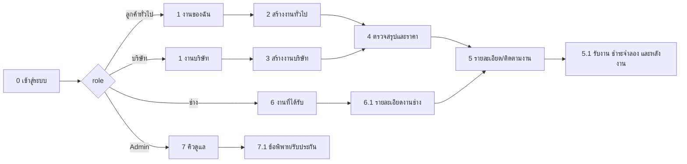

# Fixtech 1.0 — ขั้นตอนที่ 6: Wireframe หน้าจอสำคัญ

> **สถานะ:** แบบร่างเชิงโครงสร้างสำหรับตรวจ workflow และใช้แบ่งงานพัฒนา ไม่ใช่หลักฐานว่าทุกหน้าจอเชื่อม API แล้ว และไม่ใช่ production UI. ขอบเขต Demo ที่ใช้วาดคือ SRS §1.4, §13.2–13.7 และข้อสัญญา API/สถานะขั้น 5 ฉบับล่าสุด; รายการที่มีคำว่า “เสนอในแบบ” ต้องตรวจความพร้อมของ API ก่อน implement.

เอกสารนี้เป็นขั้น 6 และต่อจาก [ขั้น 1 — SRS](software-requirements-v1.md), [ขั้น 2 — Use Cases/API](mvp-demo-design-v1.md), [ขั้น 3 — Activity Diagrams](mvp-activity-diagrams-v1.md), [ขั้น 4 — ERD/Data Dictionary](mvp-data-model-v1.md), [ขั้น 5 — API/Job State](api-and-job-state-v1.md). เป็น wireframe แบบ low-fidelity เน้นลำดับข้อมูลและการกระทำ ไม่กำหนดสีหรือรายละเอียดแบรนด์.

## 1. กติกากลางของหน้าจอ

- เว็บไซต์ภาษาไทย รองรับจอมือถือและ desktop; หน้าจอเล็กให้จัด form และ action เป็นแนวตั้ง ไม่ซ่อนข้อมูลหรือปุ่มสำคัญ.
- แถบหัวแสดง Fixtech, ชื่อบทบาท, การแจ้งเตือนในเว็บ และออกจากระบบ. หลัง login แสดงเฉพาะเมนู/ข้อมูลที่ role นั้นมีสิทธิ์.
- ทุกหน้ารายละเอียดงานแสดงรหัสอ้างอิงย่อ, สถานะปัจจุบัน, timeline จาก event, ประเภทบริการ และข้อมูลที่ผู้ใช้นั้นจำเป็นต้องเห็น; ไม่แสดง UUID หรือโปรไฟล์/ข้อมูลติดต่อของคู่กรณี.
- สถานะหน้าอย่างน้อย: กำลังโหลด, สำเร็จ, ว่าง, validation error, session หมดอายุ, ไม่มีสิทธิ์/ไม่พบ (ไม่เปิดเผยว่างานของผู้อื่นมีอยู่), conflict `409`, และ integration unavailable `502/503`.
- การกระทำที่เปลี่ยนสถานะต้องมีผลตอบรับจาก API ก่อนแสดงเป็นสำเร็จ; ป้องกัน double submit และแสดงข้อความ retry ที่ไม่ทำซ้ำรายการ.
- AI ทุกจุดติดป้าย “คำแนะนำเบื้องต้นจาก AI — โปรดตรวจสอบ”; ราคาใช้ label “ราคาอ้างอิงคัดสรร · ไม่ใช่ราคาตลาดแบบ real-time” พร้อม source URL/วันทบทวนและ caveat; การจ่ายเงินติดป้าย “จำลอง — ไม่มีการโอนเงินจริง”.
- ขอ AI consent แยกจากการอัปโหลด: แสดงข้อความและภาพที่เลือก, จุดประสงค์/provider/model ตามข้อมูลจริง, และปุ่มยินยอม/ไม่ยินยอม. ห้ามสมมติว่าการแนบภาพแปลว่ายินยอมส่งให้ AI.
- เก็บข้อมูลสังเคราะห์เท่านั้นใน Demo. ไม่มีวิดีโอ, real payment, email/SMS, สมัครช่าง/ตรวจเอกสารจริง หรือข้อมูลตลาด live.

## 2. แผนผังการนำทางและหน้าจอ



## 3. Wireframe หน้าจอ

### WF-00 — สมัครบัญชี เข้าสู่ระบบ และสถานะ Demo

```text
+--------------------------------------------------------------+
| Fixtech ระบบสาธิต 1.0 |
| |
| [เข้าสู่ระบบ] [สมัครบัญชี] |
| สมัคร: เลือก ลูกค้าทั่วไป / ลูกค้าบริษัท |
| ชื่อที่แสดง · อีเมลของตน · ชื่อบริษัท (ถ้ามี) |
| ตั้งรหัสผ่าน · ยืนยันรหัสผ่าน · [สมัครและเข้าสู่ระบบ] |
| |
| หรือเข้าสู่ระบบด้วยบัญชีที่มีอยู่ |
| [ อีเมล ______________________________ ] |
| [ รหัสผ่าน ___________________________ ] [เข้าสู่ระบบ] |
| |
| บัญชีทดลองอยู่ใน README · ใช้ข้อมูลสังเคราะห์เท่านั้น |
| AI: local / ตรวจสถานะ ราคา: curated / non-live |
| การชำระเงิน: จำลองเท่านั้น · ไม่มีการซ่อมหรือรับเงินจริง |
+--------------------------------------------------------------+
```

**การทำงาน:** หน้า สมัคร ใช้ `POST /api/auth/register` และเลือกได้เฉพาะ role ลูกค้าทั่วไป/บริษัท; server ตรวจซ้ำและสร้าง session เมื่อสมัครสำเร็จ ผู้ใช้ต้องตั้งรหัสเองและกรอกยืนยันให้ตรงกัน ไม่มีการส่งอีเมลจริง หน้า เข้าสู่ระบบ ใช้ `POST /api/auth/login` แล้วโหลด `/api/auth/me`, `/api/demo/status` และ catalog; ส่งไปหน้าหลักตาม role ที่ server คืนมา ช่าง/Admin ใช้บัญชี seed และสมัครเองไม่ได้ ข้อผิดพลาด login ไม่เปิดเผยว่าบัญชีใดมีอยู่

### WF-01 — หน้าหลัก / รายการงานของฉัน

```text
+------------------------------------------------------------------+
| Fixtech | งานของฉัน [แจ้งเตือนจาก API] [ออกจากระบบ]|
| สวัสดี, บัญชีทดลอง |
| [ + แจ้งปัญหาใหม่ ] |
|------------------------------------------------------------------|
| งานของฉัน |
| [ค้นไม่มีใน MVP] (ไม่แสดงช่องค้นหาที่ยังไม่มี API) |
| |
| [ข้อมูลจาก API] SOFTWARE · ONLINE [สถานะจริง] [เปิดงาน] |
| อาการ: [ข้อความจากงาน] · [เวลาจาก API] |
| [ข้อมูลจาก API] HARDWARE · ONSITE [สถานะจริง] [เปิดงาน] |
| อาการ: [ข้อความจากงาน] · [เวลานัดจริง] Asia/Bangkok |
| |
| ไม่มีงาน: “ยังไม่มีงานซ่อม” [แจ้งปัญหาใหม่] |
+------------------------------------------------------------------+
```

**การแยก role:** ลูกค้าทั่วไป/บริษัทเห็นเฉพาะงานตนเอง (`GET /api/jobs`). ช่างเห็นเฉพาะงานที่มอบหมาย; Admin ใช้คิวแยก ไม่ใช้หน้ารายการลูกค้า. บริษัทเห็น label ของ offer เช่น “ทีมช่าง 1”; ห้ามเห็นตัวตน/ข้อมูลติดต่อช่างก่อนขั้นตอนที่อนุญาต. จำนวนแจ้งเตือนและงานทุกแถวต้องมาจาก API; โครงข้อความในภาพนี้เป็น placeholder ไม่ใช่ข้อมูล seed/fixture ที่ต้องแสดงเสมอ.

### WF-02 — สร้างงานของลูกค้าทั่วไป (B2C)

```text
+------------------------------------------------------------------+
| งานของฉัน สร้างงานซ่อม |
| ประเภทบริการ |
| [ Hardware ▾ ] [ ซ่อมที่สถานที่ ▾ ] [ เขต ▾ ] |
| อาการที่พบ * |
| [____________________________________________________________] |
| [____________________________________________________________] |
| รูปภาพ (ไม่บังคับ, 0–3 ภาพ, ≤10 MiB/ภาพ) |
| [ เลือกรูป ] ชื่อไฟล์ที่เลือกแสดงโดยเบราว์เซอร์ |
| หมายเหตุ: ห้ามแนบข้อมูลส่วนตัว/ข้อมูลลับจริงใน Demo |
| |
| [สร้างฉบับร่างและวิเคราะห์] |
+------------------------------------------------------------------+
```

**หลักการ:** รับหมวดบริการ/format เป็นคู่ที่ catalog เปิดใช้, เขต seed, อาการ และภาพ JPEG/PNG/WebP เท่านั้น; ไม่มีฟิลด์ยี่ห้อ/รุ่น/งบประมาณบังคับในฟอร์ม B2C ปัจจุบัน. ตรวจชนิด/ขนาด/จำนวนภาพในเบราว์เซอร์ก่อนสร้าง Draft เพื่อลดงานที่ล้มเหลว แล้ว server ตรวจซ้ำเสมอ. ขอ consent ก่อนอัปโหลด; เมื่อสร้าง Draft แล้วจึงมี `jobId` สำหรับอัปโหลด/วิเคราะห์. API `POST /api/jobs` รับข้อมูลพื้นฐาน แล้ว `PATCH` ใช้แก้ Draft. แสดง progress และข้อผิดพลาดโดยไม่ทิ้งข้อมูลที่กรอก. แนบภาพใช้ private storage.

**การยินยอม AI (dialog ก่อนเรียกวิเคราะห์):**

```text
วิเคราะห์ข้อมูลด้วย AI ในเครื่องสาธิต
จะส่ง: ข้อความอาการ และภาพที่เลือก 2 ภาพ
ใช้เพื่อ: สรุป/จัดหมวด/คำแนะนำเบื้องต้นเท่านั้น
AI ใช้ช่วยสรุปเท่านั้น; ผลอาจผิดพลาดและต้องตรวจเอง
ระบบปกปิดข้อมูลบางชนิดในข้อความแบบ best effort; ภาพไม่ถูกปกปิด
ใช้ข้อมูลสังเคราะห์เท่านั้น ห้ามส่งข้อมูลส่วนบุคคล/ข้อมูลลับ
[ ] ฉันยินยอมส่งข้อมูลที่ระบุเพื่อวิเคราะห์ครั้งนี้
[กลับไปแก้ภาพ] [ยินยอมและวิเคราะห์]
```

Ollama/Gemma 3 4B ทำงานบนเครื่อง Demo ผ่าน loopback; แสดง provider/model ตามค่าที่ runtime รายงาน ไม่สัญญาว่าข้อมูลถูกปกปิดครบหรือไม่ออกจากเครื่องที่รันแอป. ไม่ยินยอม: คง Draft และใช้ `POST /api/jobs/{jobId}/manual-summary` เพื่อกรอกสรุปเอง; ห้ามส่งภาพ/ข้อความไป AI. ยินยอมแล้วจึงบันทึก consent scope และเรียก analyze/chat; เมื่อ AI ล้มเหลวให้คง Draft, แสดง retry/manual option และไม่แสดงสรุปหรือราคาว่าสำเร็จ.

### WF-03 — สร้างงานบริษัท (B2B)

```text
+------------------------------------------------------------------+
| งานบริษัท สร้างงานซ่อม |
| ประเภทบริการ |
| [ Software ▾ ] [ ออนไลน์ ▾ ] [ เขตบริการ ▾ ] |
| ยี่ห้อ (ไม่บังคับ) [________________] รุ่น (ไม่บังคับ) [________]|
| เวลาที่สะดวก (หมายเหตุ) [_____________________________________] |
| อาการ/ขอบเขตปัญหา * |
| [____________________________________________________________] |
| รูปภาพ (0–3 ภาพ; ห้ามใช้ภาพอุปกรณ์/ข้อมูลจริงที่เป็นความลับ) |
| [ เลือกรูป ] |
| |
| [สร้างฉบับร่างและวิเคราะห์] |
+------------------------------------------------------------------+
```

**หลักการ:** ใช้ `POST/PATCH /api/jobs` โดย account role จาก session ต้องเป็นบริษัท. ยี่ห้อ/รุ่น/เวลาสะดวกเป็น optional ตาม contract ขั้น 5; ไม่เติมฟิลด์อายุอุปกรณ์, ที่อยู่เต็ม, ข้อจำกัดลับ หรือเวลานัดที่ backend/schema ยังไม่ได้กำหนด. พื้นที่ใช้เขตบริการที่มีใน catalog; รูปแบบ service เลือกได้เฉพาะคู่ที่เปิดใช้. AI consent และแนบรูปทำงานเหมือน B2C.

### WF-04 — ตรวจผลวิเคราะห์ ราคา และเผยแพร่/เลือกข้อเสนอ

```text
+------------------------------------------------------------------+
| งาน #FT-… DRAFT · ตรวจรายละเอียดก่อนเผยแพร่ |
| ผลสรุปจาก AI (อ่านทบทวน; อาจคลาดเคลื่อน) |
| [ข้อความสรุปจากผลวิเคราะห์] |
| คำแนะนำเบื้องต้น: … · โปรดตรวจสอบ / ไม่ใช่คำวินิจฉัย |
| |
| ราคาอ้างอิงคัดสรร · ไม่ใช่ราคา real-time |
| ลูกค้าทั่วไป: ราคาเดียว ฿… |
| บริษัท: ช่วงประมาณ ฿…–฿… |
| แหล่งข้อมูล: [URL] · ทบทวนเมื่อ … · ขอบเขต/ข้อจำกัด … |
| |
| [กรอกสรุปเองแทนผล AI] [วิเคราะห์ใหม่] [ยืนยันผลสรุป] |
| (หลังยอมรับ) [เผยแพร่งาน] |
+------------------------------------------------------------------+
```

**แยก workflow หลัง publish:** B2C แสดงสถานะจับคู่ช่างโดยอัตโนมัติ; ไม่ต้องเลือกจากรายชื่อ. B2B เมื่อมี offer ให้แสดงรายการข้อเสนอแบบเปรียบเทียบและ pseudonym:

```text
ข้อเสนอสำหรับบริษัท — เลือกได้หนึ่งรายการ
ทีมช่าง 1 ขอบเขต … ฿… [อยู่นอกช่วงประเมิน? แสดงส่วนต่างชัดเจน]
 [ดูรายละเอียด] [เลือกข้อเสนอนี้]
ทีมช่าง 2 ขอบเขต … ฿… [เงื่อนไข/ข้อยกเว้น] [ดูรายละเอียด] [เลือก]
ก่อนเลือก: ตรวจยอดและ scope; การเลือกยืนยัน agreed amount กับขอบเขต
```

**Trace API:** manual-summary/analyze → price-estimates → accept estimate → confirm-summary → publish; บริษัทอ่าน offers แล้วเรียก select. ไม่มี API แก้ข้อความผล AI โดยตรง; หากผู้ใช้ไม่ยอมรับให้กรอกสรุปด้วย `POST /api/jobs/{jobId}/manual-summary` หรือวิเคราะห์ใหม่ตาม consent. ถ้า API คืน `409 JOB_CHANGED` ระหว่างประเมินราคา ให้รีเฟรช Draft แล้วลูกค้ากดประเมินใหม่ ห้ามแสดงราคาเก่าหรือเผยแพร่. แสดงคำเตือนและเหตุผลเมื่อข้อมูล AI/ราคาไม่มีหรือ integration ไม่พร้อม; ห้ามใช้ตัวเลข fallback ปลอม, fixture เก่า หรือคำว่า live. หากไม่มี provider แสดง `NO_PROVIDER_FOUND` และทางออกตาม API ปัจจุบันคือยกเลิก/กลับไปติดต่อผู้ดูแลนอกระบบ; ไม่วาดปุ่ม rematch ที่ยังไม่มี route.

### WF-05 — รายละเอียดงานลูกค้า: Timeline, นัดหมาย และแชต

```text
+------------------------------------------------------------------+
| ← งานของฉัน #FT-… · SOFTWARE / ONLINE [WAITING_FOR_APPOINTMENT]|
| อาการ / สรุปที่ยืนยันแล้ว … |
| ราคาเสนอ … · ราคาที่ตกลง ฿… · ประวัติสถานะ [ดู timeline] |
| ช่างที่ได้รับมอบหมาย: “ผู้ให้บริการที่จับคู่แล้ว” (ไม่เผย ID) |
|------------------------------------------------------------------|
| นัดหมาย |
| เสนอ: …–… Asia/Bangkok · รออีกฝ่ายยืนยัน |
| [เสนอเวลา] [ยืนยัน*] [ขอเลื่อนพร้อมเหตุผล] [ยกเลิกพร้อมเหตุผล] |
| *ปุ่มยืนยันแสดงเฉพาะฝ่ายที่ยังไม่ได้ยืนยัน proposal นี้ |
|------------------------------------------------------------------|
| แชตของงาน (ข้อความเท่านั้น) |
| อีกฝ่าย: … [เวลา] |
| [พิมพ์ข้อความ________________________________] [ส่ง] |
|------------------------------------------------------------------|
| การทำงาน: ผู้ให้บริการเริ่ม → ส่งงานเสร็จ → ลูกค้าตรวจรับ |
| แจ้งเตือน [เปิดศูนย์แจ้งเตือน] |
+------------------------------------------------------------------+
```

ส่วนที่ยังไม่ถึงเงื่อนไขแสดง disabled พร้อมคำอธิบาย (เช่น เริ่มงานได้เมื่อนัดยืนยันแล้ว). อ่าน timeline จาก events; chat/appointment/notifications อ่านจาก endpoints ที่ระบุในขั้น 5. แสดงเวลาตาม Asia/Bangkok. ไฟล์แนบในแชตและ real-time socket ไม่มีใน Demo.

### WF-06 — หน้าช่าง/ทีมช่าง: งานที่ได้รับและจัดการบริการ

```text
+------------------------------------------------------------------+
| Fixtech | งานที่ได้รับ [แจ้งเตือน] [ออกจากระบบ]|
| |
| #FT-… งานที่จับคู่แล้ว เขต … นัดรอยืนยัน [เปิดงาน] |
| ประเภท/อาการที่จำเป็น … · estimate/ยอดตกลง … |
| |
| รายละเอียดงาน |
| อาการและ summary ที่ลูกค้ายืนยัน · รูปที่ได้รับอนุญาตให้ดู |
| [ส่งข้อความ] [เสนอ/ยืนยันนัด] [เริ่มงาน] |
| เมื่อกำลังดำเนินการ: [ส่งงานเสร็จ + หมายเหตุ] |
| หลังส่งงาน: [เสนอเงื่อนไขรับประกัน] · 7 / 14 / 30 วัน หรือไม่มี |
| ยอด DIRECT (ถ้ามี): [ยืนยันว่าได้รับเงินตรง] |
+------------------------------------------------------------------+
```

ช่างเห็นเฉพาะงานที่มอบหมาย และเฉพาะภาพที่ผ่าน authorization; ไม่เห็นโปรไฟล์/ข้อมูลติดต่อเต็มของลูกค้า. B2B offers เป็นข้อมูล seed/simulation ไม่ใช่ quote เชิงพาณิชย์จริง. ปุ่ม transition ปรากฏเมื่อ role และ state อนุญาต: `start` หลัง SCHEDULED; submit completion หลัง IN_PROGRESS; เสนอ warranty หลังส่งงาน; direct-received เฉพาะเมื่อมี payment simulation แบบ DIRECT. ไม่แสดงช่องปรับ agreed amount ที่ไม่มี workflow เปลี่ยนราคา.

### WF-07 — ลูกค้าตรวจรับและบริการหลังงาน

```text
+------------------------------------------------------------------+
| งาน #FT-… · รอตรวจรับ |
| ช่างส่งงานเสร็จ: … |
| เงื่อนไขรับประกันที่ช่างเสนอ: 14 วัน · ครอบคลุม … · ไม่รวม … |
| [ยอมรับเงื่อนไข] |
| |
| [ยืนยันรับงาน] [เปิดข้อพิพาทพร้อมเหตุผล/หลักฐาน] |
|------------------------------------------------------------------|
| COMPLETED · ยอดตกลง ฿… |
| ชำระเงิน (สาธิตเท่านั้น — ไม่มีเงินจริง) |
| บริษัท: [จำลองชำระผ่านแพลตฟอร์ม] |
| ทั่วไป: [จำลองผ่านแพลตฟอร์ม] หรือ [ตกลงจ่ายตรงกับช่าง] |
| สถานะ DIRECT แสดงว่า “ช่างยืนยันว่าได้รับ” เท่านั้น |
|------------------------------------------------------------------|
| รับประกัน: [เปิด ticket] (ถ้ามีและยัง Active) |
| รีวิว: [1–5 ดาว] [ความเห็น (ไม่บังคับ)] [ส่งรีวิว] |
+------------------------------------------------------------------+
```

ต้องรับทราบ warranty terms ก่อน confirm-completion; ไม่มี warranty ก็ยืนยันข้อเสนอ “ไม่มี” ได้ตาม flow. ข้อพิพาทรับประเภท/เหตุผลและหลักฐานที่อยู่ในงาน; ใช้ `DISPUTED` และรอ Admin. รีวิวทำได้หนึ่งครั้งต่อ job หลัง completed. Payment ใช้ยอดจาก server และแยก platform simulation กับ direct acknowledgment. ข้อมูลใดที่ API ไม่ส่งให้ role นั้นต้องไม่เติมจาก client.

### WF-08 — Admin: คิวข้อพิพาทและรับประกัน

```text
+------------------------------------------------------------------+
| Fixtech Admin คิวดูแล [แจ้งเตือน] |
| [ข้อพิพาท] [Warranty claims] [งานสาธิต] |
|------------------------------------------------------------------|
| ข้อพิพาท OPEN · #FT-… · ประเภท … · เปิดเมื่อ … [ตรวจรายการ] |
| Ticket OPEN · #FT-… · อายุประกัน … [ตรวจรายการ] |
|------------------------------------------------------------------|
| รายละเอียดเคส (เฉพาะสิทธิ์ Admin) |
| ประเภท/เหตุผล · ข้อความ/หลักฐาน · สถานะงานและ audit |
| หมายเหตุ: การพิจารณาข้อพิพาททำโดย Admin ไม่ใช่ AI |
| ผลการพิจารณา * [___________________________________________] |
| ผลลัพธ์ [RETURN_TO_CUSTOMER ▾] |
| [บันทึกผลและปิดเรื่อง] |
+------------------------------------------------------------------+
```

ใช้ `GET /api/admin/disputes`, `GET /api/admin/warranty-claims`, routes resolve ที่กำหนด; outcome ต้องสอดคล้อง `completed_at` guard. แสดงเหตุผลยืนยันก่อนส่ง เพราะ resolve สร้าง audit และ notification. Admin ไม่แก้ราคา/AI output/ข้อมูลบัญชีโดยปริยาย; ไม่มีปุ่มอนุมัติเอกสารช่างจริงหรือหน้าตรวจผล AI ใน Demo เพราะไม่มี API สำหรับความสามารถเหล่านี้. การตรวจคุณภาพ AI เป็นการตรวจโดยทีมพัฒนานอก workflow Admin ของ Demo.

## 4. Traceability ขั้น 1–5 → หน้าจอ/API/ข้อมูล

| หน้าจอ | ขั้น 1: requirement | ขั้น 2: use case / API | ขั้น 3: activity/state | ขั้น 4: ตารางหลัก | ขั้น 5: endpoints / guard |
|---|---|---|---|---|---|
| WF-00 login | FR บัญชี/role; NFR privacy | UC-01 | ทุก flow เริ่ม authenticated | `users` | `/api/auth/login`, `/me`; role จาก session |
| WF-01 รายการงาน | FR ownership/role | UC-02/03/04/06 | ดู current state | `jobs`, `job_status_events`, `notifications` | `GET /api/jobs`; owner/assigned/Admin filtering |
| WF-02 B2C | §13.2 image/AI/price | UC-02/07 | ขั้น 3 §7.1 | `jobs`, `job_attachments`, `ai_consents`, `ai_analysis_runs` | create/PATCH/attachments/consent/analyze; consent + Draft guards |
| WF-03 B2B | §13.2 B2B offers | UC-03/07 | §7.1 | `jobs`, `company_profiles`, `service_catalog` | company role; session-derived owner; validated catalog pairs |
| WF-04 estimate/offer | §13.7 curated-price ruling | UC-02/03/07 | READY → POSTED → MATCHED/selection | `price_estimates`, `pricing_rule_sets`, `offers`, `jobs` | estimate/accept/confirm/publish/offers/select; fresh snapshot, amount server-authoritative |
| WF-05 tracking/chat | §13.2 chat/notification/appointment | UC-08 | §7.2–7.3 | `job_messages`, `notifications`, `appointments`, `job_status_events` | owner/assigned provider only; appointment collision/confirm guards |
| WF-06 technician | §13.2 matched/provider workflow | UC-04/08/10 | start → submit completion → warranty proposal | `provider_profiles`, `jobs`, `warranties` | assigned provider/state guards; no client-supplied identity |
| WF-07 aftercare | §13.2 payment/warranty/review/dispute | UC-09/10 | completion/payment/claim/dispute | `payment_simulations`, `warranties`, `warranty_claims`, `reviews`, `disputes`, `dispute_evidence` | completed-only payment/review; one review; warranty active; disputes allowed states |
| WF-08 Admin | §13.2 Admin workflow | UC-06/10 | dispute resolution | `disputes`, `warranty_claims`, `admin_audit_logs`, `notifications` | Admin-only queue/resolve; completion history guard; audit + notification atomic |

### ความสอดคล้องที่ต้องรักษา

1. **ราคา:** บางส่วนของขั้น 1–3 ที่ยังใช้คำ “real-time/live market” เป็นข้อความประวัติที่ขัดกับคำตัดสิน SRS §13.7. หน้าจอขั้น 6 ยึด curated references, provenance และ caveat ของขั้น 5; ไม่วาด real-time API.
2. **AI:** Demo ใช้ Ollama/Gemma 3 4B local, ไม่ใช่ cloud AI; consent ระบุ scope; image result เป็น draft ที่ต้องให้คนตรวจ และ AI ไม่ให้ราคา/คำวินิจฉัยรับประกัน/ตัดสินข้อพิพาท.
3. **กลุ่มลูกค้า:** B2C auto-match และแสดงยอดเดียวที่ยอมรับ; B2B เห็น price range ก่อน publish แล้วเลือกหนึ่ง offer/scope/amount ก่อนนัด. ห้ามทำ UI ให้ B2C เลือกช่างจาก offer list.
4. **ความเป็นส่วนตัว:** ซ่อนข้อมูลระบุตัว/ติดต่อของคู่กรณี; แสดงเฉพาะงาน owner/assigned provider/Admin; ห้ามให้ UI สร้าง role/owner เอง.
5. **State:** หน้าจอสะท้อน API transitions; ไม่เปลี่ยนสถานะเพียงเพราะเปิดหน้า, ปิด modal, ส่งข้อความ หรือ payment simulation. นัดต้องยืนยันสองฝ่ายก่อน SCHEDULED; งานต้อง COMPLETED ก่อนจ่าย/รีวิว; Admin dispute resolution ผ่าน guard.
6. **Demo boundary:** ไม่มีเงินจริง, email/SMS, video, profile verification จริง, live price, live provider, Admin AI review UI หรือ production safety guarantee. แสดงข้อมูล seed/curated/simulated ตามจริง.

## 5. สถานะการทำงานและแผนแบ่งหน้าที่

**สถานะการตรวจรับ UI:** ผ่านตามขอบเขตระบบสาธิต 1.0 จาก authenticated browser walkthrough บนฐานชั่วคราวครบ B2C, B2B, ช่าง และ Admin ครอบคลุม consent/upload, AI/manual fallback, ราคา/ข้อเสนอ, นัดหมาย, completion, payment simulation, warranty/review/dispute, responsive 320/768/1280px, keyboard focus และ browser console ตาม [ผลตรวจระบบ](validation.md) เคยพบและแก้ค่า service format ค้างหลัง reset ฟอร์ม แล้วทดสอบ B2B ซ้ำผ่าน ผลนี้ไม่ใช่ WCAG certification หรือ production acceptance ให้ใช้เกณฑ์ §6 เป็น regression checklist เมื่อแก้ UI ต่อไป

สำหรับทีม 3 คน ให้แบ่งเป็น vertical ownership โดยทุกคนต้องใช้ contract ขั้น 1–5 เดียวกัน และกำหนดผู้รวมงาน/ผู้ตรวจรับชัดเจน ตารางนี้เป็นเจ้าของหลัก ไม่ใช่ข้อห้ามช่วยกัน:

| ผู้รับผิดชอบ | หน้าจอ/งานหลัก | จุดเชื่อม |
|---|---|---|
| คนที่ 1 — Customer workflows | WF-00–04: login ของบัญชีลูกค้า, B2C/B2B intake, consent/รูป, AI/ราคา, publish/เลือก offer | ใช้ API ขั้น 5 และ schema ขั้น 4; เขียน/ดูได้เฉพาะงานของบัญชีตน; เพิ่ม tests สำหรับฟอร์ม validation และสอง workflow |
| คนที่ 2 — Provider/service lifecycle | WF-05–07: หน้าช่าง, assignment, chat, นัดหมาย, เริ่ม/ส่งงาน, ตรวจรับ, payment simulation, warranty/review/dispute intake | ใช้ state machine ขั้น 5; เน้น permission ของ assigned provider, collision/idempotency และ acceptance หลังงาน; ห้ามเพิ่ม transition เองจาก wireframe |
| คนที่ 3 — Platform/Admin/integration & release | WF-01/08 และ shared shell: role navigation, Admin queue/actions, notifications, integration wiring, migration/seed, test orchestration และ release checklist | รับผิดชอบ cross-role authorization/privacy, Admin audit/notification, health/setup path, รวม branch และรัน full regression; ไม่เป็น QA คนเดียว ทุกคนต้องทดสอบ slice ของตนและ peer-review อย่างน้อยหนึ่ง slice |

**จุดรวมงานที่ต้องทำร่วมกัน:** ก่อนแยกงานให้ล็อก route/state/schema จากขั้น 4–5 และตกลง component รายละเอียดงาน/ข้อความ error กลาง; รวม branch อย่างน้อยสัปดาห์ละ 2 ครั้ง; คนที่ 3 เป็น integrator แต่ไม่รับงานทดสอบทั้งหมดไว้คนเดียว. ลำดับส่งมอบคือ (1) login/navigation + health, (2) Draft/consent/AI/estimate, (3) B2C/B2B matching/offer, (4) provider chat/appointment/completion, (5) payment simulation/aftercare/Admin, (6) cross-role browser acceptance. หากเวลาไม่พอ ให้ลด polish/edge UI ก่อน ห้ามตัด authorization, consent, transaction guards หรือป้ายเตือน payment/price.

## 6. เกณฑ์ตรวจรับ Wireframe ก่อนลงมือ UI

- ทุกปุ่มมี route/API รองรับ หรือทำเครื่องหมาย explicitly ว่าไม่อยู่ใน Demo; ไม่มีปุ่มหลอก.
- ทำ walkthrough 4 บทบาทด้วย seed: B2C สร้าง/จับคู่อัตโนมัติ; บริษัทเปรียบเทียบและเลือกข้อเสนอ; ช่างจัดการนัด/ซ่อม/ส่งงาน; Admin resolve dispute/warranty.
- ตรวจการปฏิเสธ owner/role ที่ไม่ถูกต้องและข้อมูลคู่กรณีไม่รั่ว; ทดสอบ `401/403/404/409/413/502/503` ที่เกี่ยวกับแต่ละหน้า.
- ทดสอบจอ 320px, 768px, desktop; keyboard-only, focus, labels, error announcement, contrast และไม่พึ่งสีอย่างเดียว.
- แสดง AI uncertainty, curated-price provenance/non-live, simulated-money warning และ synthetic-data warning ในจุดตัดสินใจ ไม่ซ่อนใน footer อย่างเดียว.
- ทดสอบเงื่อนไข AI/price unavailable, no provider, appointment collision, payment retry, review duplicate, dispute completed-job guard และ warranty ไม่มี/มี.

## 7. Handoff ไปขั้น 7 — สูตรราคาและคะแนนจับคู่

ขั้น 7 ตัดสินและ implement สูตร deterministic และ matching แบบกรอง eligibility แล้วเรียง `priority`; รายละเอียดพฤติกรรม/ตัวอย่างอยู่ใน [Step 7](step-7-pricing-matching-decisions.md). ไม่มี weighted score, controls ความซับซ้อน/เร่งด่วน หรือคำอ้างคุณภาพช่าง. Browser acceptance ตรวจทั้ง reviewed/valid-through date, source disclosure และ stale error แล้ว; เมื่อเปลี่ยน UI ในอนาคตให้ใช้ wireframe และเกณฑ์ §6 ตรวจ regression.

ผล UI ตาม contract: B2C แสดงราคาเดียว, B2B ช่วงราคา/ข้อเสนอ, curated provenance/date/caveat, stale error ที่บอกให้ทีมทบทวน catalog; ไม่แสดง weighted score หรือ `priority` เป็นคุณภาพช่าง. Browser walkthrough หลัง redesign ครบ 4 บทบาทบันทึกใน validation; policy ไม่เพิ่ม controls complexity/urgency. เมื่อเปลี่ยน UI/price policy ให้ทำ regression ตาม §6.

## 8. ประวัติการทบทวน

- v1–v2: wireframe และ mapping ขั้น 1–5 ตาม SRS 1.0; รอบ v2 แก้ความคลาดเคลื่อน AI consent, state, placeholders, Admin scope และเพิ่ม handoff ที่มีข้อมูลจริงสำหรับขั้น 7. UI ยังต้อง implement/ทดสอบตาม validation report.
